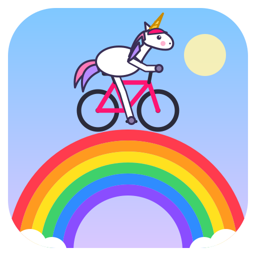

#  Open Cycling World

A cross-platform indoor cycling simulation in Rust: real bicycle hardware, real
routes from OpenStreetMap, rendered locally with Bevy, with server-authoritative
multiplayer.

<p align="center">
  
  
</p>
<p align="center"><sub>Free ride with bots on the Vaduz–Malbun road (Liechtenstein, 1390 m), rendered by the app (scenes <code>readme-climb-behind</code> / <code>readme-climb-front</code> in <code>scripts/scenes.toml</code>). Map data © OpenStreetMap contributors (ODbL), elevation SRTM (NASA / USGS).</sub></p>

**Status:** worlds, multiplayer, voice, the sky and the time machine work; textures,
weather and the browser / VR versions are in progress. Phases and decisions are
in [SPECIFICATION.md](SPECIFICATION.md).

## Worlds

Four regions, built from OpenStreetMap and official open elevation models, ridden
with real gradients. Download them from the
[latest release](https://github.com/newkit/OCW/releases) and start the app with
`ocw-desktop --world path/to/<world>.ocwpkg`, or switch worlds in the app
(menu → **World**).


<sub>Tenerife: riders on the TF-21 through the caldera of Las Cañadas, the Teide (3,715 m) straight ahead, 6 km away.</sub>

| | |
|---|---|
| **Liechtenstein** – Vaduz to Malbun (13.3 km, 1,148 m up), the Rhine valley, the Stegertunnel | |
|  |  |
| **Black Forest** – three connected packages: Freiburg – Schauinsland, Titisee – Feldberg, Triberg, Baden-Baden – Mummelsee over the Schwarzwaldhochstraße | |
|  |  |
| **Tenerife** – the whole island: the Teide from the coast (42 km, 2,350 m up), the Masca hairpins, Anaga, the sea | |
|  |  |

<sub>Rendered by the app (scene harness, `scripts/scenes.toml`), with the ISO
timestamp every capture carries. Map data © OpenStreetMap contributors (ODbL).
Elevation: swissALTI3D © swisstopo; DGM1 © LGL, www.lgl-bw.de (dl-de/by-2.0);
MDT05 © Instituto Geográfico Nacional (CC BY 4.0); SRTM (NASA / USGS).</sub>

## Build and run (Linux)

```bash
make deps     # this platform: deps-linux (detects Debian/Ubuntu, Fedora, Arch) | deps-windows | deps-macos
make check    # fmt, clippy, tests, wasm build – what CI runs
make run      # desktop client with a virtual trainer and 4 test riders
make help     # all targets (build, release, server, deploy, the test-* targets, ...)
```

Tests are the `test-*` targets: `make test` (= `test-unit`, all unit and
integration tests), `test-wasm`, `test-kiosk`, `test-screenshot` /
`test-screenshot-wayland` / `test-smoke` (both) and `test-video` /
`test-video-wayland` (headless desktop runs), `test-multiplayer` (server
and kiosk on one build machine, bot riders on the others; see
[Multiplayer test](#multiplayer-test-across-machines)) and
`test-multiplayer-local` (server and three bot riders on this machine over
loopback, as in CI). The old names `smoke`,
`screenshot`, `screenshot-wayland`, `video`, `video-wayland` and `wasm` still
work for now but are deprecated.

**Ground and road textures** (spec §4.6): `make materials`
(`scripts/fetch-materials.sh`) downloads the material library once – 21 CC0
materials from ambientCG and Poly Haven, pinned by URL and SHA-256 in
`assets/materials.toml` – checks every hash, converts it to KTX2 (1024², BC3 /
BC5, mipmapped) and writes the git-ignored `assets/materials/` (about 57 MB,
with `CREDITS.md`). The world packages are then drawn with meadow, forest
floor, rock, gravel, asphalt, paving … instead of flat colours; without the
library (or with `OCW_MATERIALS=off`) the app draws the flat land-use colours.
The packaging scripts and `deploy-test.sh` fetch and ship it beside the
binary; the console command `materials` shows which library is used and its
credits. On Windows without bash: `cargo run --release -p ocw-assets --
materials fetch`, then copy `assets\materials` beside `ocw-desktop.exe` as
`materials`.

The Rust version is pinned in `rust-toolchain.toml`; Debian's system Rust is too
old for Bevy. `make` finds the rustup toolchain in `~/.cargo/bin` by itself; for
plain `cargo`, add `. "$HOME/.cargo/env"` to your shell profile.

### macOS app

On a Mac, `make macos-app` (`scripts/build-macos-app.sh`) builds
`target/macos/Open Cycling World.app` and packs it as a DMG and a zip
(`OpenCyclingWorld-<version>-<commit>-macos-arm64.dmg`; CI builds them on every
push to `main`, workflow artifact `macos-app`). Open the DMG and drag the app to
Applications; it starts the Hills test route with the virtual trainer, or
your remembered Bluetooth devices (macOS asks for Bluetooth access on first
use). The log is in `~/Library/Logs/OCW/ocw-desktop.log` (Console.app → Log
Reports); `autoexec.cfg` is not read when started from Finder (the working
directory is `/`). The app is only ad-hoc signed, not notarised, so Gatekeeper
blocks the first start: right-click the app → Open, or System Settings →
Privacy & Security → Open Anyway, or remove the quarantine flag with
`xattr -dr com.apple.quarantine "/Applications/Open Cycling World.app"`.
Video recording (key V) needs ffmpeg: install Homebrew, then `brew install
ffmpeg` (`make deps-macos` prints both commands); the app also finds it in
`/opt/homebrew/bin`, `/usr/local/bin` and `~/.local/bin` when started from Finder.

### Browser app (preview)

`apps/web` (`ocw-web`) is the same client in a web browser (spec §14 Phase
10, milestone B1): Bevy on **WebGPU**, the shared renderer (`ocw-render`),
client loop (`ocw-client`) and `GameServer` – the local server runs in the
page's frame loop (wasm has no threads). It rides the built-in Hills test
route, or a **world package streamed over HTTP** (B2): manifest and
signature chain first, then the road graph and sections and the tiles
around the rider with range requests, every chunk checked against its
SHA-256, cached in the browser's Origin Private File System (a second
visit loads from there), with the tiles kept in memory only around the
rider. Bots and the **virtual trainer** as on the desktop. **Multiplayer**
(B3): the page joins an `ocw-server` session over **WebTransport** together
with desktop and bot riders (see [Browser riders](#browser-riders-webtransport)).
No Bluetooth or sound yet (B4, B5).

```bash
make deps-web       # once: wasm-bindgen-cli matching Cargo.lock (cargo install)
make web            # build into target/web/ (index.html, ocw_web.js, ocw_web_bg.wasm, sizes.txt)
make web-worlds     # publish data/pilot/liechtenstein.ocwpkg into target/web/worlds/ (signed by a dev root)
make web-serve      # serve it on http://127.0.0.1:8080/ (range requests; prints the world links)
make test-web       # headless Chromium on WebGPU: load, ride, screenshot into test-output/web/
make test-web-world # the same with Liechtenstein streamed from the dev server, then again from the cache
make test-web-multiplayer # ocw-server + ocw-bot riders + the browser over WebTransport: ride 30 s, screenshot, timing
```

A world: `http://127.0.0.1:8080/?world=liechtenstein&route=vaduz-malbun&trust-root=…`
(`make web-serve` prints the link with the dev root's key; `world=` takes an
id, `ID@VERSION` or a manifest URL; more options: `free=1`, `tiles=3`
(fetch radius), `keep=5`, `memory-mb=96`, `cache-mb=1024`, `cache=0`). The
loading screen shows the manifest, the base, the first tiles, the bytes
from the cache and from the network and the storage; the console's
`world.info` shows the streaming while riding.

Open the page in Chrome / Edge 113+ (Safari 26 and Firefox 141+ should work
too; a browser without WebGPU gets a message). The desktop's keys: ↑ adds
power on top of the virtual trainer's 200 W, ↓ stops (brake), Page Up /
Down ±10 W, A autodrive, W wild mode, ← / → the line (autodrive) or the lean, `` ` `` (or F12) the console (`sim.power 250`, `teleport 2.5`,
`net.stats`, `hud off`, `camera …`). Page options in the query string:
`?route=loop&bots=3&power=250&start=1.5&name=Ada`.

## Controls

| Action | Keyboard | Gamepad |
|---|---|---|
| Menu (Resume, Ride, World, Workshop, Navi, Settings, Quit) | Esc | Start / Menu (☰, Options) |
| Faster: +25 W per press, more while held | ↑ | D-pad up, left stick up or right trigger (RT / R2) |
| Stop: no power, brake | ↓ | D-pad down, left stick down or left trigger (LT / L2) |
| Steer (autodrive: move the line; manual: lean into a curve) | ← / → | left stick (left/right) |
| Autodrive on/off (on at the start) | A | South button (A / ✕) |
| Wild mode on/off (leave the road; on also switches autodrive off) | W | West button (X / □) |
| Free ride: choose the exit at the next junction | ← / → (autodrive, junction ahead) or Q / E | D-pad left / right |
| Free ride: U-turn | U | East button (B / ○) |
| Route ride: back to the route after leaving it | J | North button (Y / △) |
| Power ±10 W | PgUp / PgDn | |
| Camera: orbit / zoom | mouse drag / wheel | |
| Camera reset | C | |
| Restart everything (as at program start; the ride is saved first) | R | |
| Record a video (start / stop) | V | |
| Voice: mute / unmute your microphone | M | Select (Back / View / Share) |
| Voice: mute / unmute the speaker (all voices; game sounds stay) | Shift+M | right-stick click (R3) |
| Next screen | F11 | |
| Console (`help` lists the commands) | `` ` `` or F12 | |
| Unicorn mode: fly as a unicorn / land on the road below | G | Select + North (Y / △) |
| Unicorn mode: fly back to where you took off | Shift+G | Select + West (X / □) |

**Unicorn mode** (spec §14 Phase 13; *World → Unicorn mode*, console `god`): the rider
turns into a unicorn and flies freely over the world – like a plane: it always
flies forward along its heading. While flying:

| Action | Keyboard / mouse | Gamepad |
|---|---|---|
| Faster / slower (the throttle; it holds when let go, ↓ slows to a slow glide, never to a stop) | ↑ / ↓ | left stick up / down |
| Bank and turn left / right (the unicorn and the view roll into the turn; let go to level out) | ← / → | left stick left / right |
| Climb / descend (the nose pitches up / down; let go to level off) | + / − (the keys that type `+` and `-` on your layout, e.g. `+` and `-` on a German keyboard, `=` and `-` on a US one; or the keypad) | right / left trigger |
| Look around without changing the course (eases back to straight ahead after 1.5 s; the pointer is captured, Esc frees it, a click captures it again) | mouse | right stick |
| Look straight ahead again | L or the middle mouse button | |
| Boost ×4 / precise ×0.25 | Shift / Ctrl | South (A / ✕): boost |
| Base speed ×0.25 … ×8 (in the HUD) | mouse wheel | |
| First-person view from the unicorn's head | C | |
| Inspection panel and crosshair on / off | I | |
| Put a pin where the crosshair points (kept for the ride; `god.pins` lists them) | P | |

Touch (spec §3.2.2): a finger dragged on the left half of the view is the
stick (push it up to fly faster, down to fly slower, sideways to bank and
turn), on the right half it looks around; two fingers on one half steer too
and spreading / pinching them changes the speed scale; the **+** / **−**
buttons at the right edge (shown for 8 s after a touch) climb and descend.

**Inspection** (I, on by default): a panel top right with the altitude,
speed, speed factor, heading, the position in package metres, latitude /
longitude, the tile and the local time of the place; a crosshair in the
middle names what it points at – the road (name, OSM way, class, surface,
width, bridge / tunnel, gradient in the looking direction), a building (its
use, levels, roof shape and height), water, the land-use area and the
elevation. P puts a magenta pin there; `god.pins` lists the pins with their
coordinates and a `--start X,Z` to copy for a free ride from that spot.

The speed grows with the height above the ground (20 m/s close to it, 400 m/s
from 760 m up; at most 1,600 m/s with the boost); the throttle is a share of
it (15 … 100 %, 50 % at take-off). The turn is a coordinated one: tight when
slow, wide when fast (slow down first for a tight turn). The first model –
moving with the arrows relative to the view and hovering when no key is
held, the mouse turning the flight – is still there: Settings → Controls →
*Unicorn mode: flight* = hover (`controls.god_flight`, console `god.flight
hover`). The unicorn keeps 2 m
above terrain, water, buildings and tree crowns and stays below 8,000 m; it is stopped
softly 200 m outside the world. A glowing ring marks where G will land: the
nearest road (free ride) or the nearest point of the route. The riding keys
(A, W, U, J, Q / E) do nothing while flying; the trainer simulates a flat
road in SIM mode (ERG keeps its target), and no distance is counted.
On a shared server only the host may fly (`ocw-server --god-control
anyone|host|nobody`), never during a running event. The HUD's rider count
says how many fly ("riders: 4 (1 flying)"), `ride.riders` lists who. The
tiles stream ahead of the flight and wider with the height; above 1,500 m
over the ground only the terrain is drawn (no trees and houses). The FIT
file gets a marker at both ends of a flight.

**Menu** (spec §3.2.1): ↑ / ↓ (or Tab / Shift+Tab, the D-pad, the left
stick; held: repeats) move the focus, Enter / Space / South (A / ✕) or a click
selects, Esc / Backspace / East (B / ○) or a right click goes back and closes
the menu at the top page; Start closes it from any page. Esc closes the
console first if it is open and never quits the app: only *Quit* in the menu
(with a confirmation), the window's close button and the console's `quit` do.
The ride does not pause under the menu: the trainer keeps its mode, the ride
time, the recording and a video go on, and the ride keys (↑ ↓ ← →, A, W, U,
R, V, …, the mouse camera) are ignored while it is open. Steering falls back
to autodrive and junctions take their default exit, so the rider stays on
the road; closing the menu restores manual steering / wild mode. *Workshop*
opens the workshop scene (see [The workshop](#the-workshop-bikes-parts-and-hearts)), *Settings* has Riders, Controls, Trainer, Audio, Display
and Strava: ← / → (D-pad left / right) change the focused value, Q / E,
PgUp / PgDn or LB / RB switch between these pages (see
[Settings](#settings-and-rider-profiles)); *Ride* starts local events (race,
group ride, time trial; see *Events* below), workouts and *Restart*; *World*
changes the world and shows its data and conditions (see
[The World menu](#the-world-menu-changing-the-world-without-restarting)),
*Navi* lists the routes, saved rides and GPX files to import. Long lists are
paged (*Previous* / *Next*, or ← / → on a list row).

### The workshop: bikes, parts and hearts

*Workshop* in the menu (or `workshop open`) opens a 3D bicycle workshop over
the running ride (spec §14 Phase 4, W1 – W3): the ride goes on in autodrive
underneath and shows in a small live ride window (top right; `workshop.ride_window off`
hides it). Your bike stands on the repair stand in front, your other bikes hang
on the wall – every rider starts with six starter bikes, one per physics
profile, and **500 ♥**. Hearts are earned only by riding: **1 ♥ per 10 kJ** of
work and **1 ♥ per 20 m** climbed, credited by the local server from the power
it accepted – never for virtual power (the virtual trainer, keyboard power,
`sim.power`), in god mode, while down after a crash, for bots, in captures or
with `--no-hearts` (the kiosk's show mode). One heart is one euro of a part's
real list price (generic parts, no brands: `assets/parts.toml`).

| | Keyboard | Mouse | Gamepad | Touch |
|---|---|---|---|---|
| Choose a bike | ← / → | hover / click | D-pad ← / → | swipe, tap |
| Zones (wall, stand, bench, mirror) | ↑ / ↓ | click | D-pad ↑ / ↓ | tap |
| Swap a wall bike onto the stand / open the stand | Enter | click | A | tap |
| Next / previous part (stand) | Q / E, or the arrows (on screen) | hover / click a marker | LB / RB, D-pad | tap a marker |
| Orbit / zoom the stand view | I J K L or Shift + arrows, + / − | drag, wheel | right stick, LT / RT | drag, pinch |
| Compare / buy, sell … | C / X | middle click / the dialog's buttons | Y / X | long press / the buttons |
| Back (leaves from the overview) | Esc | right click | B | two-finger tap, ‹ Back |

On the stand a marker sits on every part (frame, wheels, tyres, groupset,
crankset, cassette, chain, cockpit, bar tape, saddle, seat post, pedals,
bottle cages, lights, computer, bag, paint); choosing one flies to it and
opens the **part picker**: what is fitted, what you own (spare parts or on
another bike) and the shop (only parts that fit, by tier, cheapest first, a
lock with the missing hearts). The focused part shows on the bike at once
(live preview); its card shows weight, price, the part's class steps and
**what it does to the bike's speed** ("Speed: +0.4 % flat, +0.6 % at 6 %",
"capped" at the band's edge; the bike's mass and its speed against the stock
bike), and the compare card (C / Y / long press pins a part) the speed
difference of the two parts on this bike. Buying fits the part;
selling refunds the full price until the part has been ridden 1 km, half
after. Paint is free. **Leaving the workshop applies the bike** at once in
free ride and outside events (in an event: when it is over, from the next
start); the server answers with the effect it applied.

**Parts and physics (W3, spec §14 Phase 4, 4G).** The frameset decides the
physics profile; the other parts change the bike only a little: real weights
(the bike's mass = the profile's + the parts' differences to the stock parts,
at least 6.8 kg, 9 kg for a mountain bike) and a few curated class steps –
tyres ±4 % rolling resistance per step, aero wheels / cockpits / frames
∓0.004 m² CdA, top groupsets +0.3 % drivetrain efficiency. The server takes
the values from its own copy of the catalogue (the client sends part ids
only) and **caps the whole build**: at 250 W and 75 kg the best build of a
profile is at most **+1.5 %** faster on the flat and **+2.5 %** on a 6 %
climb than the stock bike. Races and group rides use the ***Profile*** mode
by default – only the frame's profile counts, parts are cosmetic; the
organiser can choose *Open* (parts count, within the caps) or *Equal* (one
bike for everyone): `event race --physics open|profile|equal`. Free ride,
single player and time trials count the parts. The other riders see the
parts on your bike (sent once per change, not in every snapshot). The wallet
is local until the backend (`<data dir>/ocw/workshop.toml` and
`hearts-ledger.jsonl`). The rider list and kit colours: the mirror corner, or
`menu workshop-page`.

### The World menu: changing the world without restarting

*World* (spec §3.2.1, *World menu*) has *Change world*, *About this world*,
*Routes*, *Time* (the time machine) and *Weather*.

*Change world* lists the world packages found – the cache, the package given
with `--world` and the packages next to it (the kiosk installs several in
`/var/tmp/ocw/`), the `.ocwpkg` files next to the app, in `data/` and
`data/pilot/` – with their size and, when not verified, "unsigned" or
"untrusted"; neighbouring packages show as one world with parts, broken files
are listed with the reason (`world list` shows it). Then the test routes
(Hills, Loop). A world's page rides its default (its first route, else a free
ride – as `--world` alone), a free ride (random, or *from here*), one of its
routes or a free ride in one of its parts. The switch runs while the app keeps
running: the ride so far is saved (FIT, Strava sync), the new one is loaded in
the background (the HUD shows "Loading …"), then a new session starts.
Bluetooth trainers, sensors and gamepads stay connected, the trainer mode
stays, a video recording goes on; a running event ends. Every switch asks
first (*Change the ride?*). After a switch, R restarts the current ride in the
app.

*About this world* shows the package (id, version, build date, signature),
the area and the elevation range, the time zone with today's sunrise, sunset
and twilight times at your position, the data sources with their full credit
notices, and the routes with their length and climbing. *Weather* says
"clear" until the weather simulation exists (spec §14 Phase 9 S4).

In a shared ride (`--server`) only the host changes the world: the menu asks
the server, which checks it, loads the package from its own installed
packages (`ocw-server --world-control host|anyone|nobody`) and moves everyone
to it; every client loads the same package (it must be installed there too)
and joins again. The same from the console:

```text
world list                                        # numbered
world info
world switch 2                                    # or an id, name or path
world switch europe/blackforest
ride.switch --route loop
ride.switch --world europe/example@3              # free ride, random start
ride.switch --world /var/tmp/ocw/example.ocwpkg --free-ride --start 1200,-300
ride.switch --world example.ocwpkg --route "Valley loop"
ride.switch --world example.ocwpkg --route-gpx tour.gpx
ride.import-gpx ~/Downloads/tour.gpx --ride       # needs a loaded package
```

`ride.import-gpx` matches the GPX file onto the loaded package's roads (the
same matcher as `--route-gpx`), prints the report and saves the route in
`~/.local/share/ocw/routes/`, where *Navi → Routes* lists it for that
package. *Navi → GPX import* offers the `.gpx` files from
`~/.local/share/ocw/gpx/` and the downloads folder. Not with `--server`
(the server chooses the course; its host can switch the world).

In manual steering, the keys ramp the lean and it stays when released (press
the other way to straighten up); the stick sets the lean directly, centred is
upright. The road's bends have to be steered, see spec §5.2.1.

## Connecting a gamepad

Any controller that the operating system sees as a gamepad works (Xbox,
PlayStation, Switch Pro, 8BitDo, generic USB pads); the app reads it through
Bevy's gamepad support (gilrs) and picks it up while running, no restart needed.
More than one pad: the stick with the largest deflection steers, any pad's
buttons count.

**Linux**

1. Connect it:
   - USB: plug it in.
   - Bluetooth: put the pad in pairing mode, then
     ```bash
     bluetoothctl
     scan on            # wait for the pad's address (XX:XX:…)
     pair XX:XX:XX:XX:XX:XX
     trust XX:XX:XX:XX:XX:XX
     connect XX:XX:XX:XX:XX:XX
     scan off
     ```
     (or use the desktop's Bluetooth settings). PlayStation pads work with the
     kernel's `hid-playstation` driver; Xbox pads over Bluetooth may need the
     `xpadneo` driver.
2. Check that Linux sees it: `ls /dev/input/by-id/ | grep -i joystick`, or
   `evtest` (pick the pad, move the stick).
3. Permissions: the app reads `/dev/input/event*`. On a normal desktop login
   this is allowed for the logged-in user (systemd-logind `uaccess`). For other
   sessions (SSH, kiosk users, some window managers) add the user to the
   `input` group and log in again: `sudo usermod -aG input $USER`. The log line
   `gilrs … Failed to open "/dev/input/eventN"` means this permission is missing
   (harmless when no pad is used).
4. Unusual pads with wrong buttons: give an SDL mapping (generate one with
   SDL's `controllermap` tool or [SDL_GameControllerDB](https://github.com/mdqinc/SDL_GameControllerDB))
   in the environment: `SDL_GAMECONTROLLERCONFIG="<mapping line>" ocw-desktop`.
5. Steam: with Steam running and "Steam Input" enabled for the pad, Steam may
   take it over; turn Steam Input off for that controller, or close Steam.

**Windows:** connect it (USB, Bluetooth in *Settings → Bluetooth & devices*, or
the Xbox wireless adapter); it appears in *Game controllers* (`joy.cpl`).

**macOS:** pair it in *System Settings → Bluetooth* (or plug it in); it appears
under *Game Controllers* in System Settings.

Then start the app: the left stick steers, the triggers ride and stop (see
[Controls](#controls)).

## Riding modes

**Steering** (spec §5.2.1; HUD shows the mode and the surface)

- **Autodrive** (default, key A): the rider keeps to the middle of the road by
  itself and leans through the bends; ← / → (or the stick) move its line.
- **Manual** (autodrive off): ← / → lean the rider into a curve; the lean stays
  until you straighten up with the other key. Nobody steers the road's bends
  for you: miss one and the rider drifts to the edge, where it scrapes along
  and slows down.
- **Wild** (key W): not bound to the road; ride onto the meadows, up to 60 m
  either side. Switching it on also switches autodrive off (upright, manual
  lean steering), so ← / → steer you off the road; switching it off keeps the
  steering mode (press A for autodrive). The HUD shows "manual | WILD". The
  camera follows over terrain and trees.

**Collisions** (spec §14 Phase 12, K1 / K2; `ride.collisions`, on by
default): riders are solid. Touching another rider from the side or the
back is a **soft bump** – both are pushed apart, the faster one slows, the
bikes wobble (a thud and a tyre squeak; in SIM mode a short resistance
pulse). A hard hit is a **crash**: 2.5 m/s closing speed rider against
rider, 3.5 m/s into a fallen bike, a front wheel touching the rear wheel
ahead (1 m/s, or leaning into it), head-on above 1.5 m/s, a rear-end at
speed. The rider falls as a **ragdoll** (the Avian physics engine), lies
2–8 s by the impact, then picks the bike up and rides on from standstill;
the HUD shows "Crash!" with the time left, other riders' crashes get a red
marker and a feed line. While down the trainer in SIM mode rides a flat road,
ERG keeps the workout's step running. A fallen bike is an obstacle for the
riders behind (chain crashes). **Autodrive and every bot avoid collisions**:
they pass slower riders on the left (on the right in left-hand traffic
regions; on narrow roads either side) and hold back at a 0.5 m wheel gap when
both sides are blocked; two autodrive riders never bring each other down.
**Manual steering gets no help** (optional: `ride.proximity_cue`). Group
rides are soft bumps only; races use the full model. Exempt: the time
trial's ghost, the countdown formation, unicorns, the Echo rider and a
client's first 2 s after joining. `ride.chaotic_bots on` lets bots make
mistakes. `dev.bump` / `dev.crash` stage one on the local server.

**Free ride** (spec §2.2.1, §2.2.2): ride anywhere on the world package's road
network instead of a fixed route:

```bash
ocw-desktop --world data/pilot/liechtenstein.ocwpkg --free-ride [--start X,Z]
```

The package must contain the road graph (format 2, from `world-builder
package`). Before each junction an overlay shows the exits (arrows at their
real angles, street name, distance; dead end / unpaved / steep markers). Pick
one with ← / → (with autodrive, while a junction is ahead) or Q / E; the choice
turns green when it locks (20 m before the junction, earlier at speed).
Without a choice the rider takes the default exit (straightest, same road,
bigger road). At dead ends and the region border the rider turns round; U
turns round any time (in a loop as wide as the road, steered to the middle
first). Sharp turns slow the rider down automatically.

**Neighbouring packages** (spec §2.2.2): if a package for the region next
door is installed, the ride continues across the border instead of turning
round. Neighbours are found by their region box (in the manifest): the newest
version of every other package in the cache, and the packages in the same
directory as a `--world` path. Each is verified like the main package and
joined when at least one road crosses the border; the start-up log and
`worlds.info` list them (`--no-neighbours` rides the package alone). The road
graphs are joined at the start; a neighbour's terrain, buildings and trees are
loaded when you come within 3 km of it and dropped beyond 5 km (at most two
neighbours at a time). Packages built before the region section (`REGN`)
have no neighbours. To cut a region into neighbouring packages, build each
part with the same `--poly`, its own `--bbox` and one common `--origin` (a
`--bbox` part takes its road profiles and terrain from the roads up to about
1 km around it, so neighbouring parts meet without a step):

```bash
world-builder package --bbox 47.04,9.46,47.15,9.64 --origin 47.1595,9.5536 \
    --name "Liechtenstein Süd" --id test/li-south --out data/split/li-south.ocwpkg
world-builder package --bbox 47.15,9.46,47.28,9.64 --origin 47.1595,9.5536 \
    --name "Liechtenstein Nord" --id test/li-north --out data/split/li-north.ocwpkg
ocw-desktop --world data/split/li-south.ocwpkg --free-ride
```

**Route rides on the road graph** (spec §2.7, §2.2.1): ride a route of the
package, or import a GPX file and ride it:

```bash
# Import a GPX track into the package (matched onto its roads; problems are reported)
world-builder gpx --world data/pilot/liechtenstein.ocwpkg --gpx ride.gpx --name "Rheintal"
ocw-desktop --world data/pilot/liechtenstein.ocwpkg --route Rheintal
# Or match a GPX file at the start, without storing it
ocw-desktop --world data/pilot/liechtenstein.ocwpkg --route-gpx ride.gpx
```

The junction overlay shows the route's exit in blue (it is the default).
Choosing another exit (← / →, Q / E) shows "[leaves the route]"; once it locks
you are off the route and ride free. J (or `ride.rejoin`) adds the shortest
way back to the route; riding onto a later part of the route in its direction
rejoins it too. Bots stay on the route. The HUD shows the route's progress
(and lap, for loops); after the finish of an open route you ride on freely.

**Surfaces:** asphalt, gravel (tracks and paths; the Hills loop has a gravel
climb at 1.5–2.1 km) and grass beside the road roll increasingly harder
(rolling resistance ×1, ×2.5, ×6); a smart trainer in SIM mode feels it too.

**Routes and worlds**

- Built-in test routes: `--route hills` (default; steep, changing gradients) or
  `--route loop` (gentle).
- Real roads: `--route-file data/pilot/vaduz-malbun.route` (from `world-builder
  route`), optionally with `--world data/pilot/liechtenstein.ocwpkg` (terrain,
  all roads of the region, streamed in 1 km tiles; after a teleport the 3 × 3
  tiles around the rider are there in the next frame). At the end of a route
  that is not a loop the rider stops (speed 0, the full length in the HUD).
  `--world` without a route option rides the package's first route, else a
  free ride. The data comes
  from `scripts/fetch-pilot.sh` and `world-builder` (© OpenStreetMap
  contributors, ODbL).
- **Worlds** (spec §4.7), each built from the best open data of its region
  (spec §4.3: official 1–2 m terrain models, SRTM only as the fallback):

  | World | Package | Data | Routes |
  |---|---|---|---|
  | Liechtenstein (pilot) | `data/pilot/liechtenstein.ocwpkg` | OSM, swissALTI3D 2 m, SRTM (Austria) | Vaduz - Malbun |
  | Black Forest south: Freiburg, Schauinsland, Feldberg, Titisee, Belchen, Schluchsee | `data/blackforest/blackforest.ocwpkg` | OSM, LGL DGM1 (2 m), SRTM | Freiburg - Schauinsland, Titisee - Feldberg |
  | Black Forest middle: Elzach, Triberg, Hornberg, Wolfach | `data/blackforest/blackforest-middle.ocwpkg` | same | Hornberg - Triberg |
  | Black Forest north: Baden-Baden, Schwarzwaldhochstraße, Mummelsee, Hornisgrinde, Sasbachwalden, Allerheiligen, Ruhestein, Bühlerhöhe, Kniebis | `data/blackforest/blackforest-north.ocwpkg` | same | Baden-Baden - Mummelsee, Sasbachwalden - Mummelsee, Bühl - Bühlerhöhe |
  | Tenerife (Canary Islands, Spain): the whole island – Teide and Las Cañadas, La Orotava, Puerto de la Cruz, Santa Cruz, La Laguna, Anaga, Masca, Los Gigantes, Los Cristianos, Vilaflor; the sea around it (time zone Atlantic/Canary) | `data/tenerife/tenerife.ocwpkg` | OSM (Geofabrik Canary Islands), IGN MDT05 (5 m LiDAR), SRTM | Puerto de la Cruz - Teide, Los Cristianos - Teide, Masca - Santiago del Teide, Buenavista - Masca - Santiago del Teide, La Laguna - Anaga |

  Fetch and build on a build machine (the data lands in the git-ignored
  `data/`; the Black Forest DGM1 download is about 1,800 zips of 15 MB,
  imported to 2 m GeoTIFFs):

  ```bash
  scripts/fetch-pilot.sh                  # Liechtenstein: OSM, swissALTI3D, SRTM
  scripts/build-liechtenstein.sh
  scripts/fetch-pilot.sh blackforest      # both Regierungsbezirke, DGM1, SRTM (OCW_FETCH_FRESH=1: newest OSM)
  scripts/build-blackforest.sh            # south middle north (or a part)
  scripts/prepare-world-release.sh OUT data/blackforest/*.ocwpkg   # release zips, no upload
  scripts/fetch-pilot.sh tenerife         # Canary Islands extract, IGN MDT05 (2 km COGs, OGC API), SRTM
  scripts/build-tenerife.sh               # the island and its routes
  scripts/fetch-imagery.sh liechtenstein  # orthophoto + Sentinel-2 seasons for the built package
  scripts/build-liechtenstein.sh          # again: now calibrated (palette, roofs, seasonal tints)
  ```

  **Region calibration (spec §14 Phase 8 T3):** `scripts/fetch-imagery.sh
  REGION [PACKAGE...]` downloads only the 1 km cells a built package covers:
  the official orthophoto over its WMS (Orthophoto Liechtenstein 2025 and
  swisstopo SWISSIMAGE at 0.5 m, LGL DOP20 at 1 m, IGN PNOA at 1 m) and our
  own Sentinel-2 L2A seasonal median composites (spring, summer, autumn,
  winter at 20 m, `scripts/imagery.py`, needs GDAL's Python bindings) into
  `data/<region>/imagery/`, with the licence rows appended to `SOURCES.md`.
  The build scripts then run `world-builder calibrate --world PKG --imagery
  DIR --pbf OSM`: the median colour of every land class and road surface
  (section `PALT`, with the sources and their notices, which also go into
  the manifest's credits), one roof colour per building (`ROOF`: the
  orthophoto inside the footprint eroded by 1 m, OSM `roof:colour` wins) and
  per tile a colour map per season (`SEAS`). The client tints its ground
  materials with them and blends the seasonal maps by the world date (try
  `time 2026-01-20 12:00` in the console). `world-builder imagery-cells
  --world PKG --crs lv95` lists the cells of a package.

  The sea comes from the OSM coastline: its closed rings (islands) are cut
  out of the package area, which leaves the sea as water at 0 m (`world-builder
  package` reports `sea: …`). Islands are built with `--land-tiles`
  (tiles within 2 km of a road plus every tile with land, so the Teide's
  summit is in; no open sea far from the coast; spec §4.7 "Tile cover").
  `world-builder check --peak LAT,LON,M` checks that a summit is there.

  The three Black Forest packages share their border lines (48.12 N,
  48.45 N), the OSM snapshot and the projection origin, so a package started
  from rides on into the others (free ride from Freiburg to Baden-Baden):
  `--world` loads the packages in the same folder as neighbours, without
  their tiles until the rider comes near; `--no-neighbours` rides one alone.

  ```bash
  ocw-desktop --world data/blackforest/blackforest.ocwpkg                       # Freiburg - Schauinsland
  ocw-desktop --world data/blackforest/blackforest.ocwpkg --route "Titisee - Feldberg"
  ocw-desktop --world data/blackforest/blackforest.ocwpkg --free-ride --start -8018,-8406   # Freiburg
  ocw-desktop --world data/blackforest/blackforest-north.ocwpkg --route "Baden-Baden - Mummelsee"
  ocw-desktop --world data/blackforest/blackforest-north.ocwpkg --free-ride --start 18019,-75446  # Mummelsee
  ocw-desktop --world data/tenerife/tenerife.ocwpkg                             # Puerto de la Cruz - Teide
  ocw-desktop --world data/tenerife/tenerife.ocwpkg --route "Masca - Santiago del Teide"
  ocw-desktop --world data/tenerife/tenerife.ocwpkg --free-ride --start -7500,5260   # Las Cañadas
  ```

  `world-builder dem-import --crs utm32 --cell 2 --out DIR FILES` turns DTM
  tiles (XYZ text, GeoTIFF) into 2 m GeoTIFFs, `--dem DIR` (repeatable, best
  first) uses them in `package` / `route` / `graph`, `dem-tiles` lists the
  tiles of a box for downloads and `dem-diff` compares a DTM with SRTM.
  CRSs: `utm32` (any `utmNN`), `lv95`, `regcan95` (= UTM 28N, EPSG:4083, the
  Canary Islands); grids whose cell centres lie on the lattice (the IGN's
  MDT05) are moved onto it by half a cell.

  `world-builder route --bbox S,W,N,E --origin LAT,LON` cuts a route file from
  the same part of an extract as `package --bbox`, in its metres;
  `world-builder areas --pbf FILE --at LAT,LON` lists the OSM areas and
  waterways at a point (land-use diagnostics).
- Packages from `world-builder package` also carry the OSM land use and the
  buildings: the ground is coloured by land use (forest floor, meadows,
  fields, settlements, rock, scree, glaciers), lakes and rivers are flat water
  surfaces, trees stand in the forests (a few on meadows, in gardens and
  parks, never on roads, water or in buildings) and every building is
  extruded from its OSM footprint with its height (`height`,
  `building:levels`, or a default by type). Houses (spec §14 Phase 8 T4) get
  their roof shape from OSM (`roof:shape`: gabled, hipped, half-hipped,
  pyramidal, skillion, mansard, gambrel; `roof:height` / `roof:angle` /
  `roof:levels`, `roof:direction` / `roof:orientation`), walls and roof in
  the library's materials by `building:material`, `building:colour`,
  `roof:material` and the measured roof colour, procedural windows and a
  door per storey and bay, eaves, parapets and chimneys close up; what OSM
  does not say comes from the regional style presets in
  `assets/building-styles.toml` (Rhine valley and towns, Alpine villages
  above 750 m, Black Forest farms with their huge roofs, Canarian flat roofs
  with parapets). Package section `BTAG` (optional; older apps draw flat or
  gable roofs).
  Roads (spec §14 Phase 8 T5) wear their markings, kerbs and sidewalks:
  centre, lane and edge lines from the road class and OSM `lanes`,
  `lanes:forward` / `backward`, `overtaking`, `lane_markings`; cycle lanes
  (`cycleway*=lane`); zebra crossings, signalled crossings, stop and
  give-way lines at the way nodes (`highway=crossing` with `crossing=*`,
  `highway=stop`, `highway=give_way`); raised kerbs and paved sidewalks
  from `sidewalk*`, `kerb` and from sidewalks mapped as separate ways
  (`footway=sidewalk`) beside a road; no paint on gravel, dirt or cobbles.
  The line widths, dashes and colours are regional
  (`assets/road-styles.toml`: German, Swiss / Liechtenstein with yellow
  zebras and cycle lanes, Spanish), drawn in the road shader (crisp near,
  no shimmer far away), with tyre tracks, repaired patches and cracks on the
  asphalt and grass between the ruts of tracks. The road edge slopes into
  the terrain as a gravel verge (no slab edge on flat ground), with a wall
  where the ground falls away. Package section `RDRS` (optional; older apps
  skip it, older packages get the markings of their road class).
  `world-builder check` lists what a package contains; older packages
  without land use still load (plain grass and placeholder tree patches).
- Default arguments: `ocw-desktop.args` beside the executable (or
  `$OCW_ARGS_FILE`) is read before the command line, which wins
  (`--no-args-file` ignores it; see config/README.md, kiosk).

**World packages: signatures and cache** (spec §4.7, §12)

Every package has a manifest next to it (`liechtenstein.ocwpkg.manifest.json`:
id, version, attributions, SHA-256 of the file and of each tile) and is
verified on every load. Damaged or tampered packages are always refused.
Packages not signed by a trusted key load from a **path** with a warning
(local builds), but from the **cache** only with `--allow-unsigned`;
`--require-signed` refuses them everywhere. Debug builds trust the development
root keys (`crates/ocw-worldstore/keys/dev-roots.json`), release builds only
with `--trust-dev-root`; more roots with `--trust-root FILE` or as
`~/.config/ocw/trusted-roots/*.pub.json`.

```bash
ocw-desktop --fetch-world https://HOST/worlds/europe/liechtenstein/3/manifest.json
ocw-desktop --fetch-world /media/usb/worlds/europe/liechtenstein/3/manifest.json
ocw-desktop --list-worlds
ocw-desktop --world europe/liechtenstein --free-ride     # newest version; or ID@VERSION
```

Downloads go to the cache (`~/.local/share/ocw/worlds/<id>/<version>/`,
`$OCW_WORLD_CACHE` or `--world-cache DIR`); the signature is checked before the
large download, interrupted downloads resume (HTTP range requests), and a
package is installed only when all its files match the manifest.
- Everyone (bots too) starts at a random point of the route
  (`--random-start false` starts at 0), in rows of up to three behind you
  (you start in the front row's centre). Ten bots by default (`--bots N`),
  at twelve different strengths (85–280 W) so the field spreads out; they
  push harder uphill.

**Trainer and sensors**

- Without a remembered device the app rides with a **virtual trainer**
  (`--power`, PgUp/PgDn, `sim.power`). Bluetooth trainers and sensors (FTMS,
  Cycling Power, Cadence, Heart Rate, Wahoo trainers): `devices.scan`,
  `devices.connect N`; connected devices are remembered
  (`~/.config/ocw/devices.toml`) and reconnected at the next start
  (`--virtual` ignores them).
- Trainer control: **SIM** (default; the trainer simulates the road's
  gradient, scaled by `trainer.difficulty`, default 50 %), **ERG** (holds a
  power: `erg.target 200`), or `trainer.mode off`.
- ↑ adds power on top of any device (25 W per press), ↓ stops (power 0 and
  brake).

**Gradient:** the HUD shows the gradient at the rider and, in brackets, the
average over the next 100 m (`+9.4 % (100 m +7.8 %)`). Bottom left, a mini
elevation profile shows the road from 150 m behind to 1.5 km ahead (white
line = you; climbing / descending ahead above it), coloured by gradient:
blue below -2 %, green to 3 %, yellow to 6 %, orange to 9 %, red to 12 %,
wine red above; flat roads stay flat (at least 40 m of height range). In
free ride it looks ahead along the exit currently selected at the next
junction and the default exits after it. The chase camera tilts gently with
the road (uphill it drops behind you and looks up the climb), smoothed and
capped at 8 degrees (`camera.tilt`). In a tunnel (the road under the
terrain, e.g. the Steg tunnel on the Vaduz–Malbun route at km 8.8) a simple
tube is drawn (cut into the hillside at the portals) and the camera follows
close behind you inside it.

**Workouts** (spec §2.8): the menu (*Ride → Workouts*), `--workout FILE` or
`workout start FILE` ride a structured workout in ERG mode; targets in % FTP
use the rider profile's FTP (`--ftp` overrides it, default 200 W). See
[Workouts](#workouts).

**Videos:** V starts recording the window as an MP4 (H.264 CRF 18, 25 fps,
with the game sound as AAC) into
`~/Videos/OCW/` (or `~/.local/share/ocw/videos/`), V again stops it (ignored
while the console is open; console: `video start|stop`). While recording,
the HUD shows a small red "REC m:ss" at the top right; after stopping,
"Video saved: <file>" for a few seconds. The sound is what the output device
plays (without a device, e.g. `--no-audio`, the mixer is rendered in step
with game time); it is muxed in when the recording stops. Windows wider than
2560 px are scaled down; ticks without a new image repeat the last one so the video
keeps real time (on the kiosk test machine all 25 images per second are
new; a slow screenshot readback can lower that elsewhere – `make test-video`
records with a fixed time step instead). Needs `ffmpeg` (`make deps` installs it).

**Timestamp:** the top right corner always shows the local date and time
with its UTC offset, e.g. `2026-11-12T22:14:05+01:00`, also with `hud off`:
every screenshot and video frame shows when it was taken (during
`--capture` the capture start plus the game time, so it runs smoothly in the
video). The files carry it too: screenshots are JPEG (quality 90) with EXIF
`DateTimeOriginal` / `CreateDate` / `OffsetTimeOriginal` and `Software` =
`Open Cycling World <build>` (a path ending in `.png` gives a PNG with the
`tEXt` chunks `Creation Time` and `Software`); videos have `creation_time`
(UTC) and the build in `comment` (`ffprobe -show_format`, `exiftool`).

**FPS counter:** `fps on` (console), *Settings → Display* or `set display.fps
on` shows a small green badge at the top right, e.g. `58 fps  max 21 ms`: the
frames the app really drew in the last second (wall clock) and the longest of
them. It is off for riders by default and on in every test picture and video
(`drive.sh`, the scene harness, `make test-multiplayer`; `OCW_FPS=0` hides it
there). During frame capture (`--capture`) it still shows the real render
rate, not the 25 frames per second of the video; `--log-fps S` writes the same
rate to the log every S seconds.

**Events** (spec §2.3): a race, a group ride or a time trial against your
own ghost, started on demand on the current route (single player with bots
on the in-process server; the same server logic will run networked
events). Start them from the menu (*Ride*; it asks first, with Cancel
focused) or the console:

```bash
event race [--laps N | --km X] [--bots N]   # default: 1 lap of a loop, 5 km of a route that ends
event group [--watts W] [--bots N]          # bots hold W (default 150) and regroup; no ranking
event tt [--laps N | --km X]                # alone, no drafting, against your best effort
event race --physics open                   # race mode: open | profile (default) | equal
event status | event cancel | event dismiss
```

- Everyone (you and the bots) lines up in the start formation behind the
  start line - at the start / finish arch on a loop, at the beginning of a
  route that ends - and waits there through the countdown ("Get ready",
  3-2-1, GO!); pedalling does not move you before GO. `--bots N` replaces
  the field with N bots (twelve strengths, bikes and kits, as at the start); without it the
  current bots ride. A time trial removes them: you ride alone.
- The server decides the start, who finished when (to the hundredth of a
  second within the 50 Hz tick) and the ranking; after the first finisher
  the others have 2 minutes (or a quarter of the winner's time) before they
  are DNF. You ride on after the finish.
- The HUD (right) shows the event, your position and the gap to the rider
  ahead ("P3/11  +4.2 s to Bot 4"), the time and the distance to go (with
  the lap), in a time trial the gap to the ghost ("Ghost -1.8 s (ahead)"),
  in a group ride where you are relative to the group. At your finish the
  results panel shows positions, times and gaps to the winner (provisional
  while others ride); Esc, Enter or A (gamepad A / B) closes it, or it
  closes after 30 s.
- **Ghost:** a time trial records your distance over time (2 Hz); your best
  effort per route and length is kept in `~/.local/share/ocw/ghosts/`
  (`$OCW_DATA_DIR/ghosts`) and rides with you the next time as a
  translucent rider beside you (casting no shadow). It exists only on your
  client - nobody drafts it.
- Events need a route (test routes, route files, package routes); free ride
  has no fixed course.

**Rides and Strava** (spec §2.8)

- Every ride is recorded and saved as a FIT file when the app closes (rides of
  at least a minute) or with `ride.save`: `~/.local/share/ocw/rides/`
  (`--record false` turns it off). The FIT file has a lap at each workout
  step (start, step change, end, stop) and at an event's start, each event
  lap and your finish, so Strava and analysis tools show them as laps.
- Strava (optional; interim direct upload until the backend exists): create a
  Strava API app at <https://www.strava.com/settings/api> with the callback
  domain `localhost`, set `OCW_STRAVA_CLIENT_ID` / `OCW_STRAVA_CLIENT_SECRET`
  (or `client_id` / `client_secret` in `~/.config/ocw/strava.toml`), then
  `strava.connect` once. Saved rides upload in the background; failed uploads
  are retried.

## Command-line options (`ocw-desktop`)

| Option | Meaning |
|---|---|
| `--name NAME` | Display name of your rider for this session (default: the rider profile's name) |
| `--rider NAME` | Ride as this rider profile for this session (default: the one chosen in the Workshop) |
| `--settings-file PATH` | Settings file (default `~/.config/ocw/settings.toml`; `riders.toml` is read next to it) |
| `--power W` | Initial power of the virtual trainer (default 200) |
| `--no-hearts` | Earn no hearts in this session (the kiosk's show mode) |
| `--bots N` | Number of test riders (default 10; they start in rows of up to three behind you) |
| `--server HOST[:PORT]` | Ride on a remote `ocw-server --listen` over QUIC (default port 47800) instead of the local server; see [Running the server](#running-the-server) |
| `--server-cert SHA256` / `--insecure-dev` | Trust the server's certificate by its fingerprint / accept any (only for a server on 127.0.0.1 or ::1) |
| `--route hills\|loop` | Built-in test route (default `hills`; with `--world`, a test route only when given) |
| `--route NAME\|FILE` (with `--world`) | Ride a route of the package by name, or an `ocw-graph-route` file, on the road graph |
| `--route-gpx PATH` | Ride a GPX track or route, matched onto the `--world` package's roads at the start |
| `--route-file PATH` | Ride a route file from `world-builder route` (interim format) |
| `--world PATH\|ID` | World package: a file from `world-builder package`, or a cache id (`europe/liechtenstein`, `ID@VERSION`); with `--route-file`, `--route`, `--route-gpx` or `--free-ride`. Alone it rides the package's first route (section `ROUT`), or a free ride if it has none (the log says which; with `--server` a free ride, as the server's `--world` alone) |
| `--fetch-world URL` | Download (or install from a directory) a world package into the cache: URL or path of its `manifest.json`; exits unless `--world` is given |
| `--list-worlds` | List the world packages in the cache and exit |
| `--world-cache DIR` | World package cache (default `~/.local/share/ocw/worlds`, or `$OCW_WORLD_CACHE`) |
| `--allow-unsigned` / `--require-signed` | Accept untrusted packages from the cache too / refuse them also from paths |
| `--trust-root FILE`, `--trust-dev-root` | Also trust this root public key / the development roots (debug builds always do) |
| `--free-ride` | Free ride on the package's road graph (needs `--world`) |
| `--no-neighbours` | Do not join the installed neighbouring packages (the ride turns at the region border) |
| `--start X,Z` | Free ride start: the road nearest local X,Z metres (default: random) |
| `--random-start BOOL` | Start at a random point (default on, off for screenshot/capture runs) |
| `--workout FILE` | Load and start a structured workout (`.toml`, `.erg`, `.mrc`; see [Workouts](#workouts)) |
| `--ftp W` | Your FTP in watts for % FTP workout targets (default: the rider profile's FTP, else 200) |
| `--virtual` | Use the virtual trainer even if Bluetooth devices are remembered |
| `--devices-file PATH` | Remembered devices (default `~/.config/ocw/devices.toml`) |
| `--record BOOL` | Record the ride as a FIT file (default on, off for screenshot/capture runs) |
| `--window WxH` | Window size (default 1280x720) |
| `--fullscreen` | Borderless fullscreen on the current monitor |
| `--monitor SPEC` | Fullscreen on a monitor: index, resolution (`2560x1600`) or name part (`HDMI`) |
| `--cmd COMMAND` | Run a console command at startup (repeatable) |
| `--exec FILE` | Run the console commands in a file at startup (also `autoexec.cfg` if present) |
| `--at SECONDS=COMMAND` | Run a console command when the app has run SECONDS (game time; a ride switch does not reset it; scripted rides) |
| `--screenshot PATH`, `--screenshot-delay S` | Save a screenshot after S seconds (default 5), then exit (JPEG with EXIF time; `.png`: PNG) |
| `--capture DIR`, `--capture-fps N`, `--capture-seconds S`, `--capture-warmup S` | Save every frame with a fixed game-time step (smooth videos) as `frame_NNNNN.png`, plus `audio.wav` (game sound in step with the frames), `metadata.txt` (ffmpeg metadata) and `still.jpg` (last frame), then exit |
| `--no-audio` | No sound: open no audio output (frame capture opens none anyway; videos still get the mixer's sound) |
| `--echo-bot` | The voice echo test: an Echo rider on the road plays your microphone back, delayed, when you are near it (`voice.echo`, see *Voice chat*) |
| `--no-vsync` | Draw as fast as possible instead of waiting for the display's refresh (benchmarks) |
| `--max-fps N` | Draw at most N frames per second (with `--no-vsync`: a steady rate even where the display gives no refresh, e.g. on a locked screen) |
| `--log-fps S` | Log the real render rate every S seconds (`render rate fps=… worst_ms=…`; wall clock, also during `--capture`) |
| `--video-dir DIR` | Where videos (key V, console `video`) are saved (default `~/Videos/OCW/`) |
| `--version` | Print the build id, e.g. `0.1.0-7d538c0-dirty (debug)`: version, commit, `-dirty` for uncommitted changes, `(debug)` for debug builds. It is also shown small in the HUD's lower right corner and logged at startup |

## Settings and rider profiles

Settings live in `~/.config/ocw/settings.toml` (macOS: `~/Library/Application
Support/ocw/`, Windows: `%APPDATA%\ocw\`; `OCW_CONFIG_DIR` or
`--settings-file` choose another place). Change them with `set KEY VALUE` in the
console (saved at once), or by editing the file; `get` lists them all:

| Key | Values (default) | Applies |
|---|---|---|
| `controls.autodrive` | on / off (on): autodrive at the start of a ride | next start |
| `controls.invert_y` | on / off (off): god mode – moving the mouse up looks down | at once |
| `controls.god_flight` | plane / hover (plane): god mode flies like a plane (always forward; ↑ ↓ throttle, ← → bank) or hovers (arrows move relative to the view, the mouse turns) | at once |
| `trainer.difficulty` | 0 to 100 (50): % of the road gradient in SIM mode | at once |
| `trainer.virtual_power` | 0 to 2000 W (200): the virtual trainer at the start (`--power`) | next start |
| `display.hud` | on / off (on) | at once |
| `display.units` | metric / imperial (metric) | at once |
| `display.fps` | on / off (off): FPS counter (top right: the real render rate over the last second and its longest frame, e.g. `58 fps  max 21 ms`) | at once |
| `display.camera` | chase / side / top (chase) | at once |
| `display.night_brightness` | 0 to 50 (10): least light at night in % of daylight (0 = realistic darkness); Settings → Display | at once |
| `display.sky` | atmosphere / simple (atmosphere): Bevy's physically based sky, or one plain colour for weak GPUs | at once |
| `display.bike_lights` | auto / on / off (auto): the front and rear lights of bikes with lights fitted (Workshop, slot lights) from dusk to dawn and in tunnels | at once |
| `display.unicorn_trail` | on / off (on): the rainbow trail behind the unicorns of god mode (console `god.trail`; not on the full Display page) | at once |
| `display.fullscreen` | on / off (off): borderless fullscreen (`--fullscreen`) | next start |
| `ride.bots` | 0 to 50 (10): test riders (`--bots`) | next start |
| `ride.random_start` | on / off (on): random start point (`--random-start`) | next start |
| `ride.record` | on / off (on): save rides as FIT (`--record`) | next start |
| `ride.collisions` | on / off (on): rider collisions – soft bumps and crashes (group rides soft bumps only; in a shared ride the host decides, `ocw-server --collisions`); Settings → Controls | at once |
| `ride.chaotic_bots` | on / off (off): bots that sometimes make mistakes (late reactions, wheel touches) that can cause crashes | at once |
| `ride.proximity_cue` | on / off (off): a soft bell and a HUD arrow when someone is within 1 m beside or 2 m in front (an aid for manual steering; it never steers) | at once |
| `audio.master` | 0 to 100 (80): master volume in %, scales every bus | at once |
| `audio.effects` | 0 to 100 (80): game sounds (bike, wind, tyres, menu, event and workout cues) | at once |
| `audio.others` | 0 to 100 (80): the other riders' bikes (bots, remote riders), a part of the effects (master × effects × others) | at once |
| `audio.music` | 0 to 100 (60): music (none yet; not on the Audio page until there is) | at once |
| `audio.voice` | 0 to 100 (100): voice chat (Phase 6) | at once |
| `audio.mute` | on / off (off): mute all sound | at once |
| `audio.output` | a device name from `audio.devices`, or `default` (default) | at once |

```toml
[display]
units = "imperial"
camera = "side"

[ride]
bots = 2

[audio]
master = 70
output = "USB Audio Device, USB Audio"
```

**Audio** (spec §3.3): every sound is synthesised by OCW itself – wind rising
with the speed, the tyres on asphalt, gravel and grass, the freewheel ticking
while you coast, the chain at your cadence (estimated from the power without a
cadence sensor), menu clicks, the event countdown beeps and finish chime, the
workout step cue. A bus's loudness is master × bus, both on a squared curve
(50 % ≈ -12 dB). The output device is saved by name; when it is missing (USB
headset unplugged) the default device plays and the saved one is taken again
as soon as it is back (the device list is re-read every 3 s). Without any
output device (headless runs, CI) the app runs silently and logs
`audio: no audio output: …`; `--no-audio` (and frame capture with `--capture`)
opens none. Videos still get the sound: frame capture renders it exactly in
step with the frames into `DIR/audio.wav`. The other riders' bikes are heard
around the own rider's head (stereo by direction, fading with distance, gone
beyond about 70 m; the nearest 8 each with their own sound, the rest as one
group layer). *Settings → Audio* has the volumes (master, effects, other riders,
voice; Enter plays a test sound on that bus), Mute and the Output (← / → step through `default` and the
devices).

Precedence: defaults < `settings.toml` < `autoexec.cfg` < command-line options.
Command-line options and `set --temp` hold only for the session and are never
saved. Unknown keys are kept in the file (and reported at the start); an
invalid value (wrong type, out of range) is reported and the default used. A
file that is not valid TOML is left alone: the app then uses the defaults and
saves nothing.

**Rider profiles** are in `riders.toml` next to `settings.toml`: name, weight
(30–200 kg; values outside are clamped), optional height and FTP, and which
rider is chosen, and each rider's bike and look. The chosen rider's weight is
the rider mass of the physics: it goes to the server when joining (the server
clamps it again) and, plus the bike's mass, to the trainer as SIM mass (Wahoo
trainers; FTMS has no field for it). Without profiles you ride as `Rider` with
75 kg on the standard road bike. Changes apply from the next start (R
restarts).

```toml
active = "Alex"

[[rider]]
name = "Alex"
weight_kg = 78.0
height_cm = 182.0
ftp_w = 250
bike = "road-aero"        # optional, see below
frame_color = "#1E88E5"   # optional colours, #RRGGBB
jersey_color = "#FF1472"
helmet_color = "#F2F2EE"
kit = "band"              # plain, band or sash
```

**Bikes** (spec §2.5): the bike names one of a small set of curated physics
profiles; the client sends only its id, the server takes drag, rolling
resistance, bike mass and drivetrain efficiency from its own table (an
unknown id rides the standard road bike). At 250 W on flat asphalt they are
within ±3 % of the road bike's speed (±5 % on a 6 % climb); off the asphalt
wider tyres feel less of the gravel's and grass's rolling resistance, which
also goes to the trainer in SIM mode.

| `bike` | Model | Bike mass | CdA | Crr | Off-road |
|---|---|---|---|---|---|
| `road` (default) | Road – standard: drop bars | 8.0 kg | 0.320 m² | 0.0040 | full |
| `road-aero` | Road – aero: deep rims | 8.6 kg | 0.305 m² | 0.0040 | full |
| `road-climbing` | Road – climbing: light frame | 6.8 kg | 0.330 m² | 0.0040 | full |
| `tt` | Time trial: aero bars, disc wheel, aero helmet | 9.2 kg | 0.295 m² | 0.0039 | 130 % |
| `gravel` | Gravel: drop bars, 40 mm tyres | 9.0 kg | 0.325 m² | 0.0045 | 50 % |
| `mtb` | Mountain bike: flat bar, 60 mm tyres, suspension fork | 11.0 kg | 0.330 m² | 0.0048 | 30 % |

*Off-road* is the share of a rough surface's extra rolling resistance the bike
feels (gravel is 2.5 ×, grass 6 × the road bike's asphalt value). Colours and
kit are cosmetic only: the other riders see them (bots ride varied bikes and
colours), the physics never does.

Each bike is a 3D model (`assets/models/bike-<bike>.glb`) with the rider on
it (`rider.glb`), in the frame, jersey and helmet colours (your own rider wears
a cotton cap). The wheels turn with the speed and the legs with your cadence
(others at a typical cadence); riders sit up on the tops on climbs from 4 %,
stand on the pedals from about 8.5 % and in sprints (650 W and more) with the
bike rocking under them, and stop pedalling with the cranks level when they
freewheel. Riders more than 40 m from the camera are drawn with a simpler
model.

Manage them in the in-game menu (Esc / Start): the workshop's mirror corner
(or `menu workshop-page`) chooses the rider and opens their *Bike* page (the bike, its physics numbers, frame / jersey /
helmet colour and kit, all with ← / →),
*Settings → Riders* edits them (weight, height, FTP with ← / →; add, delete),
and the other *Settings* pages (Controls, Trainer, Audio, Display, Voice; the
Strava account page is under *Navi → Strava*, also reachable as a tab) change the
settings above with ← / → (D-pad) and Enter (A); Q / E (LB / RB) switch between
these pages. In the console: `riders.add` / `riders.edit` (also `--rename`,
`--bike`, `--frame-color` …) / `riders.select`, e.g.
`riders.edit Alex --bike gravel --frame-color #43A047 --kit sash`.

### World time and the time machine

The world shows the local time of the rider's place **in the virtual world**
(its time zone and daylight saving time, spec §14 Phase 9), with the sun where
it is there: a rider in Tokyo riding Liechtenstein at 14:00 sees 06:00 in Vaduz
in winter. The HUD's main line ends with the world clock (`☼ 18:42`, `◐` in the
twilight, `●` at night; `x600`, `paused`, `fixed` or `+2 h` when the time
machine runs). The time zone comes from the world package (section `TZID`,
set by `world-builder package`, `--time-zone` overrides); older packages and
route files use the zone of their origin (`Europe/Vaduz` for Liechtenstein,
`Europe/Berlin` for the Black Forest, `Atlantic/Canary` for Tenerife, else the longitude's zone), the test
routes are in Vaduz. The sun lights the scene from its real position, warm at
sunrise and sunset; the night is dark but never black (`display.night_brightness`,
Settings → Display, default 10 % of daylight).

The night sky has no stars (a star catalogue with a fitting licence is still
open, spec §14 Phase 9 Q7), but everything else of it: the **moon** in its real
place and phase (the moon's series of Meeus, within a few minutes of the
published full and new moons), its bright limb towards the sun, earthshine on
the dark part, rising and setting; at night it is the scene's light – bluish,
weak at a crescent, with soft shadows around full moon. **Planets** (Mercury,
Venus, Mars, Jupiter, Saturn, within arc minutes) appear as points of light as
the twilight deepens, Venus first. The **Milky Way** is a procedural band along
the galactic plane (own work, no photo), visible only in a dark, moonless sky
away from towns. **Street lamps** stand along lit roads (OSM `lit`, section
`LITR` of the world package; roads without the tag are lit in towns by land
use), their heads glow at night and the nearest light the road in warm pools;
windows light up, towns spill an orange **sky glow** above the horizon.
**Bike lights** are a part (*Workshop*, slot *lights*): riders with lights
fitted switch them on from dusk to dawn and in tunnels (`display.bike_lights`).

*World → Time* (the time machine; and the console command `time`) sets the date and time
(1900–2100), the time speed (paused, x1, x10, x60, x600) and presets (sunrise,
golden hour, noon, sunset, blue hour, midnight, the solstices, the nights of
the next full and new moon). The game server
owns the clock: solo you set it, in a shared ride only the host (the rider
connected longest; `ocw-server --time-control host|anyone|nobody`). Each ride
starts at the real time.

## Console commands

Open the console with `` ` `` or F12; `help` lists the commands, `help NAME`
shows one. *Dev* commands need the in-process local server (always the case
for now).

| Command | What it does |
|---|---|
| **General** | |
| `help [COMMAND]` | List commands, or show help for one |
| `console [open\|close\|toggle]` | Open, close or toggle the console |
| `clear` | Clear the console output |
| `echo TEXT` | Print text |
| `exec FILE` | Run the commands in a file, one per line |
| `fps [on\|off]` | Show or hide the FPS counter (this session; `set display.fps on` keeps it) |
| `hud [on\|off]` | Show or hide the HUD |
| `hud.units metric\|imperial` | Speed and distance in km/h and km, or mph and miles |
| `set [--temp] KEY VALUE` | Change a setting and save it in `settings.toml` (`--temp`: this session only); see [Settings](#settings-and-rider-profiles) |
| `get [KEY]` | Show all settings with where their value comes from, or one with its range and description |
| `hud.profile [on\|off]` | Show or hide the elevation profile of the road ahead (bottom left; on by default) |
| `screenshot [PATH]` | Save a screenshot of the window (default `screenshot.jpg`: JPEG quality 90 with its time in EXIF; a `.png` path gives PNG) |
| `reset` | Start everything again as at program start (key R); the ride is saved first |
| `video [start\|stop\|toggle]` | Record the window as an MP4 (key V; needs `ffmpeg`) |
| `menu [open\|close\|toggle\|up\|down\|left\|right\|select\|back\|tab-next\|tab-prev]` | Open, close or drive the in-game menu (Esc / Start) |
| `quit` | Exit the app |
| **Time and sky** (spec §14 Phase 9) | |
| `time` | The world time at your place in the world (its zone and DST), the clock's mode and speed, the sun and the moon, and who sets the time |
| `time HH:MM` \| `time YYYY-MM-DD [HH:MM]` | Time machine: this local time today, or that date (keeping the time of day), years 1900–2100 |
| `time +2h` \| `time -30m` \| `time +1d` | Move the world time (keeps the mode; real time becomes an offset) |
| `time offset +3h` \| `time real` | Real time plus an offset, or back to real time |
| `time speed 1\|10\|60\|600` \| `time pause` \| `time play` | Time speed (x600: a day in 2.4 minutes) |
| `time sunrise\|golden-hour\|noon\|sunset\|blue-hour\|midnight\|summer-solstice\|winter-solstice\|full-moon\|new-moon` | Presets at your place on the current world date (solstices keep the time of day; `full-moon` / `new-moon`: the local midnight nearest to the next full / new moon) |
| `sky` | Sun azimuth / elevation, the light, the moon (phase, place), the planets above the horizon and the light pollution at the rider |
| `camera.look AZ [EL]` \| `camera.look off` | Look at the sky from just behind the rider: azimuth (0 = north, 90 = east) and elevation in degrees (the moon, a planet, the Milky Way); `off` returns to the chase camera |
| `sky.night PERCENT` \| `sky.mode atmosphere\|simple` \| `sky.lights auto\|on\|off` | This session's night brightness, sky and bike lights (the `display.*` settings keep them) |
| **Audio** (spec §3.3) | |
| `audio.volume master\|effects\|others\|music\|voice PERCENT` | Set a volume for this session (`set audio.effects 60` also saves it) |
| `audio.mute [on\|off\|toggle]` | Mute or unmute all sound (`set audio.mute on` saves it) |
| `audio.output NAME\|default` | Play on this output device (`set audio.output "NAME"` saves it); a missing device falls back to the default until it appears |
| `audio.devices` | List the output devices (`*` = playing now) and read the list again |
| `audio.status` | The output playing now and the mix |
| `audio.play SOUND` | Play a sound: `move`, `value`, `confirm`, `back`, `beep`, `go`, `finish`, `step`, `shift`, `bump`, `crash`, `remount`, `proximity`, `test`, `test-music`, `test-effects`, `test-voice`, `test-others` |
| **Rider** | |
| `rider.autodrive on\|off` | Autodrive (key A) |
| `rider.wild on\|off` | Wild mode (key W; on also switches autodrive off) |
| `rider.lean DEGREES` | Lean into a curve (positive = right, 0 = upright; manual steering) |
| `rider.steer METRES` | Autodrive line: lateral position on the road (positive = right) |
| `rider.state` | Print your rider's state |
| `riders.list` | Rider profiles (`*` = chosen for the next start) and who rides now |
| `riders.add NAME [--weight KG] [--height CM] [--ftp W] [BIKE OPTIONS]` | Add a rider profile (weight default 75 kg) |
| `riders.edit NAME [--weight KG] [--height CM] [--ftp W] [--rename NEW] [--no-height] [--no-ftp] [BIKE OPTIONS]` | Change a rider profile; bike options: `--bike road\|road-aero\|road-climbing\|tt\|gravel\|mtb`, `--frame-color`, `--jersey-color`, `--helmet-color` `#RRGGBB`, `--kit plain\|band\|sash` |
| `riders.remove NAME` | Delete a rider profile |
| `riders.select NAME` | Choose who rides (Workshop); applies from the next start |
| `workshop [open\|close\|left\|right\|up\|down\|select\|back\|slot-next\|slot-prev\|compare\|action\|reset\|orbit DEG]` | Open, close or drive the workshop scene (menu: Workshop) |
| `workshop.ride_window on\|off` | The live ride window in the workshop |
| `hearts` | Your hearts and the last ledger lines |
| `hearts.grant N` | *Dev:* grant hearts (tests, screenshots; local server only) |
| `workshop.parts [SLOT] [--bike ID]` | The parts that fit a bike, with prices |
| `workshop.buy PART [--bike ID]` | Buy a catalogue part with hearts and fit it |
| `workshop.equip ITEM [--bike ID]` / `workshop.unequip SLOT [--bike ID]` | Fit an owned part / back to the base part |
| `workshop.sell ITEM` | Sell a part (full price before its first ride, half after) |
| `workshop.paint #RRGGBB\|default [--bike ID]` | Paint a frame (free) |
| `bikes.list` / `bikes.select ID [--now]` | Your garage / the bike on the stand (applies when the workshop closes) |
| `rider.gps` | Your rider's GPS position (also bottom-left in the HUD; route files and world packages only), with a copyable `lat, lon` line |
| `teleport KM` | *Dev:* move your rider to a distance on the route (free ride: along the path, taking default exits). On a route that ends, a distance past the end moves you to the end, where riders stop, and the reply says so; a loop takes any distance (laps on) |
| `teleport.xz X Z` | *Dev:* free ride: move to the road nearest local x / z metres |
| `ride.turn left\|right\|straight\|default\|+\|-\|N` | Free ride: choose the exit at the next junction |
| `ride.uturn` | Free ride: turn round (key U) |
| `ride.junction` | Free ride: show the next junction's exits (and the route's) |
| `ride.rejoin` | Route ride: back to the route after leaving it (key J) |
| `ride.route` | Route ride: name, progress and whether you are on the route |
| `ride.collisions on\|off` | Collisions (spec §14 Phase 12; `set ride.collisions off` keeps it); the server answers, in shared rides only the host may |
| `ride.chaotic_bots on\|off` | Bots that sometimes make mistakes |
| `ride.proximity_cue on\|off` | The proximity cue (bell and HUD arrow) |
| `ride.crashes` | The collision rules in force, your crash state and the last crashes |
| `dev.bump` | *Dev:* the nearest other rider bumps into you from the side (a soft bump) |
| `dev.crash` | *Dev:* the nearest other rider cuts in front of you: a wheel touch, you fall (ragdoll, remount) |
| `dev.bot_bike BOT [--bike P] [--parts ID… \| --best] [--power W] [--lane M] [--name N]` | *Dev:* a bot's bike and parts (`--best`: the capped best build), steady power, fixed lane and name – compare a stock and an upgraded bike side by side |
| `net.stats` | Connection statistics |
| `worlds.info` | The loaded world package: id, version, content hash, trust, credits |
| `worlds.list` | World packages in the local cache, with their trust state |
| `worlds.verify [PATH\|ID]` | Verify a world package's hashes and signature (default: the loaded one) |
| `world list` | The worlds you can ride (cache, `--world` and the packages next to it, data folders), numbered, with id, version, size, signature state, routes, parts; broken ones with the reason |
| `world info` | The world ridden now: package, area, elevation, data sources with their notices, routes, time zone, sun and twilight times |
| `world switch N\|ID\|NAME\|PATH` | Ride another world without restarting (its first route, else a free ride; a test route: `hills`, `loop`); in a shared ride the host asks the server |
| **Events** (spec §2.3) | |
| `event race [--laps N\|--km X] [--bots N] [--physics MODE]` | Race from the start formation to the finish (default 1 lap / 5 km; MODE: `profile` – the default, only the frame's profile counts –, `open` – parts count, capped –, `equal`) |
| `event group [--watts W] [--bots N] [--physics MODE]` | Group ride: bots hold the pace and regroup (default mode `profile`) |
| `event tt [--laps N\|--km X] [--physics MODE]` | Time trial alone against your ghost (default mode `open`) |
| `event status` | The event, your HUD lines and the standings |
| `event cancel` | End the event (everyone rides on) |
| `event dismiss` | Close the results panel (Esc / A) |
| **God mode** (spec §14 Phase 13) | |
| `god [on\|off\|toggle\|back\|status]` | Fly as a unicorn (G), land on the road below (G again), fly back (`back`, Shift+G), or show the flight |
| `god.view flight\|first` | The flight camera behind the unicorn, or first-person from its head (C) |
| `god.pose X Z HEIGHT [YAW] [PITCH]` | Dev: move the unicorn to local X,Z metres, HEIGHT above the ground, heading YAW degrees (0 = north, 90 = east), PITCH up |
| `god.cruise FORWARD [CLIMB] [TURN]` | Dev: fly by itself (−1 … 1, turn in deg/s, positive = left; `god.cruise 0` stops) – scenes and videos |
| `god.inspect [on\|off]` | The inspection panel and the crosshair (I); without an argument: what the crosshair points at |
| `god.pin`, `god.pins [list\|clear]` | Put a pin where the crosshair points (P); list the pins with coordinates and `--start X,Z`, or remove them |
| `ride.riders` | The riders of the ride and who of them flies in god mode |
| `god.trail on\|off`, `god.invert on\|off` | The rainbow trail; invert the mouse's Y (settings `display.unicorn_trail`, `controls.invert_y`) |
| **Camera** | |
| `camera.mode chase\|side\|top` | Camera perspective |
| `camera.orbit YAW PITCH [DISTANCE]` | Orbit the chase camera (degrees; 0 = behind, 180 = in front; metres) |
| `camera.tilt [on\|off\|FRACTION]` | Tilt the chase camera with the road (default on, 0.7 of the slope angle, at most 8 degrees) |
| **Trainer and devices** | |
| `trainer.mode sim\|erg\|off` | Trainer control |
| `trainer.difficulty PERCENT` | Scale the road gradient in SIM mode |
| `erg.target WATTS` | ERG mode with this target power |
| `sim.power WATTS` | *Dev:* the virtual trainer's power |
| `workout load FILE` | Load a workout (`.toml`, `.erg`, `.mrc`) |
| `workout start [FILE \| --example NAME]` | Start the loaded workout (again from the beginning), or load a file / bundled example and start it |
| `workout stop` | Stop the workout; the trainer returns to its previous mode |
| `workout list` | The workouts of the workouts folder and the bundled examples |
| `workout skip` | Skip to the next step |
| `workout pause\|resume` | Pause / resume the workout clock by hand |
| `workout status` | Step, target, time left, next step |
| `devices.scan` | Scan for Bluetooth trainers and sensors (in the background) |
| `devices.connect N\|ID` | Connect a device from the last scan, and remember it |
| `devices.list` | Running and remembered devices |
| `devices.forget ID\|all` | Forget a remembered device (from the next start) |
| `devices.virtual` | Start an additional virtual trainer |
| **Rides and Strava** | |
| `ride.status` | The current recording |
| `ride.save` | End the ride, save it as FIT (and upload if Strava is linked); a new recording starts |
| `ride.switch --route NAME \| --route-file FILE \| --world PKG [--free-ride] [--start X,Z] [--route NAME\|FILE] [--route-gpx FILE]` | Ride something else without restarting (the ride so far is saved, devices stay connected) |
| `ride.restart` | Start the current ride again in the app (R after a switch) |
| `ride.current` | What is ridden now, as a `ride.switch` line |
| `ride.import-gpx FILE [--ride]` | Match a GPX file onto the loaded package and save it as your route (Navi → Routes); `--ride` rides it |
| `strava.connect` | Link your Strava account (opens the browser) |
| `strava.status` | Strava link and upload state |
| `strava.sync [--retry]` | Upload every saved ride not on Strava yet (`--retry`: also failed ones) |
| `strava.disconnect` | Unlink Strava (deletes the stored tokens) |

## Workouts

A structured workout (spec §2.8) sets the trainer's target power step by
step (ERG mode). Start one from the menu: *Ride → Workouts* lists your
workout files in `~/.local/share/ocw/workouts/` (`$OCW_DATA_DIR/workouts`;
`.toml`, `.erg`, `.mrc`), then the bundled examples; choosing one starts it
and closes the menu. While one runs, the page shows its step, *Skip step*
and *Stop workout*. Or use `--workout FILE`, or the console: `workout start
FILE`, `workout start --example short-demo` (examples: `short-demo`,
`sweet-spot`, `two-by-five`, `over-unders`), `workout load FILE` then
`workout start`, `workout list`. The HUD shows a panel in the lower
right corner: the current target, the step and time left, the next step,
text cues, and the whole workout's profile (coloured by training zone) with
your progress.

- **Clock:** the workout time is your pedalling time. It starts when you
  first pedal, keeps running through up to 3 s without power (shifting, a
  short coast), then pauses until you pedal again. `workout pause` /
  `workout resume` stop it by hand. The ride itself never pauses.
- **Trainer:** while a workout runs it owns the trainer mode: ERG with the
  step's target (ramps follow continuously; the ERG controller smooths steps
  and eases off when your cadence drops), the previous mode (normally SIM,
  the road's gradient) during `free` steps, and the previous mode again when
  the workout ends or is stopped. With a power meter or a trainer without
  control the targets are guidance only. The virtual trainer holds the ERG
  target while its power is above 0.
- **FTP:** targets in % FTP use the riding profile's FTP (Settings → Riders,
  `riders.edit NAME --ftp W`); `--ftp W` on the command line overrides it;
  without either, 200 W.

**Format** (`.toml`; examples in `crates/ocw-sim/test-data/workouts/`):

```toml
name = "Sweet spot 3 × 10"
description = "Three 10-minute blocks at 90 % FTP"
units = "ftp"              # bare numbers in power fields: % FTP (default) or "watts"

[[steps]]
type = "ramp"              # steady | ramp | intervals | free
duration = "10:00"         # seconds, "M:SS", "H:MM:SS", "90s", "5min"
from = 50                  # ramp: from / to; steady: power
to = 75
text = "Easy spin"         # optional, shown during the step

[[steps]]
type = "intervals"         # repeat × (on, off); off is optional
repeat = 3
on = { duration = "10:00", power = 90, cadence = 90 }   # cadence: optional hint (rpm)
off = { duration = "5:00", power = "150W" }            # "…W" / "…%" override `units`

[[steps]]
type = "free"              # no target: SIM mode for this step
duration = "5:00"

[[cues]]                   # optional timed texts
at = "12:00"               # workout time
text = "Halfway through the first block"
duration = 10              # seconds shown (default 10)
```

Unknown keys are errors (typos are reported with the line), as are
durations ≤ 0 and targets above 1000 % FTP or 3000 W.

**Import:** `.erg` (minutes + watts) and `.mrc` (minutes + % FTP) files, the
plain-text format with `[COURSE HEADER]` / `[COURSE DATA]` (and optional
`[COURSE TEXT]` cues: seconds, text, seconds shown), load the same way. Each
pair of data points is a ramp (or a steady stretch); a minute that appears
twice is a step. The `MINUTES WATTS` / `MINUTES PERCENT` header line decides
the unit (without it: the file extension). Comments (`;`, `#`), blank lines,
CRLF and extra columns are accepted; distance-based (slope) courses are not
workouts and are refused. FIT workout files are not imported yet.

## Running the server

By default every ride runs on the *local server*: the same game-server logic
(physics for all riders, bots, junction decisions) runs inside the desktop app
on its own thread and talks to the client over in-process channels (spec
§6.1). The **headless server** `ocw-server` is the same logic as a standalone
program; with `--listen` desktop clients ride on it over the network (QUIC,
the first step of Phase 5 multiplayer; accounts, sessions and the HTTPS API
follow).

Collisions on a server: `--collisions on|off` (on), `--chaotic-bots`, and who
may change them from a client (`ride.collisions`): `--collision-control
host|anyone|nobody` (host). The rules travel in the welcome, every snapshot
and the event state.

### Hosting a ride over the network

```bash
cargo run --release -p ocw-server -- --listen --bots 3     # UDP 0.0.0.0:47800
```

**Port: UDP 47800** (QUIC; `--listen ADDR` for another address or port, e.g.
`--listen 127.0.0.1:47801`). Open it for UDP in the firewall to accept clients
from other machines; there is no TCP port. At start the server prints the
SHA-256 fingerprint of its TLS certificate and the client command:

```bash
ocw-desktop --server HOST --server-cert 3f9a…c2   # HOST[:PORT]; the fingerprint the server printed
ocw-desktop --server 127.0.0.1 --insecure-dev     # server on the same machine only
```

- **Same course on both sides.** The client rides what it would ride locally
  and the server checks it: the server's test route is `--test-route loop`
  (default) or `hills`, so start the desktop with `--route loop` (its own
  default is `hills`); for a world package give both the same `--world`
  (and `--route NAME`). A mismatch is refused with a message.
- **Security (development mode).** The connection is always encrypted (TLS
  1.3). The certificate is self-signed: a new one at every start, or kept in
  `--tls-dir DIR` so the fingerprint stays the same. The client accepts only
  the pinned certificate (`--server-cert`); `--insecure-dev` skips the check
  and is refused for anything but 127.0.0.1 / ::1. There are no accounts yet:
  anyone who can reach the port and knows the fingerprint can join. Real
  certificates and sign-in (OIDC) come with the Phase 5 backend.
- With `--server` the console has user permission only (no `teleport`,
  `sim.power`); `--bots` is the server's option. If the connection drops,
  the HUD says so ("Disconnected: …"); restart the app to reconnect.
- The server runs until Ctrl+C (or SIGTERM), then closes all connections
  ("server shutting down"); `--seconds S` stops it earlier.

### Browser riders (WebTransport)

```bash
cargo run --release -p ocw-server -- --listen --webtransport --test-route hills
```

`--webtransport [ADDR]` adds a **WebTransport** endpoint (HTTP/3 over QUIC,
**UDP 47801** by default) next to the native one: browser riders
(`apps/web`) join the same session as desktop and bot riders, with the same
messages (one stream for the reliable ones, datagrams for snapshots and
samples). The server prints the page options:

```text
Browsers join with the page options:
  ?server=https%3A%2F%2FHOST%3A47801&cert-hash=5c1e…
```

Open the web app with them (`make web-serve`, then
`http://127.0.0.1:8080/?server=https://127.0.0.1:47801&cert-hash=5c1e…&name=Ada&route=hills`;
the page's `route` must match the server's `--test-route`). `cert-hash` is
the SHA-256 of the endpoint's self-signed certificate, which browsers
accept without a CA (`serverCertificateHashes`) only if it is an ECDSA
certificate valid for at most 14 days: the server makes one valid for 13
days, keeps it in `--tls-dir` (`web-cert.der`, `web-key.der`,
`web-cert.validity`) and renews it two days before it ends – then pages
need the new hash (`--web-info-file F` writes URL and hash as JSON for
scripts; `cert-hash=A,B` takes two). Certificates from a CA come with
hosting (B8). Browser riders are anonymous for now: a name, the plain grey
bike and kit, no workshop (spec §14 Phase 10 Q5; accounts come with Phase
5). `ocw-bot --server https://HOST:47801 --server-cert HASH` rides over
WebTransport too; the console's `net.stats` shows the link, the round trip
and the snapshot timing.

### Voice chat

Voice is **always on, like a call** (spec §2.4, §7): on a shared ride – a
server with other riders, or a voice group – the app joins the voice room by
itself with an open microphone; solo rides (the local server, bots only)
never connect. **M** / gamepad **Select** mutes your microphone, **Shift+M** /
**R3** mutes all voices; both are remembered in `settings.toml` and shown in
the HUD's voice indicator (with the connection state and who is talking).
Settings → Voice has the switches, the voice volume, the participants (mute
one rider for yourself), the microphone and speaker and spatial voice (riders
further away on the road sound quieter; only the nearest 10 are heard).
Console: `voice.status`, `voice.mute-mic [on|off|toggle]`,
`voice.mute-speaker [on|off|toggle]`, `voice.mute RIDER`, `voice.group NAME`
(a private room; `--leave` goes back), `voice.devices`, `voice.echo` (the
echo test, below); settings `voice.enabled`, `voice.volume`,
`voice.spatial`, `voice.max_voices`, `voice.input`, `voice.output`,
`audio.echo_bot`, `audio.echo_delay_ms`.

Voice needs three things:

1. **A desktop build with voice.** It is a cargo feature, off by default
   (the app builds and runs without it and says "not built in"):
   ```bash
   CC=clang-21 CXX=clang++-21 cargo build --release -p ocw-desktop --features voice   # Linux
   cargo build --release -p ocw-desktop --features voice                              # macOS
   ```
   `make build` / `make release` and `scripts/deploy-test.sh` turn the
   feature on by themselves when `clang++-21` is installed (`VOICE=0` /
   `VOICE=1` to force it off / on).
   The LiveKit Rust SDK downloads LiveKit's prebuilt libwebrtc when it is
   built. On Linux its C++ bindings need **clang 21 or newer** (the prebuilt
   libwebrtc uses Chromium's own libc++); Debian: `make deps-llvm-debian`
   installs clang-21 from apt.llvm.org (`make deps-linux-debian` includes it
   and `libglib2.0-dev`). On
   macOS the Command Line Tools must have working C++ headers (`echo
   '#include <algorithm>' | clang++ -x c++ -fsyntax-only -` must pass).
2. **A LiveKit server** (self-hosted, Apache-2.0; voice never goes over the
   game connection and is never recorded). For development, its dev mode
   on the same machine is enough:
   ```bash
   livekit-server --dev       # ws://127.0.0.1:7880, API key "devkey", secret "secret"
   ```
   (install it from <https://docs.livekit.io/home/self-hosting/local/>; for
   other machines run it with `--bind 0.0.0.0` and open TCP 7880 and UDP
   7881–7882, or give it a config file with your own key pair).
3. **A game server that knows it.** `ocw-server` issues short-lived access
   tokens (10 minutes, one room, microphone only) to the riders connected to
   it; the URL and key pair come from the environment (never from the
   repository):
   ```bash
   export OCW_LIVEKIT_URL=ws://127.0.0.1:7880 OCW_LIVEKIT_API_KEY=devkey OCW_LIVEKIT_API_SECRET=secret
   cargo run --release -p ocw-server -- --listen --bots 3
   ```
   (`--livekit-url`, `--livekit-api-key` override the first two; the secret
   is only read from the environment.) Without them the server logs "voice
   chat off" and the clients show "no voice on this server".

There are no accounts yet (Phase 5): a token is bound to the rider of the
connection (`rider-<id>`), and a voice group is open to everyone on the
server who knows its name.

**Integration test.** With a LiveKit server running and the three variables
set, `cargo test -p ocw-voice --features livekit --test
livekit_two_participants -- --nocapture` connects two simulated
participants (no sound card needed): one speaks a tone, the other must hear
it and see the mute. Without the variables the test passes without doing
anything, so `cargo test --workspace` stays offline.

**Echo test** (spec §7 *Echo bot*). To check your microphone and voice
alone: `voice.echo on` (or Settings → Audio → Voice → Echo test, or start
with `--echo-bot`) puts an **Echo** rider on the road 20 m
ahead of you, standing at the right edge. Ride up to it: within 30 m the HUD
shows "ECHO TEST - speak now" with a microphone and an echo level meter, and
everything you say comes back **300 ms later** from the Echo rider's place –
attenuated by distance and panned like any rider's voice, at the voice
volume; between 30 and 60 m less and less is recorded, so the echo fades
out as you ride away. Muting your microphone (M) means nothing is echoed,
muting the speaker (Shift+M) silences the echo. Console: `voice.echo
[on|off|here|delay MS|status]` – `here` moves the Echo rider 20 m ahead of
you again, `delay` sets 20 ms to 3 s (setting `audio.echo_delay_ms`, Echo
delay on the same page, 100 ms steps; on / off is `audio.echo_bot`); `voice.echo` alone shows its state and levels. The
Echo rider is in no event or standings and earns nothing.

On a solo ride the app echoes by itself (the microphone through the voice
processing – with the `voice` feature: WebRTC's noise suppression, gain
control and echo cancellation – into a delay line and the voice mix; no
voice server, no Opus). A shared server allows it only with `ocw-server
--echo-bot` (an Echo rider at the start of every session). With a LiveKit
server the echo can also go over the real voice path (Opus and the SFU): run
the echo participant as the Echo rider (the server logs its id and the
room):

```bash
OCW_LIVEKIT_URL=… OCW_LIVEKIT_API_KEY=… OCW_LIVEKIT_API_SECRET=… \
  CC=clang-21 CXX=clang++-21 cargo run -p ocw-voice --features livekit --example echo_participant -- ROOM ECHO_RIDER_ID [DELAY_MS]
```

The clients then hear it like any rider and switch their own loopback off.
`OCW_ECHO_DEMO=echo.wav cargo test -p ocw-voice --test echo_loopback`
writes a demo of a synthetic voice riding past the Echo rider.

### Headless runs

Without `--listen` it simulates without network, for tests and simulations:

```bash
cargo run --release -p ocw-server -- --bots 5 --seconds 60          # test loop, real time
cargo run --release -p ocw-server -- --bots 20 --seconds 600 --fast # as fast as possible
cargo run --release -p ocw-server -- --world data/pilot/liechtenstein.ocwpkg \
    --bots 3 --seconds 300 --fast [--seed N]                       # free ride on a package
```

It prints the riders' positions and speeds while it runs. Options:
`--bots N` (test riders, default 10), `--seconds S` (0 = until stopped with
Ctrl+C), `--fast` (no real-time pacing), `--time-control host|anyone|nobody`
(who may change the world clock with the time machine, default the host),
`--world PKG|ID` and `--seed N` (free
ride on a world package's road graph, start point seed; verified like in the
desktop app, `--allow-unsigned` and `--trust-root FILE` as there), `--route NAME`
(with `--world`: ride one of the package's routes), `--no-neighbours` (ride
the package without its installed neighbours; by default their road graphs
are joined as in the desktop app), `--test-route loop|hills`,
`--route-file F.route` (ride a route file from `world-builder route`, like
`ocw-desktop --route-file`), `--stats-file PATH` (write the session's
statistics as JSON at the end: tick timing, ticks over budget or late, peak
riders, who joined and left, route id and SHA-256 of the route file),
`--listen [ADDR]` and `--tls-dir DIR` (see above).

Clients and the server must use the same build of a world package (junctions
are identified by vertex index): the Hello and Welcome carry the package name
and a fingerprint of its road graph, and a mismatch is refused.

### Bot clients (`ocw-bot`)

`ocw-bot` (crate `apps/bot`, no Bevy) is a headless client: remote riders
that join an `ocw-server --listen` over QUIC like the desktop app does
(Hello, sensor samples from a virtual rider at 4 Hz, snapshots, prediction of
the own rider) and report what they saw:

```bash
cargo run --release -p ocw-bot -- --server HOST[:PORT] --server-cert 3f9a…c2 \
    --riders 3 --seconds 120 [--route loop|hills | --route-file F.route] [--follow NAME]
```

Options: `--riders N` (one connection each, named `PREFIX-1`, …;
`--name-prefix`, default the `--label`, which defaults to the OS),
`--seconds S` (0 = until the server shuts down), `--power W` (base power,
default 200), `--weight KG`, `--follow NAME` (keep a few metres ahead of that
rider, e.g. a desktop client, instead of riding the own power), `--index K`
(first rider's index across several processes: gaps and looks),
`--insecure-dev` (server on this machine), `--join-timeout S`, `--report
PATH` (JSON). It ends with one `OCW-BOT-REPORT {json}` line; the exit code is
0 if every rider joined and none lost its connection. The course must be the
server's (`--route` = its `--test-route`, or the same `--route-file`); bots do
not ride road graphs (free ride, package routes). `ocw-bot verdict
--server-stats stats.json --processes N --riders-per-process R [--client NAME]...
BOT-OUTPUT...` checks a whole run (used by the multiplayer test; `--client`
names the GUI clients that took part).

### Multiplayer test across machines

```bash
make test-multiplayer        # scripts/test-multiplayer.sh
```

Runs `ocw-server --listen` and the kiosk's desktop client on `marge` (the
kiosk joins as "Kiosk" over 127.0.0.1) and two `ocw-bot` riders on each
reachable build machine (`marge`, `macos`, `Win11Builder`, `leela`;
unreachable ones are skipped), all on the kiosk's course (its route file is
copied to the bot machines), for 180 s. It builds the release binaries
first, pins the server's certificate on every client, switches the kiosk
into the session (through `ocw-desktop.args`) and back afterwards, and ends
with a verdict (`RESULT: PASS` / `FAIL`): all clients joined and stayed,
everyone saw everyone moving, snapshots at 10 Hz without gaps, prediction
error, server tick timing. Logs, `stats.json`, the verdict and the kiosk's
screenshots and short video are in `test-output/multiplayer/<run>/`, the
images also in the `test-output/` build history. While the kiosk's desktop
session is locked (screen off), a window that waits for the display's refresh
draws only once a second, so the test runs the kiosk with `--no-vsync
--max-fps 60` and it takes its pictures anyway. Without a kiosk (or with a
kiosk build older than these options while locked) a headless desktop client
"Camera" (weston on the same machine, release build on the GPU) rides along
and takes the pictures instead (`OCW_MP_CAMERA=auto`, `1` always, `0` never). The videos (15 s, `OCW_MP_VIDEO_S`) are the app's own
real-time 25 fps recordings with the FPS counter on; the summary lists the
camera's measured render rate. On macOS the bots run under `caffeinate -i -s`, so the
Mac does not doze off during the run. Settings: `OCW_MP_BOTS`
(machines), `OCW_MP_RIDERS`, `OCW_MP_SECONDS`, `OCW_MP_VIDEO_S`, `OCW_MP_PORT`, `OCW_MP_KIOSK=0`
(bots only), `OCW_MP_CAMERA`, `OCW_MP_BUILD=0`, `OCW_MP_SERVER`, `OCW_MP_HOST` (see the
script's header and spec §11.4.1). The server's address comes from
`config/machines.toml` and is never printed (logs have it replaced). The
test changes no firewall: if a bot gets no answer, it reports that UDP 47800
on the server machine seems blocked from that machine – open it there for
UDP to fix it.

## Build servers

All building and testing runs on remote machines over SSH
(`scripts/remote.sh`), described in `config/machines.toml` (git-ignored; keys
in `config/ssh/`). Details and background: [config/README.md](config/README.md).

### 1. On this machine: key and entry

```bash
cp config/machines.example.toml config/machines.toml      # once; then add an entry per machine
mkdir -p config/ssh && chmod 700 config/ssh
ssh-keygen -t ed25519 -N "" -C "ocw-build" -f config/ssh/ocw_build_ed25519   # one key per machine is best
```

An entry in `config/machines.toml` needs `name`, `os` (`linux` / `macos` /
`windows`), `host`, `user`, `identity_file`, `shell` and `repo_path`; see the
documented template.

### 2. On the build machine: SSH server, build user, key

**Linux (Debian / Ubuntu):**

```bash
sudo apt install openssh-server && sudo systemctl enable --now ssh
```

**Linux (Fedora):**

```bash
sudo dnf install openssh-server && sudo systemctl enable --now sshd
sudo firewall-cmd --permanent --add-service=ssh && sudo firewall-cmd --reload   # if firewalld is active
```

Then, as the build user (a separate account is best), install the public key:

```bash
mkdir -p ~/.ssh && chmod 700 ~/.ssh
echo '<contents of config/ssh/<key>.pub>' >> ~/.ssh/authorized_keys && chmod 600 ~/.ssh/authorized_keys
```

**macOS:** *System Settings → General → Sharing → Remote Login* on (for the
build user), then add the public key to `~/.ssh/authorized_keys` as above.

**Windows (10 / 11, any language):** copy `scripts/setup-windows-buildserver.ps1`
and the public key (`.pub`, never the private key) to the machine, open
**PowerShell as Administrator** and run:

```powershell
Set-ExecutionPolicy -Scope Process -ExecutionPolicy Bypass   # allow scripts in this window only
.\setup-windows-buildserver.ps1 -PublicKeyFile .\ocw_build_ed25519.pub
```

It installs and starts the OpenSSH server (automatic start, firewall rule,
PowerShell as login shell), creates the local, non-admin build user `claude`
(`-User NAME` to change; asks for its password) with the key, and a writable
repo folder (`-RepoPath`, default `C:\src\OCW`). It is safe to run again. To
allow scripts permanently for your user instead:
`Set-ExecutionPolicy -Scope CurrentUser -ExecutionPolicy RemoteSigned`, and
`Unblock-File .\setup-windows-buildserver.ps1` for a downloaded script.

Then, still **as Administrator**, install the build toolchain. Rust on
Windows links with Microsoft's linker, so the **Visual Studio Build Tools**
with the C++ workload (MSVC compiler and linker, Windows SDK) are required;
they are installed system-wide, which the non-admin build user cannot do
itself, and `winget` is usually not available to that user either:

```powershell
winget install --id Microsoft.VisualStudio.2022.BuildTools -e `
  --override "--quiet --wait --norestart --add Microsoft.VisualStudio.Workload.VCTools --includeRecommended"
```

(Several GB; or use the installer *Build Tools for Visual Studio* from
visualstudio.microsoft.com and select **Desktop development with C++**.)
Git and make are optional: `remote.sh` copies the tree with `tar`, which
Windows has built in.

Rust itself is installed **as the build user** (no admin rights needed), e.g.
over SSH from this machine:

```bash
scripts/remote.sh <name> ssh 'Invoke-WebRequest https://win.rustup.rs/x86_64 -OutFile $env:TEMP\rustup-init.exe; & $env:TEMP\rustup-init.exe -y --default-toolchain none'
scripts/remote.sh <name> run 'rustup show active-toolchain'   # installs the pinned toolchain
```

Check the Windows machine: a *Private* network profile, sleep disabled
(*Settings → System → Power*), and a fixed IP address (e.g. a DHCP
reservation) – otherwise SSH fails with *no route to host*.

### 3. On this machine: host key and test

```bash
ssh-keyscan -p 22 <host> >> config/ssh/known_hosts                  # once (connections are verified strictly)
scripts/remote.sh <name> ssh 'uname -a'                              # Windows: '$PSVersionTable.PSVersion'
```

### 4. Build tools on the machine

| OS | Command (in the copied checkout, e.g. `scripts/remote.sh <name> run 'make …'`, or locally on the machine) |
|---|---|
| Linux | `make deps-linux` – detects Debian/Ubuntu (apt), Fedora (dnf) or Arch (pacman), installs the packages (sudo; run it yourself in a terminal there), rustup with the pinned Rust and appimagetool (to `~/.local/bin`, for AppImages); or the parts: `make deps-linux-debian` / `-fedora` / `-arch`, `make deps-rust`, `make deps-appimage` (no sudo). On Debian / Ubuntu `deps-linux-debian` also runs `make deps-llvm-debian`: clang, lld and libclang 21 from the LLVM apt repository (apt.llvm.org; adds its key to `/etc/apt/keyrings/apt.llvm.org.asc` and `/etc/apt/sources.list.d/llvm-21.list`), needed by the voice feature's WebRTC build (`webrtc-sys`) – Debian 13 ships only clang 19 (the build looks for `clang++` unless `CXX` is set, so use `CXX=clang++-21`); the GLib / GIO headers it also needs on Linux are in every distribution's package list (`libglib2.0-dev`, `glib2-devel`, `glib2`); another version with `make deps-llvm-debian LLVM_VERSION=22` |
| macOS | `make deps-macos` – Xcode Command Line Tools, rustup, ffmpeg (if Homebrew is installed; otherwise it prints the commands to install Homebrew and ffmpeg, which needs an admin password) |
| Windows | `make deps-windows` – winget: Git, Visual Studio Build Tools (C++), rustup (needs GNU make, e.g. `winget install ezwinports.make`) |

rustup can also be installed without sudo and without touching shell
profiles: `curl --proto '=https' --tlsv1.2 -sSf https://sh.rustup.rs | sh -s -- -y --no-modify-path --default-toolchain none`
(`remote.sh` loads `~/.cargo/env` itself).

### 5. Use it

```bash
scripts/remote.sh <name> run 'cargo test --workspace'        # copy the working tree, run there
scripts/remote.sh <name> run '.claude/skills/run-ocw/drive.sh shot-wayland /tmp/ocw.jpg 6 -- --virtual'
scripts/remote.sh <name> fetch test-output ./from-machine     # copy results back
scripts/deploy-test.sh <name>                                  # release build for the kiosk on its screen
```

- Build slots: only so many `remote.sh run` commands run at once per machine
  (2 on Linux, 1 on Windows and macOS by default), because each parallel Bevy
  build needs ~4–5 GB; the others wait and take whichever slot frees first.
  Set `slots = N` per machine in `config/machines.toml` (or `[defaults]`), or
  `OCW_REMOTE_SLOTS=N` for one call. Branch checkouts use 4 build jobs
  (`OCW_REMOTE_JOBS`); `jobs = N` per machine caps them on main and branch
  checkouts.
- Windows (measured on 6 cores / 8 GB): the first `cargo build --workspace`
  takes about 50 min, `cargo clippy --workspace --all-targets` 10 min, `cargo
  test --workspace` 5 min on top. Each MSVC link of a Bevy binary (debug
  info) needs ~5 GB, so 3 jobs ran out of memory (`LLVM ERROR: out of
  memory`): set `jobs = 2` for an 8 GB machine. Commands run in PowerShell
  5.1: chain with `;` (not `&&`), and leave out `2>&1` (it turns cargo's
  stderr into error records); filter output locally instead
  (`remote.sh … run 'cargo test --workspace' 2>&1 | grep …`). The exit code
  is that of the last native program. GUI programs cannot open windows over
  SSH (session 0); GUI runs need the scheduled-task approach (`display =
  "interactive-task"`, not set up yet).
- `python3 tools/build-dashboard/dashboard.py` shows each machine's load, its
  running tasks, the queue of runs waiting for a slot and the slots in use
  (every run leaves a task marker while it runs); on
  Windows, add the build user to "Performance Monitor Users" for the
  processor queue length ([tools/build-dashboard/README.md](tools/build-dashboard/README.md#windows-permissions)).
  It also lists the **open questions for the user** from `SPECIFICATION.md`
  (by phase, with the proposals; decided ones behind a toggle; milestones
  waiting for one) – answerable on the page (also from a phone) with the
  token of `config/dashboard-token`; answers land in
  `test-output/answers/answers.jsonl` and `inbox.log` for the coordinator –
  and watches the disks: its **janitor** deletes the
  `target/` of merged or gone agent checkouts above 75 % use, of idle
  agent checkouts above 85 %, and alerts above 92 % (`--janitor
  off|dry-run|on`, `make janitor-plan` for a dry run; every deletion is
  logged in `test-output/build-log/DAY/janitor.jsonl`). Each machine card
  has an **Enabled/Disabled** toggle, a **build slots stepper** (1–8) and a
  note (same token): stored in the git-ignored `config/build-machines.toml`
  (`tools/build-dashboard/build_machines.py list|set` from a shell), every
  change logged in `test-output/build-log/DAY/machines.jsonl`.
  `scripts/remote.sh` refuses `run` and `sync` on a disabled machine (exit
  3; ssh, fetch, put and deploys stay allowed) and takes its slot count
  from there (over `machines.toml`; `OCW_REMOTE_SLOTS` still wins for a
  call).
- Branches other than `main` get their own checkout on the machine
  (`<repo_path>-<branch>`), several GB each: after merging or abandoning an
  agent branch, `scripts/remote-gc.sh --branch <branch>` (`make
  remote-gc-branch BRANCH=…`) deletes its `target/` on every reachable
  machine.
- The tree is copied as it is when `remote.sh` is called (a snapshot); a run
  waiting for a build slot syncs that snapshot when it gets the slot. Files
  are compared by content and changed ones get the time of the copy (no
  source mtimes: an older file version replacing a newer one rebuilds), so
  unchanged files are never touched.
- Compiler cache: with `sccache` installed on a machine (`make deps-sccache`
  there: a pinned release to `~/.local/bin`, no sudo; Windows: `make
  deps-sccache-windows MACHINE=<name>` from here; done on marge, the Mac and
  Win11Builder), `remote.sh` sets `RUSTC_WRAPPER` for every run, so all
  checkouts on the machine share compiled dependencies and a new branch
  checkout does not compile Bevy from scratch. `OCW_SCCACHE=0` turns it off
  for one call; `sccache_size = "30G"` per machine sets the cache size.
- `OCW_SEED=1`: a new branch checkout on a file system with copy-on-write
  clones (APFS on the Mac, Btrfs/XFS) starts with a clone of the main
  checkout's `target/` (off by default: it did not save time when measured). `OCW_CARGO_SPLIT=1` gives cargo calls with the voice feature
  their own build directory (`target/build-voice`, `scripts/cargo-shim/cargo`
  on the remote `PATH`); off by default, as cargo already keeps plain and
  voice artefacts apart (spec §11.2).
- `make remote-gc` lists the `target/` of remote checkouts whose agent branch
  is gone or merged (worktree removed) with their sizes; `make remote-gc
  GC=1` deletes them (the checkouts, the main checkout and the cache stay).
- Windows: `make windows-move-toolchain MACHINE=Win11Builder` shows what
  moving `CARGO_HOME`, `RUSTUP_HOME` and the sccache cache from C: to
  `B:\toolchain` would do (sizes on C:); `APPLY=1` moves them
  (`scripts/windows-move-toolchain.ps1`: copy, user variables, `cargo
  --version` check, then the old dirs go).
- Waiting runs take a free slot in order of arrival (Linux, macOS). Each run
  is logged with its slot wait, sync time, cargo's own build time and the
  crates compiled (`test-output/build-log/*/runs.jsonl`).
- Build profile: `make build-profile MACHINE=marge` (or
  `scripts/remote.sh M run 'scripts/build-profile.sh --label L'`; Windows:
  `powershell -ExecutionPolicy Bypass -File scripts/build-profile.ps1 -Label
  L`) times clean, no-op and incremental builds with cargo's `--timings`
  reports into `test-output/build-profile/L/`; `python3
  scripts/build_profile.py compare A B` prints a before/after table.
- Screenshots and videos on machines with a real GPU: use the Wayland modes
  (`shot-wayland`, `video-wayland`; headless weston). Xvfb (X11) cannot
  present a real GPU's Vulkan output (no DRI3), so `drive.sh` runs X11 modes
  on Mesa's lavapipe (`WGPU_ADAPTER_NAME=llvmpipe`; `OCW_X11_ADAPTER=NAME`
  picks another, `OCW_X11_ADAPTER=` leaves the choice to wgpu). Since
  2026-11-11 the build user on marge is in the `render` group (for weston's
  GPU renderer), so wgpu sees RADV there; without that setting every X11 run
  panicked with "Fallback system failed to choose present mode … Options:
  []". The app itself also no longer panics on such an adapter: it restarts
  once on one that can present to the window (`apps/desktop/src/surface.rs`).
- The kiosk (the app permanently on a machine's screen, restarted on every
  deployment) is set up once on that machine's desktop: see
  [config/README.md](config/README.md#test-app-on-a-machines-screen-kiosk).

**Troubleshooting:** `Connection refused` – no SSH server running (step 2).
`Connection timed out during banner exchange` – the machine is overloaded or
hanging (e.g. out of memory). `Host key verification failed` – step 3 missing
or the machine was reinstalled (remove its old line from
`config/ssh/known_hosts`). On Windows, a key in the wrong file for an admin
account (`C:\ProgramData\ssh\administrators_authorized_keys`) or a network set
to *Public* are the usual causes; the server log is in Event Viewer under
*Applications and Services Logs → OpenSSH*.

## Tools and scripts

| Tool | Use |
|---|---|
| `make help` | All make targets: deps, build, check, deploy and the tests (`test`, `test-wasm`, `test-kiosk`, `test-smoke`, `test-video`, `test-multiplayer`, …) |
| `cargo run -p ocw-server -- --bots 3 --seconds 10 --fast` | Headless game server (`--world PKG [--seed N]`: free ride on a package; `--route-file F`; `--stats-file PATH`) |
| `cargo run -p ocw-bot -- --server HOST --server-cert FP --riders N` | Headless bot riders on a remote server (`--server https://HOST:47801`: over WebTransport); `ocw-bot verdict` checks a multiplayer test run |
| `scripts/test-multiplayer.sh` | Multiplayer test across the build machines (`make test-multiplayer`) |
| `scripts/test-kiosk.sh` | Tests the kiosk script with a fake app (`make test-kiosk`) |
| `world-builder graph` / `route` / `package` / `check` | OSM + elevation import: road graph statistics, route files, world packages (`--bbox S,W,N,E --origin LAT,LON`: one part of a region, for neighbouring packages), package validation (`cargo run --release -p world-builder -- help`) |
| `world-builder gpx --world PKG --gpx FILE [--name N] [--route-file F] [--dry-run]` | Import a GPX track: map-match it onto the package's road graph and store it as a package route (section `ROUT`; optionally also as an `ocw-graph-route` file); off-road stretches and gaps are reported |
| `world-builder route --world PKG --from LAT,LON --to LAT,LON --name N` | Store the shortest main-road route between two points as a package route |
| `world-builder routes --world PKG [--from OLD_PKG] [--remove N] [--export-gpx]` | List and check a package's routes; carry the routes of an older build over (by stable edge ID, re-matching broken ones); export them as GPX |
| `world-builder keys init-root` / `keys new-signing` / `sign` / `verify` / `publish` / `diff` | Package signing and distribution, see below |
| `scripts/fetch-pilot.sh [liechtenstein\|blackforest\|tenerife]` | Download a region's OSM extracts and elevation data (swissALTI3D, LGL DGM1, IGN MDT05, SRTM) with a licence table `SOURCES.md` |
| `scripts/build-liechtenstein.sh`, `scripts/build-blackforest.sh [south middle north]`, `scripts/build-tenerife.sh` | Build the world packages and their routes (`OCW_SRTM_ONLY=1`: SRTM terrain, for comparisons) |
| `scripts/prepare-world-release.sh OUT PKG...` | Release zips of packages (`ocw-world-<name>-v<N>.zip` with `LICENSE-DATA.md`, `README.md`, route files) and the OSM source zip (ODbL offer); no upload |
| `scripts/measure.py [--label T] [--out F] -- CMD` | Wall time and peak memory of a command (package builds, client runs) |
| `world-builder package … --profile FILE` | Every package build ends with a stage table (time, CPU, cores in use, peak memory per stage); `--profile` also writes it as JSON |
| `scripts/world-profile.sh [--data DIR] [--ref DIR] [WORLD...]` | Build Liechtenstein / Black Forest parts / Tenerife into `test-output/world-profile/` with the stage profiles and compare them byte for byte with a reference build (`--data ~/src/OCW/data` on marge) |
| `scripts/build-profile.sh`, `scripts/build-profile.ps1` | Rust build profile: clean / no-op / incremental builds with `--timings` (`make build-profile`) |
| `scripts/fetch-imagery.sh REGION [PACKAGE...]` | Region calibration imagery (spec §14 Phase 8 T3): orthophoto cells over the official WMS and own Sentinel-2 seasonal median composites (`scripts/imagery.py`) for the cells a built package covers, licence rows in `SOURCES.md` |
| `world-builder calibrate` / `imagery-cells` | Measure a package's palette, roof colours and seasonal tint maps in that imagery (sections `PALT`, `ROOF`, `SEAS`; manifest credits renewed); list the imagery cells a package covers |
| `world-builder dem-import` / `dem-tiles` / `dem-diff` | High-resolution DTMs: import XYZ / GeoTIFF tiles as 2 m GeoTIFFs, list the tiles of a box, compare with SRTM |
| `scripts/remote.sh MACHINE run 'CMD'` | Copy the tree to a build machine (`config/machines.toml`) and run a command there (`sync`, `ssh`, `fetch`, `put LOCAL... DIR`: copy git-ignored files into the checkout, `field KEY`: a machine setting for scripts) |
| `python3 tools/build-dashboard/dashboard.py` | Web page (port 8765) with the build machines' load and their running/queued tasks, disks and the janitor, and the open questions of the spec; `--once` prints it as text, `--janitor-plan` a dry run of the janitor |
| `scripts/remote-gc.sh [--branch B] [--dry-run]` | Delete the `target/` of merged / gone agent checkouts on the build machines, or of branch B's checkout (cleanup on merge) |
| `scripts/deploy-test.sh MACHINE` | Release build on a test machine, deployed for its kiosk |
| `scripts/collect-test-output.sh [CHECKOUT...]` | Merge screenshots and videos from agent worktrees (`.claude/worktrees/*`) into `test-output/` and its build history `test-output/index.md` |
| `scripts/ocw-kiosk.sh install\|run\|status` | Keep the test app running on a machine's screen, restarted on each deploy |
| `scripts/build-appimage.sh` | Linux AppImage (needs `appimagetool`: `make deps-appimage`, part of `make deps-linux`) |
| `scripts/build-macos-app.sh` | macOS app bundle, DMG and zip, ad-hoc signed (`make macos-app`, on a Mac) |
| `scripts/setup-windows-buildserver.ps1` | Windows build machine: OpenSSH server and a local build user |
| `.claude/skills/run-ocw/drive.sh` | Headless screenshots and videos (X11 / Wayland) for tests |
| `cargo run -p ocw-assets -- generate [--check]` | Regenerate the bike and rider models in `assets/models/` (glTF, own work); `--check` only compares |
| `cargo run -p ocw-assets -- validate [DIR]` | Asset validator: licence entry (`license`, `source`, `author`) in `manifest.toml` for every model, no physics values, required nodes and paint slots, triangle budgets |
| `cargo run -p ocw-assets -- info FILE.glb` | A model's nodes, positions, triangles and materials |
| `scripts/fetch-materials.sh` (`make materials`) | Material library: download the pinned sources of `assets/materials.toml` (cache `~/.cache/ocw/material-sources`), check their SHA-256, convert to KTX2 into `assets/materials/` |
| `cargo run -p ocw-assets -- materials validate [DIR]` | Material validator: `license`, `source`, `author` and a SHA-256 pin for every material, no share-alike / non-commercial / no-derivatives / unknown licence; with DIR the converted library too |
| `cargo run -p ocw-assets -- materials credits` | The material credits (Markdown, as in `assets/materials/CREDITS.md`) |
| `scripts/install-materials.sh DEST` | Fetch the library and copy it into a package (AppImage, macOS bundle, kiosk install) |
| `scripts/render-scenes.sh [--list] [--only NAME,GLOB] [--remote MACHINE] [--pick DIR]` | Scene harness: renders the scenes of `scripts/scenes.toml` (screenshots, short videos) headlessly on Wayland (`make test-scenes`), see [Scene harness](#scene-harness) |

**Signing and publishing world packages** (spec §4.7): an offline root key
certifies signing keys; a signing key signs package manifests. Secret keys
(`*.key`) stay in `~/.config/ocw/keys` (`$OCW_KEY_DIR`), never in the
repository.

```bash
world-builder keys init-root --name "OCW root"                  # once; keep root.key offline
world-builder keys new-signing --name "builds 2026" --days 365  # signing key, certified by the root
world-builder package --id europe/liechtenstein --sign-key ~/.config/ocw/keys/builds-2026.key
world-builder sign --key ~/.config/ocw/keys/builds-2026.key data/pilot/liechtenstein.ocwpkg
world-builder verify data/pilot/liechtenstein.ocwpkg [--trust-root root.pub.json]
world-builder publish data/pilot/liechtenstein.ocwpkg --out /srv/worlds   # <id>/<version>/ layout
world-builder diff old.ocwpkg new.ocwpkg                        # stable edge IDs kept / removed / added
```

`package` always writes the manifest (unsigned without `--sign-key`); the
version counts up when the package content changes (`--pkg-version N` sets
it), `--dem-attribution TEXT` replaces the SRTM notice. Clients trust a root
by its public key file `root.pub.json`.

Release builds are published as GitHub Releases (`release/README.md` has the
build notes); screenshots and videos from development
are not in the repository: they are stored as one zip per day with an index
(`index.md`) on the GitHub release `build-history`; new test runs land in the
git-ignored `test-output/`.

### Scene harness

`scripts/scenes.toml` lists reproducible scenes: name, description,
`ocw-desktop` arguments, console commands at startup (`cmds`) and at given
game times (`at = ["4=teleport 8.8", "6=camera.mode side"]`), and the output:
a screenshot after `shot` seconds and/or a video of `video` seconds (25 fps
frame capture). `scripts/render-scenes.sh` renders them with
`.claude/skills/run-ocw/drive.sh` on a headless weston (`--x11`: Xvfb) into
`test-output/scenes/<date-time>/NAME.jpg|mp4` (2560×1440 by default) (each run is also archived in
`test-output/YYYY-MM-DD/` with an `index.md` row). Every scene starts with
empty config and data folders (`OCW_CONFIG_DIR`, `OCW_DATA_DIR`; a scene can
bring its own `riders.toml`) and the virtual trainer, so the machine's
settings, devices and ghosts never leak in.

```bash
scripts/render-scenes.sh --list                       # scenes, and which world package is used
make test-scenes                                      # all scenes on this machine
make test-scenes ONLY='menu-*,tunnel-*'               # some of them (comma-separated globs)
scripts/render-scenes.sh --remote marge               # on a build machine, then fetched into test-output/scenes/
scripts/render-scenes.sh --pick test-output/scenes/2026-11-12-093000 --only 'menu-*'   # into test-output/build-history/
```

Scenes with `world = true` need the Liechtenstein package (`data/` is not
synced by `scripts/remote.sh`): `--world PKG` or `$OCW_WORLD`, else
`data/pilot/liechtenstein.ocwpkg`, the main checkout's `data/pilot/` (git
worktrees) or the kiosk install `/var/tmp/ocw/liechtenstein.ocwpkg`; the
Vaduz-Malbun route file is taken from beside it (`{world}`, `{world_dir}` in
the arguments). Scenes with `world = "blackforest"` (`bf-*`) need the Black
Forest package the same way: `--world blackforest=PKG`,
`$OCW_WORLD_BLACKFOREST`, else `data/blackforest/blackforest.ocwpkg` (with
its route files beside it); render them with `OCW_PROFILE=release` (260 MB
package); `world = "tenerife"` (`showcase-tf-*`) likewise with
`tenerife=PKG`, `$OCW_WORLD_TENERIFE` or `data/tenerife/tenerife.ocwpkg`.
Without a package these scenes are skipped; the test-route
scenes always run. `--pick` copies the good renders of a folder into
`test-output/build-history/YYYY-MM-DD/HHMMSS-NAME.jpg|mp4` (images over 600 KB
are made smaller – JPEG quality ~80, older PNGs a 256-colour palette – with
their metadata kept; videos over 3 MB are re-encoded with sound and metadata) with one row per
file in its `index.md` (the scene's description), ready for the zip of the
GitHub release `build-history`. Look at every image before picking it.

## Repository layout

| Path | Contents |
|---|---|
| `apps/desktop` | Desktop client: wires devices, local server, prediction and rendering |
| `apps/web` | Browser app (`ocw-web`, wasm32 + WebGPU): the shared client with the local server in the frame loop and the virtual trainer, worlds streamed over HTTP (`world.rs`, `browser.rs`: fetch, OPFS); `web/index.html` |
| `crates/ocw-client` | Client logic shared by the desktop and browser apps: `ClientCore` (prediction, interpolation, view), events, god-mode state, key logic, GPS position, sky |
| `apps/bot` | `ocw-bot`: headless bot clients for remote servers, multiplayer test verdict |
| `services/server` | Game server logic, in-process local server, headless server binary |
| `crates/ocw-core` | Shared types, units, constants |
| `crates/ocw-sim` | Physics, session logic, client prediction, interpolation, trainer control, workouts (format, `.erg` / `.mrc` import, runner) |
| `crates/ocw-protocol` | Protobuf protocol (`proto/`) and conversions |
| `crates/ocw-devices` | Device backends: virtual trainer, Bluetooth trainers and sensors (FTMS, Cycling Power, CSC, Heart Rate, Wahoo) |
| `crates/ocw-world` | Routes, road graph, terrain, world packages, surfaces |
| `crates/ocw-worldgen`, `apps/world-builder` | OSM + elevation import: road graph, profiles, world packages |
| `crates/ocw-worldstore` | World package files, keys, trusted roots, local cache, download; `stream`: packages streamed by chunk (range planning, verification, the chunk cache behind a trait, tile residency; also wasm) |
| `crates/ocw-fit` | FIT activity file writer (ride export) |
| `crates/ocw-voice` | Voice chat (always-on logic, spatial audio, mixer; LiveKit backend with the `livekit` feature) |
| `crates/ocw-render` | Bevy plugins: world, riders, camera, HUD, console; the bundled UI font (`assets/fonts/`) |
| `crates/ocw-assets` | Bike and rider models: generator, glTF reader, asset validator, rider-on-bike pose, riding animation states; material library: licence rule, pinned manifest, KTX2, conversion and fetch (no Bevy) |
| `assets/models/` | The shipped glTF models and their licence manifest (embedded in the app) |
| `artwork/` | Logos and other original artwork |

## License

Code is dual-licensed under [MIT](LICENSE-MIT) or [Apache-2.0](LICENSE-APACHE), at your option.

Third-party assets keep their own licences, listed next to them:

- Ground, road and house textures (`assets/materials.toml`, fetched into
  `assets/materials/`, not in git): CC0 1.0 materials from
  [ambientCG](https://ambientcg.com) (Lennart Demes) and
  [Poly Haven](https://polyhaven.com) (Rob Tuytel, Amal Kumar, Dimitrios
  Savva, Dario Barresi, Charlotte Baglioni); every material with its author and page in the manifest and in
  `CREDITS.md`.
- UI font Fira Mono (© The Mozilla Foundation and Telefonica S.A.), compiled
  into `ocw-desktop`: SIL Open Font License 1.1, see
  [`crates/ocw-render/assets/fonts/`](crates/ocw-render/assets/fonts/README.md).
