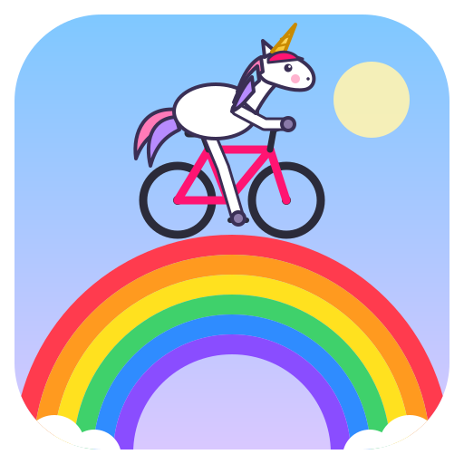

#  Open Cycling World

**Try it in your browser: <https://newkit.github.io/OCW/>** – ride solo on the
test routes or in Liechtenstein, with virtual power or a smart trainer over
Bluetooth in Chrome or Edge. It is a development build (spec §14 Phase 10
B8a); multiplayer and voice come with the hosted version.

A cross-platform indoor cycling simulation in Rust: real bicycle hardware, real
routes from OpenStreetMap, rendered locally with Bevy, with server-authoritative
multiplayer.

<p align="center">
  
  
</p>
<p align="center"><sub>Free ride with bots on the Vaduz–Malbun road (Liechtenstein, 1390 m), rendered by the app (scenes <code>readme-climb-behind</code> / <code>readme-climb-front</code> in <code>scripts/scenes.toml</code>). Map data © OpenStreetMap contributors (ODbL), elevation SRTM (NASA / USGS).</sub></p>

**Status:** worlds, multiplayer, voice, the sky, the time machine, the weather and the
weather machine work; textures, real weather and the browser / VR versions are in progress. Phases and decisions are
in [SPECIFICATION.md](SPECIFICATION.md).

## Worlds

Four regions, built from OpenStreetMap and official open elevation models, ridden
with real gradients. Download them from the
[latest release](https://github.com/newkit/OCW/releases) and start the app with
`ocw-desktop --world path/to/<world>.ocwpkg`, or switch worlds in the app
(menu → **World**).


<sub>Tenerife: riders on the TF-21 through the caldera of Las Cañadas, the Teide (3,715 m) straight ahead, 6 km away.</sub>

| | |
|---|---|
| **Liechtenstein** – Vaduz to Malbun (13.3 km, 1,148 m up), the Rhine valley, the Stegertunnel | |
|  |  |
| **Black Forest** – three connected packages: Freiburg – Schauinsland, Titisee – Feldberg, Triberg, Baden-Baden – Mummelsee over the Schwarzwaldhochstraße | |
|  |  |
| **Tenerife** – the whole island: the Teide from the coast (42 km, 2,350 m up), the Masca hairpins, Anaga, the sea | |
|  |  |

<sub>Rendered by the app (scene harness, `scripts/scenes.toml`), with the ISO
timestamp every capture carries. Map data © OpenStreetMap contributors (ODbL).
Elevation: swissALTI3D © swisstopo; DGM1 © LGL, www.lgl-bw.de (dl-de/by-2.0);
MDT05 © Instituto Geográfico Nacional (CC BY 4.0); SRTM (NASA / USGS).</sub>

## Build and run (Linux)

```bash
make deps     # this platform: deps-linux (detects Debian/Ubuntu, Fedora, Arch) | deps-windows | deps-macos
make check    # fmt, clippy, tests, wasm build – what CI runs
make run      # desktop client with a virtual trainer and 4 test riders
make help     # all targets (build, release, server, deploy, the test-* targets, ...)
```

In this project's own setup all building and testing runs on dedicated build
machines through `scripts/remote.sh`, watched in the build dashboard: see
[Build infrastructure](#build-infrastructure).

Tests are the `test-*` targets: `make test` (= `test-unit`, all unit and
integration tests), `test-wasm`, `test-kiosk`, `test-screenshot` /
`test-screenshot-wayland` / `test-smoke` (both) and `test-video` /
`test-video-wayland` (headless desktop runs), `test-multiplayer` (server
and kiosk on one build machine, bot riders on the others; see
[Multiplayer test](#multiplayer-test-across-machines)) and
`test-multiplayer-local` (server and three bot riders on this machine over
loopback, as in CI). The old names `smoke`,
`screenshot`, `screenshot-wayland`, `video`, `video-wayland` and `wasm` still
work for now but are deprecated.

**Ground, road, house and gear textures** (spec §4.6): `make materials`
(`scripts/fetch-materials.sh`) downloads the material library once – 31 CC0
materials from ambientCG and Poly Haven (with Phase 8 T6 the jersey knit,
the carbon twill and the saddle leather for riders and bikes), pinned by URL
and SHA-256 in
`assets/materials.toml` – checks every hash, converts it to KTX2 (1024², BC3 /
BC5, mipmapped) and writes the git-ignored `assets/materials/` (about 57 MB,
with `CREDITS.md`). The world packages are then drawn with meadow, forest
floor, rock, gravel, asphalt, paving … instead of flat colours; without the
library (or with `OCW_MATERIALS=off`) the app draws the flat land-use colours.
The packaging scripts and `deploy-test.sh` fetch and ship it beside the
binary; the console command `materials` shows which library is used and its
credits. On Windows without bash: `cargo run --release -p ocw-assets --
materials fetch`, then copy `assets\materials` beside `ocw-desktop.exe` as
`materials`.

The Rust version is pinned in `rust-toolchain.toml`; Debian's system Rust is too
old for Bevy. `make` finds the rustup toolchain in `~/.cargo/bin` by itself; for
plain `cargo`, add `. "$HOME/.cargo/env"` to your shell profile.

### macOS app

On a Mac, `make macos-app` (`scripts/build-macos-app.sh`) builds
`target/macos/Open Cycling World.app` and packs it as a DMG and a zip
(`OpenCyclingWorld-<version>-<commit>-macos-arm64.dmg`; CI builds them on every
push to `main`, workflow artifact `macos-app`). Open the DMG and drag the app to
Applications; it starts the Hills test route with the virtual trainer, or
your remembered Bluetooth devices (macOS asks for Bluetooth access on first
use). The log is in `~/Library/Logs/OCW/ocw-desktop.log` (Console.app → Log
Reports); `autoexec.cfg` is not read when started from Finder (the working
directory is `/`). The app is only ad-hoc signed, not notarised, so Gatekeeper
blocks the first start: right-click the app → Open, or System Settings →
Privacy & Security → Open Anyway, or remove the quarantine flag with
`xattr -dr com.apple.quarantine "/Applications/Open Cycling World.app"`.
Video recording (key V) needs ffmpeg: install Homebrew, then `brew install
ffmpeg` (`make deps-macos` prints both commands); the app also finds it in
`/opt/homebrew/bin`, `/usr/local/bin` and `~/.local/bin` when started from Finder.

### Browser app (preview)

`apps/web` (`ocw-web`) is the same client in a web browser (spec §14 Phase
10): Bevy compiled to WebAssembly, the shared renderer (`ocw-render`),
client loop (`ocw-client`), menus (`ocw-ui`) and game server. Solo, the
game server runs inside the page's frame loop (wasm has no threads), with
bots and the virtual trainer as on the desktop. The page can stream a
**world package over HTTP** (B2), join an `ocw-server` session over
**WebTransport** together with desktop and bot riders (B3), connect
trainers and sensors over **Web Bluetooth** (B4), play the game sound and
join voice calls (B5), has the desktop's menus, settings, captures and
gamepad support (B6), and flies in **Unicorn mode** like the desktop
(Phase 13 G5). It draws with **WebGPU**, or with **WebGL 2** where
WebGPU is missing (B7). A **public preview** runs on GitHub Pages
(<https://newkit.github.io/OCW/>, B8a): solo, the test routes and
Liechtenstein; see [The public preview](#the-public-preview-github-pages)
for how it is built and updated. Full hosting (B8) comes later; until
then you build the app and serve it yourself, as below.

#### 1. What you need

- **Rust from rustup** with the pinned toolchain and the wasm target.
  `rust-toolchain.toml` names both (Rust 1.99.1, `wasm32-unknown-unknown`),
  so rustup installs them at the first `cargo` call in the checkout. By
  hand: `rustup target add wasm32-unknown-unknown`.
- **`wasm-bindgen-cli` at exactly the `wasm-bindgen` version in
  `Cargo.lock`** (0.2.130 now): `make deps-web` runs `cargo install
  wasm-bindgen-cli --version <that version> --locked` if it is missing (no
  sudo; into `~/.cargo/bin`). `make web` stops with the command to run if
  the version does not match.
- **`curl`, `tar`, `gzip`, `python3`** (`make deps` installs `curl`; the
  others come with every Linux). The build fetches LiveKit's JS SDK for voice
  (`scripts/fetch-livekit-client.sh`: `livekit-client` 2.23.0 from the npm
  registry, checked against its SHA-256, kept in `target/web-vendor/`).
  Without network the build still succeeds, with a warning, and the page
  rides without voice. `python3` also runs the dev server and the browser
  tests.
- **Optional:** `wasm-opt` (binaryen) shrinks the modules of `make web`
  when it is installed; `make web-preview` always uses it and fetches the
  pinned release itself (`scripts/fetch-binaryen.sh`; Debian's
  `apt install binaryen` is too old for today's modules). Python's
  `brotli` module (or the `brotli` tool) adds the brotli size to
  `sizes.txt`.
- **A browser.** Chrome or Edge 113+ draw with WebGPU, and they are the
  only ones with **Web Bluetooth**, so you need one of them to ride with a
  trainer. On Debian: `sudo apt install chromium`. Firefox and Safari should
  run the page with WebGPU or WebGL 2 and virtual power, but nobody has
  tried them yet. On Linux, WebGPU and Web Bluetooth are still behind flags
  in Chromium. Start it like this (the browser tests use the same flags):
  ```bash
  chromium --enable-unsafe-webgpu --enable-features=Vulkan --enable-experimental-web-platform-features
  ```
  Without the WebGPU flags the page falls back to the WebGL 2 build. Without
  `--enable-experimental-web-platform-features` there is no Web Bluetooth,
  and you ride with virtual power. Windows, macOS, ChromeOS and Android have
  both without flags. The browser tests use a pinned Chromium of their own
  (`make deps-browser`, see [Testing the browser app](#testing-the-browser-app)).

#### 2. Build

```bash
make deps-web    # once: wasm-bindgen-cli matching Cargo.lock
make web         # both builds into target/web/ (scripts/build-web.sh)
```

**Building on a build machine.** In this project builds run on the build
machines (`config/machines.toml`, see [Build servers](#build-servers)),
not on the machine you sit at. There, instead of the two lines above:

```bash
make web-remote MACHINE=marge            # make deps-web + make web there, the page fetched into target/web/ here
make web-remote MACHINE=marge WORLDS=1   # also make web-worlds there (step 5), with the worlds and target/web-keys/root.hex
```

`make web-remote` (`scripts/web-remote.sh`) runs the build with
`scripts/remote.sh MACHINE run`, then fetches only what the page loads: the
files in the table below and, when the machine has published worlds,
`target/web/worlds/` and the dev root's public key (the private keys stay
there). Then `make web-serve` (step 3) serves it here. Without a build,
`make web-serve` stops and says to run `make web` or `make web-remote`.

`make web` builds the `web-release` profile (release, size-optimised, thin
LTO) twice, because Bevy picks WebGPU or WebGL 2 when it is compiled:

| File in `target/web/` | What it is |
|---|---|
| `index.html` | The page. It picks the build, then loads it |
| `ocw_web.js`, `ocw_web_bg.wasm` | The WebGPU build (feature `webgpu`) |
| `ocw_web_webgl2.js`, `ocw_web_webgl2_bg.wasm` | The WebGL 2 build (feature `webgl2`) |
| `ocw-voice.js`, `livekit-client.umd.js`, `livekit-client.LICENSE.txt` | Voice: the page's shim and LiveKit's SDK (Apache-2.0) |
| `sizes.txt` | The modules' sizes (raw, gzip, brotli) and the build time |

The page asks the browser for a WebGPU adapter. If it gets one, it loads the
WebGPU build. With no `navigator.gpu`, no adapter or an error, it loads the
WebGL 2 build. A browser with neither gets a message saying what it needs.
`?gpu=webgl2` or `?gpu=webgpu` forces one build. The HUD's build id ends in
`web WebGPU` or `web WebGL2`, and the console's `gpu` prints the API, the
adapter and the quality preset. Each module is about 76 MiB raw, 16.9 MiB
gzip and 10.7 MiB brotli. A browser downloads only one of them. On a
12-core build machine `make web` in a fresh checkout took 12.5 minutes
(WebGPU 8, WebGL 2 4.5). A rebuild after a change takes about 6 + 5
minutes. `WEB_GPU=webgpu make web` builds only one module, and
`WEB_PROFILE=dev make web` makes a quicker debug build with function names
for stack traces. A new build keeps the published worlds in
`target/web/worlds/`.

#### 3. Serve it and open it

```bash
make web-serve                 # http://127.0.0.1:8080/ (WEB_PORT=8090 for another port)
```

`make web-serve` needs a build in `target/web/` (step 2). Without one it
stops with the commands to run, instead of answering every page with
"404 File not found".

Open <http://127.0.0.1:8080/> (or `http://localhost:8080/`), then click into
the page or press a key to start the sound. `make web-serve` runs
`scripts/web-serve.py`. It serves `target/web/` with what the app needs:
`application/wasm` for the modules (streaming compilation), HTTP range
requests for the world packages, `Cache-Control: no-store` (always the fresh
build), and the COOP/COEP headers (`Cross-Origin-Opener-Policy:
same-origin`, `Cross-Origin-Embedder-Policy: require-corp`), which the
hosting will send too. The app does not need COOP/COEP yet: it uses no
wasm threads. Any static server works for a solo ride on the test routes,
but streaming worlds needs range requests.

- **Why not `file://`:** the page loads its module as an ES module and
  fetches the `.wasm`, which browsers refuse from `file://` URLs.
- **Why localhost:** WebGPU, Web Bluetooth, WebTransport, the microphone
  and the Origin Private File System (the world cache) work only in a
  *secure context*: an `https://` page, or `http://localhost` /
  `http://127.0.0.1`. A plain `http://` page from another machine's address
  gets none of them: no WebGPU (so the WebGL 2 build loads), no trainer,
  no multiplayer, no world cache. Only pages on localhost also accept the
  dev server's trust options for world packages (`trust-root`,
  `trust=dev`, `allow-unsigned`).
- **From another machine on the LAN:** forward the port with SSH, so the
  page is on localhost again:
  ```bash
  ssh -N -L 8080:127.0.0.1:8080 USER@BUILD-MACHINE     # then open http://localhost:8080/ here
  ```
  `make web-serve WEB_BIND=0.0.0.0` (`scripts/web-serve.py --bind
  0.0.0.0`) serves the LAN directly. It prints a warning and this
  machine's LAN URLs (`http://ADDRESS:8080/?route=hills`). A page opened by
  a LAN address is not a secure context: it loads the WebGL 2 build and
  rides solo with virtual power, without trainers (Web Bluetooth),
  multiplayer (WebTransport) or the world cache. The world trust options
  work only on localhost pages, so streamed worlds do not load there
  either: use the SSH tunnel above for them. Chromium's
  `--unsafely-treat-insecure-origin-as-secure=http://ADDRESS:8080` (also
  under `chrome://flags`) is meant to lift that, but it has not been tried
  with OCW yet, and the world trust options still work only on localhost.
  A real https host comes with B8.

#### 4. Ride solo

Without options the page rides the built-in **Hills** test route on the
in-page local server, with 5 bots and the virtual trainer at 200 W, as
*Rider*. The keys are the desktop's:

- ↑ ramps the power up on top of the virtual trainer, ↓ stops (brake), Page
  Up / Page Down change it by ±10 W.
- A switches autodrive, W wild mode, ← / → move the line (autodrive) or
  lean (manual).
- Mouse: the camera. C resets it.
- M / Shift+M mute the microphone / the voices.
- Esc (gamepad Start) opens the menu. `` ` `` or F12 opens the console
  (`help` lists the commands, e.g. `sim.power 250`, `teleport 2.5`,
  `net.stats`, `hud off`, `camera …`, `time sunset`, `weather rain`).

*Dev* commands (`teleport`, `sim.power`, `dev.*`) work only with the in-page
server, as on the desktop.

Page options go in the query string. Full examples for the built-in test
routes (no world package needed):

```text
http://127.0.0.1:8080/?route=hills
http://127.0.0.1:8080/?route=hills&bots=5&power=200&start=0&name=Ada&ftp=250&quality=auto
http://127.0.0.1:8080/?route=loop&bots=3&power=250&start=1.5&name=Ada&ftp=250
http://127.0.0.1:8080/?route=hills&gpu=webgl2&quality=low
```

The first rides the **Hills** test route with the defaults; the second
spells every common option out; the third rides the flat **Loop**; the last
forces the WebGL 2 build with the Low preset.
Unknown keys and bad values are ignored, with a line in the browser
console:

| Option | Meaning |
|---|---|
| `route=hills\|loop` | The test route (default `hills`). With `world=`: a route of the package |
| `bots=N` | Bots on the local server, 0–50 (default 5, or your saved `ride.bots`) |
| `power=W` | The virtual trainer's power, 0–1500 W (default 200, or your saved `trainer.virtual_power`) |
| `start=KM` | Start this far along the route |
| `name=NAME` | Your rider's name (up to 32 characters) |
| `ftp=W` | FTP for workouts' % FTP targets, 50–600 W |
| `quality=auto\|low\|medium\|high` | The graphics preset for this visit (not saved) |
| `gpu=webgpu\|webgl2` | Force the WebGPU or the WebGL 2 build |
| `origin=LAT,LON` | Give the test route a place on the globe (the GPS line in the HUD, the sun, the FIT track), e.g. `origin=47.13996,9.52151` |
| `world=ID\|ID@VERSION\|URL` | Stream a world package (below) |
| `free=1` | With `world=`: a free ride on its road network instead of a route (the junctions take their default exit; there are no junction keys in the browser yet) |
| `tiles=1–8`, `keep=2–12` | With `world=`: fetch radius and keep radius in tiles around the rider |
| `memory-mb=N`, `cache-mb=N`, `cache=0` | With `world=`: memory for loaded tiles, the browser cache's budget, no cache |
| `trust-root=HEX`, `trust=dev`, `allow-unsigned=1` | With `world=`, on localhost pages only: trust a development root key, the dev keys, or unsigned packages (chunks are still checked) |
| `server=https://HOST:PORT`, `cert-hash=HEX[,HEX]` | Join a game server over WebTransport (below) |

#### 5. Worlds over HTTP

The browser does not read files from your disk. It streams a world package
from the web server. First the manifest and the signature chain, then the
road graph and sections, then the tiles around the rider, fetched with range
requests. Every chunk is checked against its SHA-256 and kept in the
browser's **Origin Private File System**, so a second visit loads from
there. Only the tiles around the rider stay in memory.

```bash
make web-worlds    # publish data/pilot/liechtenstein.ocwpkg into target/web/worlds/
make web-serve     # prints a link per world, with the dev root's key
```

The package comes from the world build (*Routes and worlds* under [Riding
modes](#riding-modes): `scripts/fetch-pilot.sh` and
`scripts/build-liechtenstein.sh`, on a build machine). It is not in git
(`data/` is git-ignored). A git worktree finds it in the main checkout's
`data/pilot/`. On a machine without a local build, `make web-remote
MACHINE=marge WORLDS=1` publishes the build machine's package there and
fetches the worlds and the key.

`make web-worlds` (`scripts/publish-web-worlds.sh PKG...`;
`WEB_WORLD_PKGS="a.ocwpkg b.ocwpkg"` for others) builds `world-builder`,
creates a **development signing root** in `target/web-keys/` on its first
run (git-ignored, never for production), signs a copy of each package with
it, and publishes it in the `world-builder publish` layout
(`worlds/<id>/<version>/manifest.json`, the package, `worlds/<id>/latest`).
The root's public key goes to `target/web-keys/root.hex`. Open the link
`make web-serve` printed and add a route:

```text
http://127.0.0.1:8080/?world=liechtenstein&route=vaduz-malbun&trust-root=<the key of target/web-keys/root.hex>
```

The key is the 64 hex digits (32 bytes) in `target/web-keys/root.hex`; it is
created on the first `make web-worlds` and differs on every machine. A full
URL looks like this (**example key – yours differs**, so copy your own):

```text
http://127.0.0.1:8080/?world=liechtenstein&route=vaduz-malbun&trust-root=3f9a6c0e1b7d42a8c5e0f19b6d3a7c2e8f4b0d61a9c3e5f7082b4d6e8a1c3f5e
```

Print the exact URLs for your machine (the same links `make web-serve` shows):

```bash
KEY=$(cat target/web-keys/root.hex)
echo "http://127.0.0.1:8080/?world=liechtenstein&route=vaduz-malbun&trust-root=$KEY"
echo "http://127.0.0.1:8080/?world=liechtenstein&route=vaduz-malbun&bots=5&power=250&name=Ada&quality=auto&trust-root=$KEY"
echo "http://127.0.0.1:8080/?world=liechtenstein&free=1&trust-root=$KEY"   # free ride on the road network
```

Other worlds: publish them first, e.g.
`make web-worlds WEB_WORLD_PKGS="data/pilot/liechtenstein.ocwpkg data/tenerife/tenerife.ocwpkg"`,
then use `world=tenerife`. Without `route=` the package's first route is ridden;
`route=` takes a route's name or its slug (`Vaduz - Malbun` → `vaduz-malbun`), and an
unknown name makes the loading screen list the routes the package has.

The loading screen shows the manifest, the base, the first tiles, the bytes
from the cache and from the network, and the storage. The console's
`world.info` shows the streaming while you ride. Another world or route is
another page: the browser's World page shows the world but does not switch
it.

#### 6. Ride with others (multiplayer)

A browser rider joins an `ocw-server` session over **WebTransport** (HTTP/3
over QUIC), together with desktop and bot riders:

```bash
cargo run --release -p ocw-server -- --listen --webtransport --test-route hills --tls-dir ~/.local/share/ocw-server
```

The server prints the page options with the certificate's hash, e.g.
`?server=https%3A%2F%2FHOST%3A47801&cert-hash=5c1e…`. Replace `HOST` with
the server's address as seen from the browser, and add `route` to match the
server's `--test-route`:

```text
http://127.0.0.1:8080/?server=https://127.0.0.1:47801&cert-hash=5c1e…&name=Ada&route=hills
```

Desktop riders join the same server with `ocw-desktop --server HOST
--server-cert FINGERPRINT --route hills` (UDP 47800), and bots with
`ocw-bot`. WebTransport uses **UDP 47801**: open it in the firewall for
riders on other machines (an SSH tunnel does not carry UDP; the page can
still be on localhost through the tunnel). The certificate is self-signed
and valid for 13 days. Browsers take it by hash, so a new hash means a new
link: keep `--tls-dir` to keep the hash across restarts. See [Browser
riders](#browser-riders-webtransport) for the details. With `world=` the
page rides a world package. The server must ride the same one
(`ocw-server --world …`), and the browser streams it from the web server as
above.

#### Devices in the browser

The **Devices** panel (bottom right) has **+ Trainer**, **+ Power meter** and
**+ Heart rate**. Each one opens the browser's Bluetooth chooser (Web
Bluetooth needs the click). It steps aside while the menu is open. The
device runs the same protocol code as on the desktop (`ocw-devices`: FTMS,
Cycling Power, CSC, Heart Rate, Wahoo KICKRs). Power, cadence and heart rate
go to the server. The trainer gets **SIM** (the road's gradient with the
rider's build: rolling and wind resistance, mass, the weather's wind) or
**ERG** (`erg.target 200`). Workouts: `workout start --example sweet-spot`,
`workout list|stop|skip|status`. Trainer modes: `trainer.mode sim|erg|off`,
`trainer.difficulty 50`.

Once a trainer or power meter is connected, the virtual power stops. A
dropped device reconnects by itself (the HUD and the panel say
"reconnecting"), and the last SIM or ERG target is sent again. The site
remembers its devices (`localStorage`). Where Chromium keeps the permission
(`navigator.bluetooth.getDevices()`), they reconnect after a reload without
the chooser. Console: `devices.list`, `devices.connect trainer|power|hr`,
`devices.forget <name|all>`.

**Browsers without Web Bluetooth** (Firefox, Safari, every browser on iOS,
Chromium on Linux without the flag above): the panel says so and the ride
uses **virtual power** (↑ / ↓, Page Up / Down, `sim.power`). A bridge that
relays a trainer through another device comes with accounts (spec §14
Phase 10 B7, Phase 5).

#### Sound and voice in the browser

Browsers start sound only after a click or key press (the autoplay rule).
Until then a hint at the top says "click or press a key", and the
game sound (the desktop's synthesised bike, wind, tyres, weather, cues)
starts with your first gesture. *Settings → Audio* has the volumes (with a
test sound), Mute and the output device (Chromium). *Settings → Voice* has
the voice switches, the voice volume, the participants, the microphone and
speaker, spatial voice and the echo test (*Settings → Audio → Voice → Echo
test*, or `voice.echo on`). These are the desktop's pages and settings.

Voice needs a shared ride on a server that knows a LiveKit server. Solo rides
in the page never connect. Start [LiveKit](#voice-chat) and the game server
with its keys:

```bash
livekit-server --dev       # ws://127.0.0.1:7880, key "devkey", secret "secret"
export OCW_LIVEKIT_URL=ws://127.0.0.1:7880 OCW_LIVEKIT_API_KEY=devkey OCW_LIVEKIT_API_SECRET=secret
cargo run --release -p ocw-server -- --listen --webtransport --test-route hills
```

The browser gets its token over the game connection and joins the room with
the page's LiveKit SDK. The browser asks for the microphone at the first
call. A `ws://` LiveKit URL works only for pages on localhost (an `https://`
page needs `wss://`, i.e. LiveKit behind TLS). For browsers on other
machines, give the server a LiveKit URL they can reach (`--bind 0.0.0.0`,
TCP 7880 and UDP 7881–7882 open). M / Shift+M (gamepad Select / R3) mute the
microphone / the voices.

#### Menus, settings and captures

Esc (or the gamepad's Start) opens the desktop's in-game menu: *Resume, Ride,
World, Workshop, Navi, Settings, Captures*. The browser leaves out what it
cannot do: Quit and Restart (close or reload the tab), routes, rides, GPX
import, Strava and rider profiles. *Navi → Training history* and the key
rebinding work as on the desktop (the history in `localStorage`,
`ocw-history`). Every setting the browser has works as
on the desktop (`set KEY VALUE`, `get`). They are kept in the site's
`localStorage` (`ocw-settings`, the same TOML as `settings.toml`), so they
survive reloads. Clearing the site's data resets them.

*Captures* (or the console) download files named with the time:
- *Screenshot* (`screenshot`): a JPEG with the time in its EXIF, like the
  desktop's.
- *Video start / stop* (`video start|stop`): a WebM of the canvas with the
  game sound, REC in the HUD.
- *Download this ride (FIT)* (`ride.save`): the ride's FIT file. Browsers
  allow no download when a tab closes, so save it before you leave.

**Gamepads** work through the browser's Gamepad API. Press a button once,
with the page focused, so the browser shows the pad. The mapping is the
desktop's (see [Connecting a gamepad](#connecting-a-gamepad)).

#### Unicorn mode in the browser

The desktop's god mode is the same code in the page (`ocw_ui::god`): **G**
(or *World → Unicorn mode*) turns the rider into the unicorn, **G** again
lands on the road below, **Shift + G** flies back to the take-off spot. The
keys are the desktop's (see [Controls](#controls)): ↑ / ↓ faster / slower,
← / → bank, **+ / −** climb and descend – matched by the character the key
types (the browser's `KeyboardEvent.key`), so they work on a German or any
other layout – Shift boost, Ctrl precise, the wheel the speed, **C** first
person, **I** the inspection (panel and crosshair), **P** a pin
(`god.pins` lists them), **L** looks ahead again. Gamepads fly as on the
desktop (Select + North toggles), and on a touch screen a finger on the left
half steers, one on the right half looks, the **+ / −** buttons climb.

The mouse looks around in the browser's **Pointer Lock**: the page asks for
it when the flight starts (the key or click that started it is the user
gesture the browser wants). **Esc** ends the lock (the browser does that
itself), the next Esc opens the menu, a click locks the pointer again. If
the browser refuses the lock, hold the left button to look. While flying,
the trainer rides a flat road, and in a shared ride (WebTransport) the
server's rules apply as on the desktop: by default only the host flies.
The settings (*Settings → Controls*: invert Y, plane or hover; *Display*:
the rainbow trail) and the `god …` console commands are the desktop's.

#### Graphics: WebGPU, WebGL 2 and the quality presets

The WebGL 2 build draws the same world with what WebGL 2 lacks degraded:
- the simple sky instead of the atmosphere;
- levels of detail that switch instead of fading;
- one shadow cascade.

The **quality presets** Low, Medium and High trade looks for speed: shadows,
MSAA, view distance, tree draw distance, house detail, weather particles,
and in the browser the canvas' pixel ratio (High is the full look).
**Auto** (the default) picks High on the desktop and on WebGPU, Medium on a
small device (4 cores or 4 GB or less), and Low on WebGL 2 and on phones and
tablets. Choose one in *Settings → Display → Graphics* (with *Sky* and
*Fullscreen*). From the console: `set display.quality low` (saved), or
`quality low` (this session). `quality` alone says what runs and why.
`?quality=` holds for one visit. The same setting and commands work in the
desktop app (see [Settings](#settings-and-rider-profiles)).

#### Testing the browser app

The browser tests start headless Chromium, serve `target/web/` on a free
local port, and drive the page over the DevTools protocol. They need no
extra Python packages. The browser is a **pinned Chromium build**:
`make deps-browser` (`scripts/web_browser.py fetch`) downloads open-source
Chromium 157.0.8103.0 (BSD-3-Clause; Chromium's snapshot builds, revision
1717344) for Linux x64, macOS arm64 or Windows x64, checks it against the
SHA-256 in `scripts/browsers.json` and unpacks it into
`~/.cache/ocw/browsers/chromium-157.0.8103.0/` (no sudo). The tests take
`OCW_BROWSER` (a path) first, then the pinned build, then the system's
`chromium` (with a warning); `--chromium PATH` overrides all of them.
`python3 scripts/web_browser.py version` says which one they get. On the
build machines it draws with WebGPU on Vulkan, or with WebGL 2 through
ANGLE on Vulkan. Each
target but `test-web-build` runs `make web` first (and `make web-worlds`,
or the server and bot builds, where it needs them). Screenshots, logs and JSON summaries go to
`test-output/web/` (`web-<time>.jpg`, `.log`, `.json`, and per part
`-menu.jpg`, `-hud.jpg` …, the downloads in `web-<time>-downloads/`).

| Target | What it checks |
|---|---|
| `make deps-browser` | Not a test: downloads the tests' pinned Chromium (above) |
| `make test-web-build` | Both builds compile for wasm32 (part of `make check`) |
| `make test-web` | WebGPU: load, ride, the menus by keyboard and a fake gamepad, settings over a reload, the screenshot / video / FIT downloads, Unicorn mode (G, + climbs, the inspection, a pin, the menu row, landing), fps |
| `make test-web-webgl2` | Chromium without WebGPU: the page falls back to the WebGL 2 build and rides. Then WebGPU High against WebGL 2 Low in the same view, and the Graphics page |
| `make test-web-world` | Liechtenstein streamed from the dev server, a teleport, then a reload from the browser cache |
| `make test-web-unicorn` | Unicorn mode over Vaduz (Liechtenstein streamed): fly up, the inspection, a pin, the menu row, landing (`--god`) |
| `make test-web-multiplayer` | `ocw-server` and `ocw-bot` riders, the browser over WebTransport, 30 s |
| `make test-web-ble` | A fake Web Bluetooth trainer and strap: connect, power, SIM / ERG writes, a drop, a reload, no Bluetooth |
| `make test-web-ble-emulation` / `test-web-ble-real` | Chromium's own Web Bluetooth with a simulated KICKR / the real trainer in range (`BLE_DEVICE=KICKR`) |
| `make test-web-audio` | The sound locked until a click, then the mixer's chunks through Web Audio, a volume over a reload |
| `make test-web-voice` | `ocw-server` with voice tokens and the Echo rider, a fake LiveKit in the page: call, mute, drop, rejoin, echo test |
| `make test-web-livekit` | Two browser riders in a real `livekit-server --dev` room: they see and hear each other, mute. It needs `livekit-server` (v1.13.10) on the PATH or in `~/.local/bin` (`LIVEKIT_SERVER=PATH`). Without it the part is skipped |

| `make test-web-readme` | This section as a new user follows it: in a fresh copy of the current commit, `make web-serve` without a build must fail with the message, then `make deps-web`, `make web`, `make web-worlds`, `make web-serve` and every URL of steps 3 – 5 (the real key for the placeholder and the example key, the one-liner's URLs, the links `make web-serve` prints) in the pinned browser: HTTP 200, the app starts, the ride moves, the expected GPU build, no HTTP errors. Then `WEB_BIND=0.0.0.0`: the warning, the LAN URLs, the WebGL 2 build by LAN address. One screenshot per URL and `verdict.json` in `test-output/web/readme-<time>/`. The world package is linked from the build machine's `data/pilot/` instead of being built. Takes about 20 minutes (a full build) |

`scripts/test-web.py --help` lists the options (`--query`, `--world`,
`--gpu`, `--software` for SwiftShader without a GPU, `--no-ui`, `--god`).

#### The public preview (GitHub Pages)

<https://newkit.github.io/OCW/> is a solo preview of the browser app (spec
§14 Phase 10 B8a): its start page offers the Hills and Loop test routes and
Liechtenstein (Vaduz – Malbun and a free ride), with virtual power or a
trainer over Web Bluetooth in Chromium. Multiplayer, voice and sign-in are
off there ("coming in the hosted version"). `credits.html` has the
attribution, the licences and the privacy note.

**What is different from `make web`:**

| | `make web` (dev) | `make web-preview` (the preview) |
|---|---|---|
| Output | `target/web/` | `target/web-preview/` |
| Profile | `web-release`: `opt-level = "s"`, thin LTO | `web-preview-release`: the same with fat LTO and one codegen unit |
| `wasm-opt` | `-Os`, only when installed | `-Oz`, always: `scripts/fetch-binaryen.sh` fetches the pinned binaryen (version_133, SHA-256-checked) into `~/.cache/ocw/tools/` when none is installed |
| Trusted worlds | the production roots (none yet); on localhost also `trust-root`, `trust=dev`, `allow-unsigned` | only the **web preview's root** (`crates/ocw-worldstore/keys/preview-roots.json`, feature `preview` of `ocw-web`); the localhost-only options stay localhost-only |
| `config.json` | `channel: dev`: changes nothing | `channel: preview`, `worlds/`, empty `server`, `voice`, `signin`: no `?server=` and no voice on a public page, the start page's rides |
| Voice | LiveKit's SDK fetched | not included |

Sizes of one module (the WebGPU build; the WebGL 2 build is about the
same; a browser downloads only one):

| Build | raw | gzip | brotli |
|---|---|---|---|
| `make web` (`web-release`) | 76.3 MiB | 17.0 MiB | 10.7 MiB |
| `make web-preview` before `wasm-opt` | 51.0 MiB | 12.6 MiB | 8.5 MiB |
| `make web-preview` (after `wasm-opt -Oz`) | 42.2 MiB | 13.2 MiB | 8.8 MiB |

`wasm-opt` makes the module much smaller but the compressed download a
little larger; the preview keeps it for the smaller module the browser
compiles (spec §14 Phase 10, 10G *B8a* has all the variants measured).

GitHub Pages cannot serve precompressed files; whether it gzips the
modules on the fly is what `make test-web-preview PREVIEW_URL=…` reports
(the module's `content-encoding`).

**Build and try it locally:**

```bash
make web-preview          # both modules into target/web-preview/ (about 14 minutes on marge, 12 cores)
make web-preview-site     # the site into target/web-preview-site/ (with the worlds of target/web-preview-worlds/release/)
make test-web-preview     # headless Chromium on that site, served as a public page (ocw-preview.test)
make test-web-preview PREVIEW_URL=https://newkit.github.io/OCW/   # the same checks on the live site
```

`make web-preview-site` (`scripts/web-preview-site.py`) takes the build and
the signed worlds and writes `config.json` (the page configuration: the
worlds' base, no server / voice / sign-in, the start page's rides),
`credits.html` (from the world manifests' attribution, the material and
model manifests and, with `--crates`, the Rust crates in the module),
`worlds/` in the `world-builder publish` layout, `.nojekyll` and
`site.txt` (every file and the total; it fails over 1 GB, the Pages
limit). `make test-web-preview` checks the start page, the Hills route,
Liechtenstein from the preview root, that the dev trust options are
ignored, the WebGL 2 fallback, the credits page and that nothing answers
4xx/5xx; screenshots go to `test-output/web-preview/`.

**The workflow** `.github/workflows/web-preview.yml` builds the preview
on GitHub's runner (`make deps-web`, `scripts/fetch-binaryen.sh`, `make
web-preview`), downloads the signed worlds from the pre-release
`web-preview-worlds` (`gh release download`, no secret needed), assembles
the site and deploys it with `actions/upload-pages-artifact` and
`actions/deploy-pages` (Pages source: GitHub Actions). Building Bevy twice
with fat LTO is slow, so it runs by hand (`gh workflow run web-preview.yml`
or Actions → Web preview → Run workflow) and every Monday, both for
`main` (the `github-pages` environment deploys only from `main`).

**Updating the preview's worlds.** The preview trusts only packages signed
by its own root. The root and the signing key live on marge in
`~/.config/ocw/preview-keys/` (outside every checkout, mode 700): never
copy, print or commit them, and they never go to CI. After a world
rebuild, on marge:

```bash
make web-preview-worlds   # scripts/publish-preview-worlds.sh --upload [PKG...]
gh workflow run web-preview.yml
```

The script signs a staged copy of each package (default
`data/pilot/liechtenstein.ocwpkg`) with the preview's signing key, publishes
it (`worlds/<id>/<version>/`, `<id>/latest`), verifies it against the
preview root, writes the release assets (`liechtenstein-3.ocwpkg`,
`liechtenstein-3.manifest.json`, `liechtenstein.latest`,
`preview-worlds.json` with the layout, routes and hashes, `SHA256SUMS`)
and uploads them to the pre-release `web-preview-worlds`, replacing the
old ones. The signing key `web-preview-2026` is valid for two years;
the script's header shows how to make the next one with `world-builder
keys new-signing`.

#### Limitations today

- Trainers and sensors only in Chromium-based browsers (Chrome, Edge;
  on Linux with the flag). Elsewhere: virtual power.
- Safari and Firefox are untested, and so are real phones and tablets
  (the browser matrix comes with hosting, B8).
- No hosting or domain yet (B8): the public preview on GitHub Pages is
  solo only; for anything else you serve the page yourself. Multiplayer
  takes the server's self-signed certificate by hash, renewed every 11
  days.
- Unicorn mode's touch controls are untried on real phones and tablets,
  and so is the Pointer Lock in Safari and Firefox.
- The workshop and the character editor are locked: browser riders are
  anonymous ("log in to customize") and ride the plain grey bike and kit
  until accounts come (Phase 5). Their damage is not kept.
- No route or world switch inside a ride: another world or route is
  another page (`?world=…&route=…`). Free ride takes the default exit at
  every junction.
- Real weather only on a remote server (`ocw-server --weather real`): the
  in-page server cannot fetch the providers yet.
- After a dropped connection to a server, reload the page.

## Controls

| Action | Keyboard | Gamepad |
|---|---|---|
| Menu (Resume, Ride, World, Workshop, Navi, Settings, Quit) | Esc | Start / Menu (☰, Options) |
| Faster: +25 W per press, more while held | ↑ | D-pad up, left stick up or right trigger (RT / R2) |
| Stop: no power, brake | ↓ | D-pad down, left stick down or left trigger (LT / L2) |
| Steer (autodrive: move the line; manual: lean into a curve) | ← / → | left stick (left/right) |
| Autodrive on/off (on at the start) | A | South button (A / ✕) |
| Wild mode on/off (leave the road; on also switches autodrive off) | W | West button (X / □) |
| Free ride: choose the exit at the next junction | ← / → (autodrive, junction ahead) or Q / E | D-pad left / right |
| Free ride: U-turn | U | East button (B / ○) |
| Route ride: back to the route after leaving it | J | North button (Y / △) |
| Power ±10 W | PgUp / PgDn | |
| Camera: orbit / zoom | mouse drag / wheel | |
| Camera reset | C | |
| Restart everything (as at program start; the ride is saved first) | R | |
| Record a video (start / stop) | V | |
| Voice: mute / unmute your microphone | M | Select (Back / View / Share) |
| Voice: mute / unmute the speaker (all voices; game sounds stay) | Shift+M | right-stick click (R3) |
| Next screen | F11 | |
| Console (`help` lists the commands) | `` ` `` or F12 | |
| Unicorn mode: fly as a unicorn / land on the road below | G | Select + North (Y / △) |
| Unicorn mode: fly back to where you took off | Shift+G | Select + West (X / □) |

**Rebinding keys and buttons** (spec §3.2.1 M9): every key and gamepad
button of the table above except the menu (Esc / Start), the console (`` ` ``
/ F12), the sticks and the triggers can be changed in *Settings → Controls →
Keys and buttons*. Choose a group, then an action: Enter waits for the new
key or pad button (Esc / Start cancel), ← / → step the key through the list.
Two actions on one key are allowed but marked with "(!)" and a warning dot,
and the page lists the conflicts; *Reset to defaults* puts everything back.
Unicorn mode's flight keys (cursor keys, + / −, L) stay fixed – W A S D
never fly. *Pad Confirm button* swaps the menu's Confirm and Back on a pad
(east: the Nintendo layout). From the console:

```text
bind                      # all bindings and conflicts
bind autodrive Z          # the key of an action (ids: bind lists them)
bind u_turn LB --pad      # its gamepad button
bind --capture camera     # the next key or button pressed
bind --reset              # all defaults
set keys.mute_voices Shift+N   # the same as settings ([keys], [pad] in settings.toml)
```

**Accessibility** (*Settings → Display → Accessibility*): *HUD size* (100 –
200 %, the menu is sized by the window already), *Status colours*
(colour-safe: blue, yellow, orange and purple instead of green to red, for
red-green colour blindness; icons and words stay), *High-contrast HUD*
(opaque panels, white text), *Reduced motion* (no camera shake, no
flashing warnings) and *Camera shake*.

**Unicorn mode** (spec §14 Phase 13; *World → Unicorn mode*, console `god`): the rider
turns into a unicorn and flies freely over the world – like a plane: it always
flies forward along its heading. While flying:

| Action | Keyboard / mouse | Gamepad |
|---|---|---|
| Faster / slower (the throttle; it holds when let go, ↓ slows to a slow glide, never to a stop) | ↑ / ↓ | left stick up / down |
| Bank and turn left / right (the unicorn and the view roll into the turn; let go to level out) | ← / → | left stick left / right |
| Climb / descend (the nose pitches up / down; let go to level off) | + / − (the keys that type `+` and `-` on your layout, e.g. `+` and `-` on a German keyboard, `=` and `-` on a US one; or the keypad) | right / left trigger |
| Look around without changing the course (eases back to straight ahead after 1.5 s; the pointer is captured, Esc frees it, a click captures it again) | mouse | right stick |
| Look straight ahead again | L or the middle mouse button | |
| Boost ×4 / precise ×0.25 | Shift / Ctrl | South (A / ✕): boost |
| Base speed ×0.25 … ×8 (in the HUD) | mouse wheel | |
| First-person view from the unicorn's head | C | |
| Inspection panel and crosshair on / off | I | |
| Put a pin where the crosshair points (kept for the ride; `god.pins` lists them) | P | |

Touch (spec §3.2.2): a finger dragged on the left half of the view is the
stick (push it up to fly faster, down to fly slower, sideways to bank and
turn), on the right half it looks around; two fingers on one half steer too
and spreading / pinching them changes the speed scale; the **+** / **−**
buttons at the right edge (shown for 8 s after a touch) climb and descend.

**Inspection** (I, on by default): a panel top right with the altitude,
speed, speed factor, heading, the position in package metres, latitude /
longitude, the tile and the local time of the place; a crosshair in the
middle names what it points at – the road (name, OSM way, class, surface,
width, bridge / tunnel, gradient in the looking direction), a building (its
use, levels, roof shape and height), water, the land-use area and the
elevation. P puts a magenta pin there; `god.pins` lists the pins with their
coordinates and a `--start X,Z` to copy for a free ride from that spot.

The speed grows with the height above the ground (20 m/s close to it, 400 m/s
from 760 m up; at most 1,600 m/s with the boost); the throttle is a share of
it (15 … 100 %, 50 % at take-off). The turn is a coordinated one: tight when
slow, wide when fast (slow down first for a tight turn). The first model –
moving with the arrows relative to the view and hovering when no key is
held, the mouse turning the flight – is still there: Settings → Controls →
*Unicorn mode: flight* = hover (`controls.god_flight`, console `god.flight
hover`). The unicorn keeps 2 m
above terrain, water, buildings and tree crowns and stays below 8,000 m; it is stopped
softly 200 m outside the world. A glowing ring marks where G will land: the
nearest road (free ride) or the nearest point of the route. The riding keys
(A, W, U, J, Q / E) do nothing while flying; the trainer simulates a flat
road in SIM mode (ERG keeps its target), and no distance is counted.
On a shared server only the host may fly (`ocw-server --god-control
anyone|host|nobody`), never during a running event. The HUD's rider count
says how many fly ("riders: 4 (1 flying)"), `ride.riders` lists who. The
tiles stream ahead of the flight and wider with the height; above 1,500 m
over the ground only the terrain is drawn (no trees and houses). The FIT
file gets a marker at both ends of a flight.

**Menu** (spec §3.2.1): ↑ / ↓ (or Tab / Shift+Tab, the D-pad, the left
stick; held: repeats) move the focus, Enter / Space / South (A / ✕) or a click
selects, Esc / Backspace / East (B / ○) or a right click goes back and closes
the menu at the top page; Start closes it from any page. Esc closes the
console first if it is open and never quits the app: only *Quit* in the menu
(with a confirmation), the window's close button and the console's `quit` do.
The ride does not pause under the menu: the trainer keeps its mode, the ride
time, the recording and a video go on, and the ride keys (↑ ↓ ← →, A, W, U,
R, V, …, the mouse camera) are ignored while it is open. Steering falls back
to autodrive and junctions take their default exit, so the rider stays on
the road; closing the menu restores manual steering / wild mode. *Workshop*
opens the workshop scene (see [The workshop](#the-workshop-bikes-parts-and-hearts)), *Settings* has Riders, Controls, Trainer, Audio, Display
and Strava: ← / → (D-pad left / right) change the focused value, Q / E,
PgUp / PgDn or LB / RB switch between these pages (see
[Settings](#settings-and-rider-profiles)); *Ride* starts local events (race,
group ride, time trial; see *Events* below), workouts and *Restart*; *World*
changes the world and shows its data and conditions (see
[The World menu](#the-world-menu-changing-the-world-without-restarting)),
*Navi* lists the routes, saved rides and GPX files to import, and the
riders in this ride. Long lists are
paged (*Previous* / *Next*, or ← / → on a list row).

### The workshop: bikes, parts and hearts

*Workshop* in the menu (or `workshop open`) opens a 3D bicycle workshop over
the running ride (spec §14 Phase 4, W1 – W4): the ride goes on in autodrive
underneath and shows in a small live ride window (top right; `workshop.ride_window off`
hides it). Your bike stands on the repair stand in front, your other bikes hang
on the wall – every rider starts with six starter bikes, one per physics
profile, and **500 ♥**. Hearts are earned only by riding: **1 ♥ per 10 kJ** of
work and **1 ♥ per 20 m** climbed, credited by the local server from the power
it accepted – never for virtual power (the virtual trainer, keyboard power,
`sim.power`), in god mode, while down after a crash, for bots, in captures or
with `--no-hearts` (the kiosk's show mode). One heart is one euro of a part's
real list price (generic parts, no brands: `assets/parts.toml`).

| | Keyboard | Mouse | Gamepad | Touch |
|---|---|---|---|---|
| Choose a bike | ← / → | hover / click | D-pad ← / → | swipe, tap |
| Zones (wall, stand, bench, mirror) | ↑ / ↓ | click | D-pad ↑ / ↓ | tap |
| Swap a wall bike onto the stand / open the stand | Enter | click | A | tap |
| Next / previous part (stand) | Q / E, or the arrows (on screen) | hover / click a marker | LB / RB, D-pad | tap a marker |
| Orbit / zoom the stand view | I J K L or Shift + arrows, + / − | drag, wheel | right stick, LT / RT | drag, pinch |
| Compare / buy, sell … | C / X | middle click / the dialog's buttons | Y / X | long press / the buttons |
| Back (leaves from the overview) | Esc | right click | B | two-finger tap, ‹ Back |

On the stand a marker sits on every part (frame, wheels, tyres, groupset,
crankset, cassette, chain, cockpit, bar tape, saddle, seat post, pedals,
bottle cages, lights, computer, bag, paint); choosing one flies to it and
opens the **part picker**: what is fitted, what you own (spare parts or on
another bike) and the shop (only parts that fit, by tier, cheapest first, a
lock with the missing hearts). The focused part shows on the bike at once
(live preview); its card shows weight, price, the part's class steps and
**its benefit**: aero parts by speed – the watts they save at 25, 35 and
45 km/h and the speed gain at 250 W on the flat and at 6 % (the time-trial
helmet: "Benefit: +0.6 W @25, +1.8 W @35, +3.9 W @45 km/h; +0.3 % flat,
±0.0 % at 6 % – pays off above ~30 km/h"), light parts by the climb (race
shoes: "−100 g: +0.2 % at 6 %, ±0.0 % flat"), "capped" at the band's edge; the bike's mass and its speed against
the stock bike – and the compare card (C / Y / long press pins a part) the
difference of the two parts on this bike. Buying fits the part – a
groupset also fits its crankset, cassette and chain (in its price and
weight; the parts they replace go to your spare parts, and they go along
with the groupset to another bike, back to the spares and when it is sold);
selling refunds the full price until the part has been ridden 1 km, half
after. Paint is free. **Leaving the workshop applies the bike** at once in
free ride and outside events (in an event: when it is over, from the next
start); the server answers with the effect it applied.

**The bench: new bikes and spare parts (spec §14 Phase 4, 4D).** The
workbench zone (↑ / ↓ to the bench, Enter), or a click or tap on the
**"+"** hook at the end of the wall, opens the bench catalogue. Its
pages have at most six rows, and Back goes up a page:
- **Framesets** by bike type and tier, cheapest first. A frameset bought
  is a **new bike** with the base parts (entry tier) on a new hook, to be
  built up on the stand. The wall takes up to 24 bikes.
- **Complete builds:** the frameset with the mid-tier groupset and wheels
  (or the nearest tier the shop has), in one confirmation at the sum of the
  prices.
- **The shelf** (spare parts): fit one on the bike on the stand, sell it,
  or compare it. A spare frameset can hang on a new hook as a bike.
- **Selling a whole bike** refunds the frameset and its parts by their
  rules (full price before the first kilometre, half after). Starter bikes
  and your last bike cannot be sold.

From the console: `bikes.buy FRAME` (e.g. `bikes.buy frame.road.upper`;
`--with PART`, repeatable, for a complete build), `bikes.sell ID`,
`bikes.hang ITEM` (a spare frameset). Scripts open the catalogue with
`workshop bench` or `workshop plus`. New bikes get the ids `<profile>-2`, ….

**Lights** (slot *lights*) are what the bike lights of the ride draw (spec
§14 Phase 9 Q3). The fitted set's lamps glow on the bike model while the
lights are on, and their beam and far glow take the brightness and colour
of the part: the standard set has a 300 lm neutral white front and a 15 lm
red rear lamp. A bike without a set has no lights. When they are on:
`display.bike_lights` (auto: from dusk to dawn and in tunnels).

**Parts and physics (W3, spec §14 Phase 4, 4G).** The frameset decides the
physics profile; the other parts change the bike only a little: real weights
(the bike's mass = the profile's + the parts' differences to the stock parts,
at least 6.8 kg, 9 kg for a mountain bike) and a few curated class steps –
tyres ±4 % rolling resistance per step, aero wheels / cockpits / frames
∓0.004 m² CdA, top groupsets +0.3 % drivetrain efficiency. The server takes
the values from its own copy of the catalogue (the client sends part ids
only) and **caps the whole build**: at 250 W and 75 kg the best build of a
profile is at most **+1.5 %** faster on the flat and **+2.5 %** on a 6 %
climb than the stock bike, at 150, 250 and 400 W alike. Races and group rides use the ***Profile*** mode
by default – only the frame's profile counts, parts are cosmetic; the
organiser can choose *Open* (parts count, within the caps) or *Equal* (one
bike for everyone): `event race --physics open|profile|equal`. Free ride,
single player and time trials count the parts. The other riders see the
parts on your bike (sent once per change, not in every snapshot). The wallet
is local until the backend (`<data dir>/ocw/workshop.toml` and
`hearts-ledger.jsonl`). The rider list and kit colours: `menu workshop-page`.

**The changing corner (W4, spec §14 Phase 4, 4C).** ↓ ↓ to the mirror and
Enter (or `workshop mirror`) opens the character editor: your rider stands in
front of the mirror, seen over the shoulder and in the mirror from the front
(a planar reflection; `workshop.mirror off` shows a direct front view instead,
for slow graphics). The arrows (D-pad, hover, tap) move between the rider's
hotspots – head, torso, hands, legs, feet – and Q / E (LB / RB) step through
the slots: helmet, cap, glasses, hair, hair colour, face, jersey, body, skin
tone, gloves, bib shorts / tights, socks, shoes and *Try on the bike*; Enter
opens the slot's picker, R-stick / IJKL / drag turn the rider. **Body, skin,
face, hair and glasses are free** (`character --build slim|medium|strong
--skin 1…12 --face 1…4 --hair 1…6 --hair-colour #RRGGBB --glasses 1…3`; the
height comes from the rider profile, `riders.edit NAME --height CM`, and the
saddle follows it); **the kit costs hearts** like parts, priced from real list
prices (`assets/parts-sources.toml`): long-sleeve thermal jersey 130 ♥, aero
jersey 210 ♥, skinsuit 430 ♥, winter tights 180 ♥, aero bib shorts 250 ♥, tall
socks 20 ♥, aero socks 34 ♥, carbon race shoes 400 ♥, aero overshoes 70 ♥,
gel mitts 30 ♥, full-finger gloves 60 ♥, winter gloves 108 ♥, light helmet
320 ♥, aero road helmet 268 ♥, time-trial helmet 500 ♥, cotton cap 30 ♥ – and
everyone starts with a free base kit. Kit gives a **slight** benefit (spec
4C): aero items (TT and aero helmets, skinsuit, aero jersey and bibs,
overshoes, aero socks) a little less drag, light helmets and race shoes their
weight (race shoes also a tiny efficiency step); comfort items nothing. A TT
helmet and a skinsuit are about +0.5 % on the flat; bike and kit share the
same caps and count only in *Open*. Buying, wearing, taking off and selling
work as for parts (`workshop.buy helmet.tt.top`, `workshop.unequip helmet`,
`workshop.sell ITEM`). *Try on the bike* puts the rider on the bike on the
stand, pedalling slowly; Back stands them up again. Others see your look:
the character and the kit go to the server when the workshop closes and to
everyone once per change.

**The jersey designer (Phase 8 T6).** Two more slots of the character corner:
*Jersey designer* (torso) and *Kit colours* (legs). ↑ / ↓ pick a field, ← / →
change it on a draft shown live on the rider and in the mirror, Enter applies
it, Back discards it – **all free**. The jersey: the pattern (our own: plain,
chest band, sash, stripes, chevrons, gradient), the first, second (*auto*:
white on dark jerseys, black on light ones) and an optional third colour, a
race number 1–999 (a paper bib on the back, paper plates on both hips that
stay readable while pedalling)
and the pattern on the helmet (the shell in the jersey colours with a centre
stripe); the shorts get side panels in the jersey colours. The kit: the
colours of shorts, socks, shoes and gloves (*standard*: the kit's own), the
helmet colour, gloss or matte helmet and shoes. The same from the console:
`kit.design --pattern stripes --jersey #E53935 --second #F2F2EE --third
#1E1E22 --number 42 --helmet-pattern on --shorts #1E1E22 --helmet-finish
matte` (no options: the current design). Saved in the rider profile
(`riders.toml`), sent to the others like the character, once per change.
The pickers of the shorts, socks, shoes and gloves have their own colour
row too (← / →, live in the mirror; it writes a `kit.design` line). The
kit's colours are kept with the garage in `workshop.toml`, also for the
default rider without a rider profile. They are looks only and never
change the physics.
Anonymous riders of the browser app keep the plain default kit.

**Materials on riders and bikes (Phase 8 T6).** The near models are drawn
with real materials (`ocw-render::gear`, `gear.wesl`): painted frames and
bare carbon under a clear coat (`workshop.paint carbon`: near-black, the
twill weave in the highlights), carbon rims, cockpits and cranks, spun
cassettes, chainrings, hubs and rotors with anisotropic highlights, brushed
fork stanchions, posts, rails and spokes (along the tube), rubber tyres with a file tread, bar tape, the saddle
leather, jersey knit with mesh side panels, lycra shorts and skinsuits,
padded gloves, gloss or matte plastics. Knit, carbon and leather use the
library's CC0 textures (triplanar), everything else is procedural (own
work); without the library all of it is procedural. The detail fades with
the pixel size, and beyond 40 m the far model keeps plain colours (the
jersey in its pattern's dominant colour). `OCW_GEAR=off` draws the old plain
materials (for comparisons); 30 riders near cost about 0.1–0.4 ms per frame
more on marge's GPU.

### The World menu: changing the world without restarting

*World* (spec §3.2.1, *World menu*) has *Change world*, *About this world*,
*Routes*, *Time* (the time machine) and *Weather*.

*Change world* lists the world packages found – the cache, the package given
with `--world` and the packages next to it (the kiosk installs several in
`/var/tmp/ocw/`), the `.ocwpkg` files next to the app, in `data/` and
`data/pilot/` – with their size and, when not verified, "unsigned" or
"untrusted"; neighbouring packages show as one world with parts, broken files
are listed with the reason (`world list` shows it). Then the test routes
(Hills, Loop). A world's page rides its default (its first route, else a free
ride – as `--world` alone), a free ride (random, or *from here*), one of its
routes or a free ride in one of its parts. The switch runs while the app keeps
running: the ride so far is saved (FIT, Strava sync), the new one is loaded in
the background (the HUD shows "Loading …"), then a new session starts.
Bluetooth trainers, sensors and gamepads stay connected, the trainer mode
stays, a video recording goes on; a running event ends. Every switch asks
first (*Change the ride?*). After a switch, R restarts the current ride in the
app.

*About this world* shows the package (id, version, build date, signature),
the area and the elevation range, the time zone with today's sunrise, sunset
and twilight times at your position, the data sources with their full credit
notices, and the routes with their length and climbing. *Weather* is the
weather machine (see [Weather](#weather) below).

In a shared ride (`--server`) only the host changes the world: the menu asks
the server, which checks it, loads the package from its own installed
packages (`ocw-server --world-control host|anyone|nobody`) and moves everyone
to it; every client loads the same package (it must be installed there too)
and joins again. The same from the console:

```text
world list                                        # numbered
world info
world switch 2                                    # or an id, name or path
world switch europe/blackforest
ride.switch --route loop
ride.switch --world europe/example@3              # free ride, random start
ride.switch --world /var/tmp/ocw/example.ocwpkg --free-ride --start 1200,-300
ride.switch --world example.ocwpkg --route "Valley loop"
ride.switch --world example.ocwpkg --route-gpx tour.gpx
ride.import-gpx ~/Downloads/tour.gpx --ride       # needs a loaded package
```

`ride.import-gpx` matches the GPX file onto the loaded package's roads (the
same matcher as `--route-gpx`), prints the report and saves the route in
`~/.local/share/ocw/routes/`, where *Navi → Routes* lists it for that
package. *Navi → GPX import* offers the `.gpx` files from
`~/.local/share/ocw/gpx/` and the downloads folder. Not with `--server`
(the server chooses the course; its host can switch the world).

In manual steering, the keys ramp the lean and it stays when released (press
the other way to straighten up); the stick sets the lean directly, centred is
upright. The road's bends have to be steered, see spec §5.2.1.

## Connecting a gamepad

Any controller that the operating system sees as a gamepad works (Xbox,
PlayStation, Switch Pro, 8BitDo, generic USB pads); the app reads it through
Bevy's gamepad support (gilrs) and picks it up while running, no restart needed.
More than one pad: the stick with the largest deflection steers, any pad's
buttons count.

**Linux**

1. Connect it:
   - USB: plug it in.
   - Bluetooth: put the pad in pairing mode, then
     ```bash
     bluetoothctl
     scan on            # wait for the pad's address (XX:XX:…)
     pair XX:XX:XX:XX:XX:XX
     trust XX:XX:XX:XX:XX:XX
     connect XX:XX:XX:XX:XX:XX
     scan off
     ```
     (or use the desktop's Bluetooth settings). PlayStation pads work with the
     kernel's `hid-playstation` driver; Xbox pads over Bluetooth may need the
     `xpadneo` driver.
2. Check that Linux sees it: `ls /dev/input/by-id/ | grep -i joystick`, or
   `evtest` (pick the pad, move the stick).
3. Permissions: the app reads `/dev/input/event*`. On a normal desktop login
   this is allowed for the logged-in user (systemd-logind `uaccess`). For other
   sessions (SSH, kiosk users, some window managers) add the user to the
   `input` group and log in again: `sudo usermod -aG input $USER`. The log line
   `gilrs … Failed to open "/dev/input/eventN"` means this permission is missing
   (harmless when no pad is used).
4. Unusual pads with wrong buttons: give an SDL mapping (generate one with
   SDL's `controllermap` tool or [SDL_GameControllerDB](https://github.com/mdqinc/SDL_GameControllerDB))
   in the environment: `SDL_GAMECONTROLLERCONFIG="<mapping line>" ocw-desktop`.
5. Steam: with Steam running and "Steam Input" enabled for the pad, Steam may
   take it over; turn Steam Input off for that controller, or close Steam.

**Windows:** connect it (USB, Bluetooth in *Settings → Bluetooth & devices*, or
the Xbox wireless adapter); it appears in *Game controllers* (`joy.cpl`).

**macOS:** pair it in *System Settings → Bluetooth* (or plug it in); it appears
under *Game Controllers* in System Settings.

Then start the app: the left stick steers, the triggers ride and stop (see
[Controls](#controls)).

## Riding modes

**Steering** (spec §5.2.1; HUD shows the mode and the surface)

- **Autodrive** (default, key A): the rider keeps to the middle of the road by
  itself and leans through the bends; ← / → (or the stick) move its line.
- **Manual** (autodrive off): ← / → lean the rider into a curve; the lean stays
  until you straighten up with the other key. Nobody steers the road's bends
  for you: miss one and the rider drifts to the edge, where it scrapes along
  and slows down.
- **Wild** (key W): not bound to the road; ride onto the meadows, up to 60 m
  either side. Switching it on also switches autodrive off (upright, manual
  lean steering), so ← / → steer you off the road; switching it off keeps the
  steering mode (press A for autodrive). The HUD shows "manual | WILD". The
  camera follows over terrain and trees.

**Collisions** (spec §14 Phase 12, K1 / K2; `ride.collisions`, on by
default): riders are solid. Touching another rider from the side or the
back is a **soft bump** – both are pushed apart, the faster one slows, the
bikes wobble (a thud and a tyre squeak; in SIM mode a short resistance
pulse). A hard hit is a **crash**: 2.5 m/s closing speed rider against
rider, 3.5 m/s into a fallen bike, a front wheel touching the rear wheel
ahead (1 m/s, or leaning into it), head-on above 1.5 m/s, a rear-end at
speed. The rider falls as a **ragdoll** (the Avian physics engine), lies
2–8 s by the impact, then picks the bike up and rides on from standstill;
the HUD shows "Crash!" with the time left, other riders' crashes get a red
marker and a feed line. While down the trainer in SIM mode rides a flat road,
ERG keeps the workout's step running. A fallen bike is an obstacle for the
riders behind (chain crashes). **Autodrive and every bot avoid collisions**:
they pass slower riders on the left (on the right in left-hand traffic
regions; on narrow roads either side) and hold back at a 0.5 m wheel gap when
both sides are blocked; two autodrive riders never bring each other down.
**Manual steering gets no help** (optional: `ride.proximity_cue`). Group
rides are soft bumps only; races use the full model. Exempt: the time
trial's ghost, the countdown formation, unicorns, the Echo rider and a
client's first 2 s after joining. `ride.chaotic_bots on` lets bots make
mistakes. `dev.bump` / `dev.crash` stage one on the local server.

**Riding aids and the camera** (spec §14 Phase 12C / 12D; *Settings →
Controls → Riding aids*). None of these aids ever steers for you:
- **The "last moment" warning** (`ride.hit_warning`, on): a flashing amber
  triangle with an arrow towards the hit, about a second before a
  predicted collision, and when the tyres start to slide on a wet road.
  It also works in free ride.
- **The proximity arrow** (`ride.proximity_cue`, off): a pale arrow on a
  ring around your rider points at anyone within 1 m beside you or 2 m in
  front or behind, with a soft bell.
- **Camera shake** (`display.camera_shake`, console `camera.shake on|off`;
  on, off in the kiosk's show mode): after a crash or a hard bump the
  chase camera shakes briefly. While you are down it orbits wider, turned
  to the side of the fall.

On a wet road, leaning harder than the grip allows makes the bike slide
out (see [Weather physics](#weather)).

**Who rides with you:** *Navi → Riders in this ride* lists the riders with
their gap or distance. A unicorn marks riders flying in unicorn mode, a
dot (▲ / ■) hurt riders or damaged bikes, and the status line has the
count. `ride.riders` prints the same in the console.

**World objects** (spec §14 Phase 12 K3): in **wild mode** trees,
buildings, walls, fences, hedges, guard rails, posts, pylons and barriers
off the road are solid – a hit at 3.5 m/s or more into one is a crash
("Crash! (tree)"), slower you stop or slide along it; kerbs are ridden
over. Bridge railings and tunnel walls bound wild riders on their road
(not riders on a road below a bridge). On the road nothing of the world is
solid: gates, bollards and barriers on a road never block it (Q7) and are
hidden unless `display.road_barriers on` (console `road_barriers on`);
steering into the road edge at more than 30° (wild mode switched off at an
angle) is a hit on a wall, below that it is the scrape. The objects come
from the package: the section `OBST` (OSM barriers and posts, the tree
cells), `BLDG`, `BRDG` and the graph's tunnels; `world-builder obstacles
--world PKG --pbf PBF... [--out NEW]` adds `OBST` to a built package
(`package` writes it too). Fences, walls, hedges, guard rails, posts and
pylons are drawn up to 350 m from the camera. `dev.tree` (wild mode on,
local server) puts you 8 m before the nearest tree off the road ahead.

**Damage** (spec §14 Phase 12 K4 / K5; `ride.damage`, **off** by default,
only with collisions on; the host or the organiser decides in shared rides
and events): every hit takes off the **rider's condition** (injury) and the
**bike's condition** – a soft bump 0–2 % (a shoulder rub nothing), a crash
5–25 % rider and 5–30 % bike by its energy and type (head-on and the world
hardest), a fallen bike or the road edge the bike only. The bike's damage
lands on its parts by the side of the impact: a **buckled wheel** (more
rolling resistance, it wobbles), a **puncture** (ride on slowly – ×4 rolling
resistance, at most 15 km/h – or stop, ↓, or `ride.repair`, for a 30 s
repair), the **drivetrain** (2–10 % efficiency; a broken chain stops you for
45 s), a bent **handlebar** (manual lean −20 %), the **frame** (below 10 %
bike condition the bike is broken: a spare bike after 60 s, in an event
without neutral service a DNF). Injury levels: *bruised* (no effect), *hurt*
(3–8 % less virtual power, longer down), *injured* (10–20 %), *badly
injured* (a 60 s medical stop, then at most 50 % power; DNF with the
organiser's rule). Only the **virtual** rider is affected – the trainer and
the hearts see your real power. Easy riding (below half of 2.5 W/kg) heals
1 % a minute. The HUD's **damage widget** (beside the bike computer;
`hud.damage off` / Settings → Display hides it) shows a rider and a bike
silhouette with bars, the level words with an icon (● ▲ ◆ ■, never colour
alone), the damaged parts lit on the bike, labels ("rear wheel buckled",
"puncture: stop to repair") and after a hit the loss for 2 s ("−12 %
bike"); the results show a damage dot and the crashes per rider. The
avatars show it too: scuffs on the frame, a wobbling bent wheel, the chain
hanging off, dust and a torn kit. A FIT marker is written per crash.
**Damage carries over** (Q6): the bike's parts and your injury are kept in
the garage (`workshop.toml`) between rides; the injury heals over real time
(10 % an hour), the bike is repaired in the **workshop** for hearts:
`ceil(price × (1 − condition) × 0.3)` ♥ (the price paid for the part; a base
part is priced like the slot's cheapest paid part; a frame or wheel below
10 % is replaced at the full price) – at the part's hotspot (its colour
shows the damage, the dialog has *Repair* and *Repair all*) or
`workshop.repair PART|all`; the mirror shows the injury and the time to
heal. Anonymous browser riders never keep damage. `dev.damage TARGET [PCT]`
stages damage on the local server, `workshop.damage PART PCT` in the garage.

**Free ride** (spec §2.2.1, §2.2.2): ride anywhere on the world package's road
network instead of a fixed route:

```bash
ocw-desktop --world data/pilot/liechtenstein.ocwpkg --free-ride [--start X,Z]
```

The package must contain the road graph (format 2, from `world-builder
package`). Before each junction an overlay shows the exits (arrows at their
real angles, street name, distance; dead end / unpaved / steep markers). Pick
one with ← / → (with autodrive, while a junction is ahead) or Q / E; the choice
turns green when it locks (20 m before the junction, earlier at speed).
Without a choice the rider takes the default exit (straightest, same road,
bigger road). At dead ends and the region border the rider turns round; U
turns round any time (in a loop as wide as the road, steered to the middle
first). Sharp turns slow the rider down automatically.

**Neighbouring packages** (spec §2.2.2): if a package for the region next
door is installed, the ride continues across the border instead of turning
round. Neighbours are found by their region box (in the manifest): the newest
version of every other package in the cache, and the packages in the same
directory as a `--world` path. Each is verified like the main package and
joined when at least one road crosses the border; the start-up log and
`worlds.info` list them (`--no-neighbours` rides the package alone). The road
graphs are joined at the start; a neighbour's terrain, buildings and trees are
loaded when you come within 3 km of it and dropped beyond 5 km (at most two
neighbours at a time). Packages built before the region section (`REGN`)
have no neighbours. To cut a region into neighbouring packages, build each
part with the same `--poly`, its own `--bbox` and one common `--origin` (a
`--bbox` part takes its road profiles and terrain from the roads up to about
1 km around it, so neighbouring parts meet without a step):

```bash
world-builder package --bbox 47.04,9.46,47.15,9.64 --origin 47.1595,9.5536 \
    --name "Liechtenstein Süd" --id test/li-south --out data/split/li-south.ocwpkg
world-builder package --bbox 47.15,9.46,47.28,9.64 --origin 47.1595,9.5536 \
    --name "Liechtenstein Nord" --id test/li-north --out data/split/li-north.ocwpkg
ocw-desktop --world data/split/li-south.ocwpkg --free-ride
```

**Route rides on the road graph** (spec §2.7, §2.2.1): ride a route of the
package, or import a GPX file and ride it:

```bash
# Import a GPX track into the package (matched onto its roads; problems are reported)
world-builder gpx --world data/pilot/liechtenstein.ocwpkg --gpx ride.gpx --name "Rheintal"
ocw-desktop --world data/pilot/liechtenstein.ocwpkg --route Rheintal
# Or match a GPX file at the start, without storing it
ocw-desktop --world data/pilot/liechtenstein.ocwpkg --route-gpx ride.gpx
```

The junction overlay shows the route's exit in blue (it is the default).
Choosing another exit (← / →, Q / E) shows "[leaves the route]"; once it locks
you are off the route and ride free. J (or `ride.rejoin`) adds the shortest
way back to the route; riding onto a later part of the route in its direction
rejoins it too. Bots stay on the route. The HUD shows the route's progress
(and lap, for loops); after the finish of an open route you ride on freely.

**Surfaces:** asphalt, gravel (tracks and paths; the Hills loop has a gravel
climb at 1.5–2.1 km) and grass beside the road roll increasingly harder
(rolling resistance ×1, ×2.5, ×6); a smart trainer in SIM mode feels it too.

**Routes and worlds**

- Built-in test routes: `--route hills` (default; steep, changing gradients) or
  `--route loop` (gentle).
- Real roads: `--route-file data/pilot/vaduz-malbun.route` (from `world-builder
  route`), optionally with `--world data/pilot/liechtenstein.ocwpkg` (terrain,
  all roads of the region, streamed in 1 km tiles; after a teleport the 3 × 3
  tiles around the rider are there in the next frame). At the end of a route
  that is not a loop the rider stops (speed 0, the full length in the HUD).
  `--world` without a route option rides the package's first route, else a
  free ride. The data comes
  from `scripts/fetch-pilot.sh` and `world-builder` (© OpenStreetMap
  contributors, ODbL).
- **Worlds** (spec §4.7), each built from the best open data of its region
  (spec §4.3: official 1–2 m terrain models, SRTM only as the fallback):

  | World | Package | Data | Routes |
  |---|---|---|---|
  | Liechtenstein (pilot) | `data/pilot/liechtenstein.ocwpkg` | OSM, swissALTI3D 2 m, SRTM (Austria) | Vaduz - Malbun |
  | Black Forest south: Freiburg, Schauinsland, Feldberg, Titisee, Belchen, Schluchsee | `data/blackforest/blackforest.ocwpkg` | OSM, LGL DGM1 (2 m), SRTM | Freiburg - Schauinsland, Titisee - Feldberg |
  | Black Forest middle: Elzach, Triberg, Hornberg, Wolfach | `data/blackforest/blackforest-middle.ocwpkg` | same | Hornberg - Triberg |
  | Black Forest north: Baden-Baden, Schwarzwaldhochstraße, Mummelsee, Hornisgrinde, Sasbachwalden, Allerheiligen, Ruhestein, Bühlerhöhe, Kniebis | `data/blackforest/blackforest-north.ocwpkg` | same | Baden-Baden - Mummelsee, Sasbachwalden - Mummelsee, Bühl - Bühlerhöhe |
  | Tenerife (Canary Islands, Spain): the whole island – Teide and Las Cañadas, La Orotava, Puerto de la Cruz, Santa Cruz, La Laguna, Anaga, Masca, Los Gigantes, Los Cristianos, Vilaflor; the sea around it (time zone Atlantic/Canary) | `data/tenerife/tenerife.ocwpkg` | OSM (Geofabrik Canary Islands), IGN MDT05 (5 m LiDAR), SRTM | Puerto de la Cruz - Teide, Los Cristianos - Teide, Masca - Santiago del Teide, Buenavista - Masca - Santiago del Teide, La Laguna - Anaga |

  Fetch and build on a build machine (the data lands in the git-ignored
  `data/`; the Black Forest DGM1 download is about 1,800 zips of 15 MB,
  imported to 2 m GeoTIFFs):

  ```bash
  scripts/fetch-pilot.sh                  # Liechtenstein: OSM, swissALTI3D, SRTM
  scripts/build-liechtenstein.sh
  scripts/fetch-pilot.sh blackforest      # both Regierungsbezirke, DGM1, SRTM (OCW_FETCH_FRESH=1: newest OSM)
  scripts/build-blackforest.sh            # south middle north (or a part)
  scripts/prepare-world-release.sh OUT data/blackforest/*.ocwpkg   # release zips, no upload
  scripts/fetch-pilot.sh tenerife         # Canary Islands extract, IGN MDT05 (2 km COGs, OGC API), SRTM
  scripts/build-tenerife.sh               # the island and its routes
  scripts/fetch-imagery.sh liechtenstein  # orthophoto + Sentinel-2 seasons for the built package
  scripts/build-liechtenstein.sh          # again: now calibrated (palette, roofs, seasonal tints)
  ```

  **Region calibration (spec §14 Phase 8 T3):** `scripts/fetch-imagery.sh
  REGION [PACKAGE...]` downloads only the 1 km cells a built package covers:
  the official orthophoto over its WMS (Orthophoto Liechtenstein 2025 and
  swisstopo SWISSIMAGE at 0.5 m, LGL DOP20 at 1 m, IGN PNOA at 1 m) and our
  own Sentinel-2 L2A seasonal median composites (spring, summer, autumn,
  winter at 20 m, `scripts/imagery.py`, needs GDAL's Python bindings) into
  `data/<region>/imagery/`, with the licence rows appended to `SOURCES.md`.
  The build scripts then run `world-builder calibrate --world PKG --imagery
  DIR --pbf OSM`: the median colour of every land class and road surface
  (section `PALT`, with the sources and their notices, which also go into
  the manifest's credits), one roof colour per building (`ROOF`: the
  orthophoto inside the footprint eroded by 1 m, OSM `roof:colour` wins) and
  per tile a colour map per season (`SEAS`). The client tints its ground
  materials with them and blends the seasonal maps by the world date (try
  `time 2026-01-20 12:00` in the console). `world-builder imagery-cells
  --world PKG --crs lv95` lists the cells of a package.

  **Forest type and density (spec §14 Phase 8 T3):** `scripts/fetch-forest.sh
  REGION [PACKAGE...]` downloads the Copernicus High Resolution Layers
  *Dominant Leaf Type* and *Tree Cover Density* (2018, 10 m; no account; "©
  European Union, Copernicus Land Monitoring Service 2018, European
  Environment Agency (EEA)") over the package's cells into
  `data/<region>/forest/`. The build scripts then add them as the section
  `FRST` (`world-builder calibrate --forest DIR`, or `world-builder forest`;
  `OCW_NO_FOREST=1` leaves them out). Each forest then gets its measured mix
  of broadleaf and conifer trees and its measured density, near and in the
  far canopy. Packages without `FRST` guess the leaf type from land use and
  altitude.

  **Orthophoto corridor (spec §14 Phase 8 T7):** `calibrate` also cuts the
  orthophoto along the package's roads, ±50 m beside the road edges at
  0.5 m per pixel (the source's own size if coarser: 1 m in the Black
  Forest and on Tenerife), shadows and cars toned down, as JPEG chunks of
  125 m into the optional section `ORTC` (`--corridor 0` leaves it out,
  `--corridor-pixel`, `--corridor-quality`; `world-builder check` reports
  it). The client blends it into the ground near the road (the photo's colour
  with the materials' detail: blurred up close, sharp from about 15–120 m,
  gone by 950 m); `display.orthophoto off` (console `ortho off`) switches it off.

  The sea comes from the OSM coastline: its closed rings (islands) are cut
  out of the package area, which leaves the sea as water at 0 m (`world-builder
  package` reports `sea: …`). Islands are built with `--land-tiles`
  (tiles within 2 km of a road plus every tile with land, so the Teide's
  summit is in; no open sea far from the coast; spec §4.7 "Tile cover").
  `world-builder check --peak LAT,LON,M` checks that a summit is there.

  The three Black Forest packages share their border lines (48.12 N,
  48.45 N), the OSM snapshot and the projection origin, so a package started
  from rides on into the others (free ride from Freiburg to Baden-Baden):
  `--world` loads the packages in the same folder as neighbours, without
  their tiles until the rider comes near; `--no-neighbours` rides one alone.

  ```bash
  ocw-desktop --world data/blackforest/blackforest.ocwpkg                       # Freiburg - Schauinsland
  ocw-desktop --world data/blackforest/blackforest.ocwpkg --route "Titisee - Feldberg"
  ocw-desktop --world data/blackforest/blackforest.ocwpkg --free-ride --start -8018,-8406   # Freiburg
  ocw-desktop --world data/blackforest/blackforest-north.ocwpkg --route "Baden-Baden - Mummelsee"
  ocw-desktop --world data/blackforest/blackforest-north.ocwpkg --free-ride --start 18019,-75446  # Mummelsee
  ocw-desktop --world data/tenerife/tenerife.ocwpkg                             # Puerto de la Cruz - Teide
  ocw-desktop --world data/tenerife/tenerife.ocwpkg --route "Masca - Santiago del Teide"
  ocw-desktop --world data/tenerife/tenerife.ocwpkg --free-ride --start -7500,5260   # Las Cañadas
  ```

  `world-builder dem-import --crs utm32 --cell 2 --out DIR FILES` turns DTM
  tiles (XYZ text, GeoTIFF) into 2 m GeoTIFFs, `--dem DIR` (repeatable, best
  first) uses them in `package` / `route` / `graph`, `dem-tiles` lists the
  tiles of a box for downloads and `dem-diff` compares a DTM with SRTM.
  CRSs: `utm32` (any `utmNN`), `lv95`, `regcan95` (= UTM 28N, EPSG:4083, the
  Canary Islands); grids whose cell centres lie on the lattice (the IGN's
  MDT05) are moved onto it by half a cell.

  `world-builder route --bbox S,W,N,E --origin LAT,LON` cuts a route file from
  the same part of an extract as `package --bbox`, in its metres;
  `world-builder areas --pbf FILE --at LAT,LON` lists the OSM areas and
  waterways at a point (land-use diagnostics).
- Packages from `world-builder package` also carry the OSM land use and the
  buildings: the ground is coloured by land use (forest floor, meadows,
  fields, settlements, rock, scree, glaciers), lakes and rivers are flat water
  surfaces, trees stand in the forests (a few on meadows, in gardens and
  parks, never on roads, water or in buildings) and every building is
  extruded from its OSM footprint with its height (`height`,
  `building:levels`, or a default by type). Houses (spec §14 Phase 8 T4) get
  their roof shape from OSM (`roof:shape`: gabled, hipped, half-hipped,
  pyramidal, skillion, mansard, gambrel; `roof:height` / `roof:angle` /
  `roof:levels`, `roof:direction` / `roof:orientation`), walls and roof in
  the library's materials by `building:material`, `building:colour`,
  `roof:material` and the measured roof colour, procedural windows and a
  door per storey and bay, eaves, parapets and chimneys close up; what OSM
  does not say comes from the regional style presets in
  `assets/building-styles.toml` (Rhine valley and towns, Alpine villages
  above 750 m, Black Forest farms with their huge roofs, Canarian flat roofs
  with parapets). Pitched roofs fit **any footprint**: L-, T- and U-shaped
  houses, odd outlines and courtyards get a hipped or gabled roof over the
  whole polygon (a straight skeleton; flat where none fits). **Dormers and
  roof windows** come from `roof:levels` and the style (Alpine, Black
  Forest, some in the towns). **Balconies** sit on the upper floors of
  Alpine and Black Forest houses, on the gable end or the south side.
  **`building:part`** (with `min_height`) is drawn instead of the outline it
  covers, in its building's style (spec §14 Phase 8 T4). Package sections
  `BTAG` and `BPRT` (optional; older apps draw flat or gable roofs).
  Roads (spec §14 Phase 8 T5) wear their markings, kerbs and sidewalks:
  centre, lane and edge lines from the road class and OSM `lanes`,
  `lanes:forward` / `backward`, `overtaking`, `lane_markings`; cycle lanes
  (`cycleway*=lane`); zebra crossings, signalled crossings, stop and
  give-way lines at the way nodes (`highway=crossing` with `crossing=*`,
  `highway=stop`, `highway=give_way`); raised kerbs and paved sidewalks
  from `sidewalk*`, `kerb` and from sidewalks mapped as separate ways
  (`footway=sidewalk`) beside a road, their corners rounded where two meet
  at a junction (riders beside the road in wild mode roll up the kerb onto
  the sidewalk); no paint on gravel, dirt or cobbles.
  The line widths, dashes and colours are regional
  (`assets/road-styles.toml`: German, Swiss / Liechtenstein with yellow
  zebras and cycle lanes, Spanish), drawn in the road shader (crisp near,
  no shimmer far away), with tyre tracks, repaired patches and cracks on the
  asphalt and grass between the ruts of tracks. The road edge slopes into
  the terrain as a gravel verge (no slab edge on flat ground), with a wall
  where the ground falls away. Package section `RDRS` (optional; older apps
  skip it, older packages get the markings of their road class).
  `world-builder check` lists what a package contains; older packages
  without land use still load (plain grass and placeholder tree patches).
- Default arguments: `ocw-desktop.args` beside the executable (or
  `$OCW_ARGS_FILE`) is read before the command line, which wins
  (`--no-args-file` ignores it; see config/README.md, kiosk).

**World packages: signatures and cache** (spec §4.7, §12)

Every package has a manifest next to it (`liechtenstein.ocwpkg.manifest.json`:
id, version, attributions, SHA-256 of the file and of each tile) and is
verified on every load. Damaged or tampered packages are always refused.
Packages not signed by a trusted key load from a **path** with a warning
(local builds), but from the **cache** only with `--allow-unsigned`;
`--require-signed` refuses them everywhere. Debug builds trust the development
root keys (`crates/ocw-worldstore/keys/dev-roots.json`), release builds only
with `--trust-dev-root`; more roots with `--trust-root FILE` or as
`~/.config/ocw/trusted-roots/*.pub.json`.

```bash
ocw-desktop --fetch-world https://HOST/worlds/europe/liechtenstein/3/manifest.json
ocw-desktop --fetch-world /media/usb/worlds/europe/liechtenstein/3/manifest.json
ocw-desktop --list-worlds
ocw-desktop --world europe/liechtenstein --free-ride     # newest version; or ID@VERSION
```

Downloads go to the cache (`~/.local/share/ocw/worlds/<id>/<version>/`,
`$OCW_WORLD_CACHE` or `--world-cache DIR`); the signature is checked before the
large download, interrupted downloads resume (HTTP range requests), and a
package is installed only when all its files match the manifest.
- Everyone (bots too) starts at a random point of the route
  (`--random-start false` starts at 0), in rows of up to three behind you
  (you start in the front row's centre). Ten bots by default (`--bots N`),
  at twelve different strengths (85–280 W) so the field spreads out; they
  push harder uphill.

**Trainer and sensors**

- Without a remembered device the app rides with a **virtual trainer**
  (`--power`, PgUp/PgDn, `sim.power`). Bluetooth trainers and sensors (FTMS,
  Cycling Power, Cadence, Heart Rate, Wahoo trainers): `devices.scan`,
  `devices.connect N`; connected devices are remembered
  (`~/.config/ocw/devices.toml`) and reconnected at the next start
  (`--virtual` ignores them).
- Trainer control: **SIM** (default; the trainer simulates the road's
  gradient, scaled by `trainer.difficulty`, default 50 %), **ERG** (holds a
  power: `erg.target 200`), or `trainer.mode off`.
- ↑ adds power on top of any device (25 W per press), ↓ stops (power 0 and
  brake).

**Gradient:** the HUD shows the gradient at the rider and, in brackets, the
average over the next 100 m (`+9.4 % (100 m +7.8 %)`). Bottom left, a mini
elevation profile shows the road from 150 m behind to 1.5 km ahead (white
line = you; climbing / descending ahead above it), coloured by gradient:
blue below -2 %, green to 3 %, yellow to 6 %, orange to 9 %, red to 12 %,
wine red above; flat roads stay flat (at least 40 m of height range). In
free ride it looks ahead along the exit currently selected at the next
junction and the default exits after it. The chase camera tilts gently with
the road (uphill it drops behind you and looks up the climb), smoothed and
capped at 8 degrees (`camera.tilt`). In a tunnel (the road under the
terrain, e.g. the Steg tunnel on the Vaduz–Malbun route at km 8.8) a simple
tube is drawn (cut into the hillside at the portals) and the camera follows
close behind you inside it.

**Workouts** (spec §2.8): the menu (*Ride → Workouts*), `--workout FILE` or
`workout start FILE` ride a structured workout in ERG mode; targets in % FTP
use the rider profile's FTP (`--ftp` overrides it, default 200 W). See
[Workouts](#workouts).

**Videos:** V starts recording the window as an MP4 (H.264 CRF 18, 25 fps,
with the game sound as AAC) into
`~/Videos/OCW/` (or `~/.local/share/ocw/videos/`), V again stops it (ignored
while the console is open; console: `video start|stop`). While recording,
the HUD shows a small red "REC m:ss" at the top right; after stopping,
"Video saved: <file>" for a few seconds. The sound is what the output device
plays (without a device, e.g. `--no-audio`, the mixer is rendered in step
with game time); it is muxed in when the recording stops. Windows wider than
2560 px are scaled down; ticks without a new image repeat the last one so the video
keeps real time (on the kiosk test machine all 25 images per second are
new; a slow screenshot readback can lower that elsewhere – `make test-video`
records with a fixed time step instead). Needs `ffmpeg` (`make deps` installs it).

**Timestamp:** the top right corner always shows the local date and time
with its UTC offset, e.g. `2026-11-12T22:14:05+01:00`, also with `hud off`:
every screenshot and video frame shows when it was taken (during
`--capture` the capture start plus the game time, so it runs smoothly in the
video). The files carry it too: screenshots are JPEG (quality 90) with EXIF
`DateTimeOriginal` / `CreateDate` / `OffsetTimeOriginal` and `Software` =
`Open Cycling World <build>` (a path ending in `.png` gives a PNG with the
`tEXt` chunks `Creation Time` and `Software`); videos have `creation_time`
(UTC) and the build in `comment` (`ffprobe -show_format`, `exiftool`).

**FPS counter:** `fps on` (console), *Settings → Display → Graphics* or `set display.fps
on` shows a small green badge at the top right, e.g. `58 fps  max 21 ms`: the
frames the app really drew in the last second (wall clock) and the longest of
them. It is off for riders by default and on in every test picture and video
(`drive.sh`, the scene harness, `make test-multiplayer`; `OCW_FPS=0` hides it
there). During frame capture (`--capture`) it still shows the real render
rate, not the 25 frames per second of the video; `--log-fps S` writes the same
rate to the log every S seconds.

**Events** (spec §2.3): a race, a group ride or a time trial against your
own ghost, started on demand on the current route (single player with bots
on the in-process server; the same server logic will run networked
events). Start them from the menu (*Ride*; it asks first, with Cancel
focused) or the console:

```bash
event race [--laps N | --km X] [--bots N]   # default: 1 lap of a loop, 5 km of a route that ends
event group [--watts W] [--bots N]          # bots hold W (default 150) and regroup; no ranking
event tt [--laps N | --km X]                # alone, no drafting, against your best effort
event race --physics open                   # race mode: open | profile (default) | equal
event race --weather thunderstorm           # the organiser's weather, fixed for the event
event race --aids on --chaotic-bots on      # the organiser's rules (below)
event status | event cancel | event dismiss
```

- **The organiser's rules** (spec §14 Phase 12 K6): you start the event, so
  you set its rules; nobody can change them until it is over. All of them
  work for `race`, `group` and `tt`:

  | Option | Rule (default) |
  |---|---|
  | `--collisions off\|soft\|full` | collisions (group rides soft bumps only, races the full model) |
  | `--damage on\|off` | damage (your `ride.damage`) |
  | `--aids on\|off` | the riding aids – the last-moment warning, the proximity arrow and bell – allowed (not in races, else yes) |
  | `--chaotic-bots on\|off` | bots that make mistakes (your `ride.chaotic_bots`) |
  | `--neutral-service [--service-s S]` | a spare bike for a broken one (else DNF), a 30 s stop restores the bike; S: the wait for a spare wheel or bike (a puncture 30 s, a spare bike 60 s) |
  | `--dnf-injured` | a badly injured rider is DNF |
  | `--time-limit MIN` | time limit after the winner, 0.5–120 min (2 min or a quarter of the winner's time) |

  The menu's *Ride* items use the page **"Start the event?" → Organiser
  rules** (collisions, damage, riding aids, chaotic bots, neutral service,
  DNF when badly injured; `auto` = the default); the console options win
  over it. The rules show on the start line and under the results
  ("Rules: collisions on, damage off, riding aids not allowed"), and a DNF
  row says why (badly injured, bike broken, over the time limit, left).
- **Animations** (spec §2.6): riders put a foot down when they stop (the
  start formation shows it) and clip back in when they ride off, corner
  with the head and the inside knee, look over the shoulder before a free
  ride U-turn and hold the inside foot out in the loop, throw the bike at
  the line, sit up after the finish – and the winner raises both arms.

- Everyone (you and the bots) lines up in the start formation behind the
  start line - at the start / finish arch on a loop, at the beginning of a
  route that ends - and waits there through the countdown ("Get ready",
  3-2-1, GO!); pedalling does not move you before GO. `--bots N` replaces
  the field with N bots (twelve strengths, bikes and kits, as at the start); without it the
  current bots ride. A time trial removes them: you ride alone.
- The server decides the start, who finished when (to the hundredth of a
  second within the 50 Hz tick) and the ranking; after the first finisher
  the others have 2 minutes (or a quarter of the winner's time) before they
  are DNF. You ride on after the finish.
- The HUD (right) shows the event, your position and the gap to the rider
  ahead ("P3/11  +4.2 s to Bot 4"), the time and the distance to go (with
  the lap), in a time trial the gap to the ghost ("Ghost -1.8 s (ahead)"),
  in a group ride where you are relative to the group. At your finish the
  results panel shows positions, times and gaps to the winner (provisional
  while others ride); Esc, Enter or A (gamepad A / B) closes it, or it
  closes after 30 s.
- **Ghost:** a time trial records your distance over time (2 Hz); your best
  effort per route and length is kept in `~/.local/share/ocw/ghosts/`
  (`$OCW_DATA_DIR/ghosts`) and rides with you the next time as a
  translucent rider beside you (casting no shadow). It exists only on your
  client - nobody drafts it.
- Events need a route (test routes, route files, package routes); free ride
  has no fixed course.

**Rides and Strava** (spec §2.8)

- Every ride is recorded and saved as a FIT file when the app closes (rides of
  at least a minute) or with `ride.save`: `~/.local/share/ocw/rides/`
  (`--record false` turns it off).
- **Training history** (spec §14 Phase 7; *Navi → Training history*): every
  saved ride also goes into the riding rider's history,
  `~/.local/share/ocw/history/<rider>.json`: date, world and route, distance,
  time, climbing, average and normalized power, heart rate, kJ, hearts,
  crashes and damage, the workout, the power curve (5 s – 60 min) and the
  climbs. The pages show the rides (newest first; a ride's page has its
  power curve as a chart against your bests, its climbs and *Export the FIT
  file*, to the downloads folder), the weekly and monthly totals and your
  personal bests. *Import saved rides* (`history.import`) adds older FIT
  files of the rides folder. Console: `history`, `history.show N`,
  `history.bests`, `history.export N [--to DIR]`. The browser keeps its
  history in `localStorage` (`ocw-history`); its FIT files can be
  downloaded again only while the page is open. The FIT file has a lap at each workout
  step (start, step change, end, stop) and at an event's start, each event
  lap and your finish, so Strava and analysis tools show them as laps.
- Strava (optional; interim direct upload until the backend exists): create a
  Strava API app at <https://www.strava.com/settings/api> with the callback
  domain `localhost`, set `OCW_STRAVA_CLIENT_ID` / `OCW_STRAVA_CLIENT_SECRET`
  (or `client_id` / `client_secret` in `~/.config/ocw/strava.toml`), then
  `strava.connect` once. Saved rides upload in the background; failed uploads
  are retried.

## Command-line options (`ocw-desktop`)

| Option | Meaning |
|---|---|
| `--name NAME` | Display name of your rider for this session (default: the rider profile's name) |
| `--rider NAME` | Ride as this rider profile for this session (default: the one chosen in the Workshop) |
| `--settings-file PATH` | Settings file (default `~/.config/ocw/settings.toml`; `riders.toml` is read next to it) |
| `--power W` | Initial power of the virtual trainer (default 200) |
| `--no-hearts` | Earn no hearts in this session (the kiosk's show mode) |
| `--bots N` | Number of test riders (default 10; they start in rows of up to three behind you) |
| `--server HOST[:PORT]` | Ride on a remote `ocw-server --listen` over QUIC (default port 47800) instead of the local server; see [Running the server](#running-the-server) |
| `--server-cert SHA256` / `--insecure-dev` | Trust the server's certificate by its fingerprint / accept any (only for a server on 127.0.0.1 or ::1) |
| `--route hills\|loop` | Built-in test route (default `hills`; with `--world`, a test route only when given) |
| `--route NAME\|FILE` (with `--world`) | Ride a route of the package by name, or an `ocw-graph-route` file, on the road graph |
| `--route-gpx PATH` | Ride a GPX track or route, matched onto the `--world` package's roads at the start |
| `--route-file PATH` | Ride a route file from `world-builder route` (interim format) |
| `--world PATH\|ID` | World package: a file from `world-builder package`, or a cache id (`europe/liechtenstein`, `ID@VERSION`); with `--route-file`, `--route`, `--route-gpx` or `--free-ride`. Alone it rides the package's first route (section `ROUT`), or a free ride if it has none (the log says which; with `--server` a free ride, as the server's `--world` alone) |
| `--fetch-world URL` | Download (or install from a directory) a world package into the cache: URL or path of its `manifest.json`; exits unless `--world` is given |
| `--list-worlds` | List the world packages in the cache and exit |
| `--world-cache DIR` | World package cache (default `~/.local/share/ocw/worlds`, or `$OCW_WORLD_CACHE`) |
| `--allow-unsigned` / `--require-signed` | Accept untrusted packages from the cache too / refuse them also from paths |
| `--trust-root FILE`, `--trust-dev-root` | Also trust this root public key / the development roots (debug builds always do) |
| `--free-ride` | Free ride on the package's road graph (needs `--world`) |
| `--no-neighbours` | Do not join the installed neighbouring packages (the ride turns at the region border) |
| `--start X,Z` | Free ride start: the road nearest local X,Z metres (default: random) |
| `--random-start BOOL` | Start at a random point (default on, off for screenshot/capture runs) |
| `--workout FILE` | Load and start a structured workout (`.toml`, `.erg`, `.mrc`; see [Workouts](#workouts)) |
| `--ftp W` | Your FTP in watts for % FTP workout targets (default: the rider profile's FTP, else 200) |
| `--virtual` | Use the virtual trainer even if Bluetooth devices are remembered |
| `--devices-file PATH` | Remembered devices (default `~/.config/ocw/devices.toml`) |
| `--record BOOL` | Record the ride as a FIT file (default on, off for screenshot/capture runs) |
| `--window WxH` | Window size (default 1280x720) |
| `--fullscreen` | Borderless fullscreen on the current monitor |
| `--monitor SPEC` | Fullscreen on a monitor: index, resolution (`2560x1600`) or name part (`HDMI`) |
| `--cmd COMMAND` | Run a console command at startup (repeatable) |
| `--exec FILE` | Run the console commands in a file at startup (also `autoexec.cfg` if present) |
| `--at SECONDS=COMMAND` | Run a console command when the app has run SECONDS (game time; a ride switch does not reset it; scripted rides) |
| `--screenshot PATH`, `--screenshot-delay S` | Save a screenshot after S seconds (default 5), then exit (JPEG with EXIF time; `.png`: PNG) |
| `--capture DIR`, `--capture-fps N`, `--capture-seconds S`, `--capture-warmup S` | Save every frame with a fixed game-time step (smooth videos) as `frame_NNNNN.png`, plus `audio.wav` (game sound in step with the frames), `metadata.txt` (ffmpeg metadata) and `still.jpg` (last frame), then exit |
| `--no-audio` | No sound: open no audio output (frame capture opens none anyway; videos still get the mixer's sound) |
| `--echo-bot` | The voice echo test: an Echo rider on the road plays your microphone back, delayed, when you are near it (`voice.echo`, see *Voice chat*) |
| `--no-vsync` | Draw as fast as possible instead of waiting for the display's refresh (benchmarks) |
| `--max-fps N` | Draw at most N frames per second (with `--no-vsync`: a steady rate even where the display gives no refresh, e.g. on a locked screen) |
| `--log-fps S` | Log the real render rate every S seconds (`render rate fps=… worst_ms=…`; wall clock, also during `--capture`) |
| `--video-dir DIR` | Where videos (key V, console `video`) are saved (default `~/Videos/OCW/`) |
| `--version` | Print the build id, e.g. `0.1.0-7d538c0-dirty (debug)`: version, commit, `-dirty` for uncommitted changes, `(debug)` for debug builds. It is also shown small in the HUD's lower right corner and logged at startup |

## Settings and rider profiles

Settings live in `~/.config/ocw/settings.toml` (macOS: `~/Library/Application
Support/ocw/`, Windows: `%APPDATA%\ocw\`; `OCW_CONFIG_DIR` or
`--settings-file` choose another place). Change them with `set KEY VALUE` in the
console (saved at once), or by editing the file; `get` lists them all:

| Key | Values (default) | Applies |
|---|---|---|
| `controls.autodrive` | on / off (on): autodrive at the start of a ride | next start |
| `controls.invert_y` | on / off (off): god mode – moving the mouse up looks down | at once |
| `controls.god_flight` | plane / hover (plane): god mode flies like a plane (always forward; ↑ ↓ throttle, ← → bank) or hovers (arrows move relative to the view, the mouse turns) | at once |
| `trainer.difficulty` | 0 to 100 (50): % of the road gradient in SIM mode | at once |
| `trainer.virtual_power` | 0 to 2000 W (200): the virtual trainer at the start (`--power`) | next start |
| `display.hud` | on / off (on) | at once |
| `display.units` | metric / imperial (metric) | at once |
| `display.fps` | on / off (off): FPS counter (top right: the real render rate over the last second and its longest frame, e.g. `58 fps  max 21 ms`) | at once |
| `display.camera` | chase / side / top (chase) | at once |
| `display.night_brightness` | 0 to 50 (10): least light at night in % of daylight (0 = realistic darkness); Settings → Display | at once |
| `display.sky` | atmosphere / simple (atmosphere): Bevy's physically based sky, or one plain colour for weak GPUs | at once |
| `display.quality` | auto / low / medium / high (auto): the graphics preset – shadows, MSAA, view distance, tree draw distance, house detail, weather particles (and the browser's pixel ratio); auto = High on the desktop and WebGPU, Medium on small devices, Low on WebGL 2 and phones; Settings → Display → Graphics (console `quality`) | at once |
| `display.bike_lights` | auto / on / off (auto): the front and rear lights of bikes with lights fitted (Workshop, slot lights) from dusk to dawn and in tunnels | at once |
| `display.orthophoto` | on / off (on): the real place's orthophoto on the ground near the roads, where the package has it (spec §14 Phase 8 T7) | at once |
| `display.road_barriers` | on / off (off): gates, bollards and barriers on the roads (section `OBST`; never solid on the road, spec §14 Phase 12 Q7) | at once |
| `display.unicorn_trail` | on / off (on): the rainbow trail behind the unicorns of god mode (console `god.trail`; not on the full Display page) | at once |
| `display.fullscreen` | on / off (off): borderless fullscreen (`--fullscreen`) | next start |
| `ride.bots` | 0 to 50 (10): test riders (`--bots`) | next start |
| `ride.random_start` | on / off (on): random start point (`--random-start`) | next start |
| `ride.record` | on / off (on): save rides as FIT (`--record`) | next start |
| `ride.collisions` | on / off (on): rider collisions – soft bumps and crashes (group rides soft bumps only; in a shared ride the host decides, `ocw-server --collisions`); Settings → Controls | at once |
| `ride.chaotic_bots` | on / off (off): bots that sometimes make mistakes (late reactions, wheel touches) that can cause crashes | at once |
| `ride.proximity_cue` | on / off (off): a soft bell and a HUD arrow pointing at someone within 1 m beside or 2 m in front or behind (an aid; it never steers); Settings → Controls → Riding aids | at once |
| `ride.hit_warning` | on / off (on): the "last moment" warning – an amber triangle about a second before a predicted hit and when the tyres slide on a wet road (it never steers); Settings → Controls → Riding aids | at once |
| `display.camera_shake` | on / off (on): the chase camera shakes briefly after a crash or a hard bump (off for motion comfort; console `camera.shake`) | at once |
| `display.ui_scale` | 100 to 200 (100): the HUD's size in % (console `ui.scale`); Settings → Display → Accessibility | at once |
| `display.palette` | standard / colour-safe (standard): status colours for red-green colour blindness (console `ui.palette`) | at once |
| `display.high_contrast` | on / off (off): opaque HUD panels with white text (console `ui.contrast`) | at once |
| `display.reduced_motion` | on / off (off): no camera shake, no flashing warnings (console `ui.motion`) | at once |
| `controls.pad_confirm` | south / east (south): the gamepad's Confirm button in the menu; Back is the other | at once |
| `keys.<action>`, `pad.<action>` | a key name (`A`, `Up`, `PageUp`, `F5`, `Num+`, `Shift+M`, `none`) / a pad button (`South`, `East`, `North`, `West`, `LB`, `RB`, `Select`, `L3`, `R3`, `DPadUp` …, `none`): the bindings (`bind` lists the actions) | at once |
| `ride.damage` | on / off (off): damage – hits hurt the rider and damage the bike (only with collisions on; carried over to the next ride, repairs in the workshop; in a shared ride the host decides, `ocw-server --damage`); Settings → Controls | at once |
| `display.damage` | on / off (on): the damage indicator in the HUD (console `hud.damage`; the effects stay when hidden) | at once |
| `display.gps` | on / off (on): the GPS line in the HUD, bottom left (console `hud.gps`; world packages and route files only) | at once |
| `weather.physics` | on / off (on): the weather changes the physics – wind, air density, wet and icy roads; the trainer gets the wind (in shared rides the host decides, in events the organiser); World → Weather → Custom | at once |
| `audio.master` | 0 to 100 (80): master volume in %, scales every bus | at once |
| `audio.effects` | 0 to 100 (80): game sounds (bike, wind, tyres, menu, event and workout cues) | at once |
| `audio.others` | 0 to 100 (80): the other riders' bikes (bots, remote riders), a part of the effects (master × effects × others) | at once |
| `audio.music` | 0 to 100 (60): music (none yet; not on the Audio page until there is) | at once |
| `audio.voice` | 0 to 100 (100): voice chat (Phase 6) | at once |
| `audio.mute` | on / off (off): mute all sound | at once |
| `audio.output` | a device name from `audio.devices`, or `default` (default) | at once |

```toml
[display]
units = "imperial"
camera = "side"

[ride]
bots = 2

[audio]
master = 70
output = "USB Audio Device, USB Audio"
```

**Audio** (spec §3.3): every sound is synthesised by OCW itself – wind rising
with the speed, the tyres on asphalt, gravel and grass, the freewheel ticking
while you coast, the chain at your cadence (estimated from the power without a
cadence sensor), menu clicks, the event countdown beeps and finish chime, the
workout step cue. A bus's loudness is master × bus, both on a squared curve
(50 % ≈ -12 dB). The output device is saved by name; when it is missing (USB
headset unplugged) the default device plays and the saved one is taken again
as soon as it is back (the device list is re-read every 3 s). Without any
output device (headless runs, CI) the app runs silently and logs
`audio: no audio output: …`; `--no-audio` (and frame capture with `--capture`)
opens none. Videos still get the sound: frame capture renders it exactly in
step with the frames into `DIR/audio.wav`. The other riders' bikes are heard
around the own rider's head (stereo by direction, fading with distance, gone
beyond about 70 m; the nearest 8 each with their own sound, the rest as one
group layer). *Settings → Audio* has the volumes (master, effects, other riders,
voice; Enter plays a test sound on that bus), Mute and the Output (← / → step through `default` and the
devices).

Precedence: defaults < `settings.toml` < `autoexec.cfg` < command-line options.
Command-line options and `set --temp` hold only for the session and are never
saved. Unknown keys are kept in the file (and reported at the start); an
invalid value (wrong type, out of range) is reported and the default used. A
file that is not valid TOML is left alone: the app then uses the defaults and
saves nothing.

**Rider profiles** are in `riders.toml` next to `settings.toml`: name, weight
(30–200 kg; values outside are clamped), optional height and FTP, and which
rider is chosen, and each rider's bike and look. The chosen rider's weight is
the rider mass of the physics: it goes to the server when joining (the server
clamps it again) and, plus the bike's mass, to the trainer as SIM mass (Wahoo
trainers; FTMS has no field for it). Without profiles you ride as `Rider` with
75 kg on the standard road bike. Changes apply from the next start (R
restarts).

```toml
active = "Alex"

[[rider]]
name = "Alex"
weight_kg = 78.0
height_cm = 182.0
ftp_w = 250
bike = "road-aero"        # optional, see below
frame_color = "#1E88E5"   # optional colours, #RRGGBB
jersey_color = "#FF1472"
helmet_color = "#F2F2EE"
kit = "band"              # plain, band or sash
```

**Bikes** (spec §2.5): the bike names one of a small set of curated physics
profiles; the client sends only its id, the server takes drag, rolling
resistance, bike mass and drivetrain efficiency from its own table (an
unknown id rides the standard road bike). At 250 W on flat asphalt they are
within ±3 % of the road bike's speed (±5 % on a 6 % climb); off the asphalt
wider tyres feel less of the gravel's and grass's rolling resistance, which
also goes to the trainer in SIM mode.

| `bike` | Model | Bike mass | CdA | Crr | Off-road |
|---|---|---|---|---|---|
| `road` (default) | Road – standard: drop bars | 8.0 kg | 0.320 m² | 0.0040 | full |
| `road-aero` | Road – aero: deep rims | 8.6 kg | 0.305 m² | 0.0040 | full |
| `road-climbing` | Road – climbing: light frame | 6.8 kg | 0.330 m² | 0.0040 | full |
| `tt` | Time trial: aero bars, disc wheel, aero helmet | 9.2 kg | 0.295 m² | 0.0039 | 130 % |
| `gravel` | Gravel: drop bars, 40 mm tyres | 9.0 kg | 0.325 m² | 0.0045 | 50 % |
| `mtb` | Mountain bike: flat bar, 60 mm tyres, suspension fork | 11.0 kg | 0.330 m² | 0.0048 | 30 % |

*Off-road* is the share of a rough surface's extra rolling resistance the bike
feels (gravel is 2.5 ×, grass 6 × the road bike's asphalt value). Colours and
kit are cosmetic only: the other riders see them (bots ride varied bikes and
colours), the physics never does.

Each bike is a 3D model (`assets/models/bike-<bike>.glb`) with the rider on
it (`rider.glb`), in the frame, jersey and helmet colours (your own rider wears
a cotton cap). The wheels turn with the speed and the legs with your cadence
(others at a typical cadence); riders sit up on the tops on climbs from 4 %,
stand on the pedals from about 8.5 % and in sprints (650 W and more) with the
bike rocking under them, and stop pedalling with the cranks level when they
freewheel. Riders more than 40 m from the camera are drawn with a simpler
model.

Manage them in the in-game menu (Esc / Start): the workshop's mirror corner
(or `menu workshop-page`) chooses the rider and opens their *Bike* page (the bike, its physics numbers, frame / jersey /
helmet colour and kit, all with ← / →),
*Settings → Riders* edits them (weight, height, FTP with ← / →; add, delete),
and the other *Settings* pages (Controls, Trainer, Audio, Display, Voice; the
Strava account page is under *Navi → Strava*, also reachable as a tab) change the
settings above with ← / → (D-pad) and Enter (A); Q / E (LB / RB) switch between
these pages. In the console: `riders.add` / `riders.edit` (also `--rename`,
`--bike`, `--frame-color` …) / `riders.select`, e.g.
`riders.edit Alex --bike gravel --frame-color #43A047 --kit sash`.

### World time and the time machine

The world shows the local time of the rider's place **in the virtual world**
(its time zone and daylight saving time, spec §14 Phase 9), with the sun where
it is there: a rider in Tokyo riding Liechtenstein at 14:00 sees 06:00 in Vaduz
in winter. The HUD's main line ends with the world clock (`☼ 18:42`, `◐` in the
twilight, `●` at night; `x600`, `paused`, `fixed` or `+2 h` when the time
machine runs). The time zone comes from the world package (section `TZID`,
set by `world-builder package`, `--time-zone` overrides); older packages and
route files use the zone of their origin (`Europe/Vaduz` for Liechtenstein,
`Europe/Berlin` for the Black Forest, `Atlantic/Canary` for Tenerife, else the longitude's zone), the test
routes are in Vaduz. The sun lights the scene from its real position, warm at
sunrise and sunset; the night is dark but never black (`display.night_brightness`,
Settings → Display, default 10 % of daylight).

The night sky has no stars (a star catalogue with a fitting licence is still
open, spec §14 Phase 9 Q7), but everything else of it: the **moon** in its real
place and phase (the moon's series of Meeus, within a few minutes of the
published full and new moons), its bright limb towards the sun, earthshine on
the dark part, rising and setting; at night it is the scene's light – bluish,
weak at a crescent, with soft shadows around full moon. **Planets** (Mercury,
Venus, Mars, Jupiter, Saturn, within arc minutes) appear as points of light as
the twilight deepens, Venus first. The **Milky Way** is a procedural band along
the galactic plane (own work, no photo), visible only in a dark, moonless sky
away from towns. **Street lamps** stand along lit roads (OSM `lit`, section
`LITR` of the world package; roads without the tag are lit in towns by land
use), their heads glow at night and the nearest light the road in warm pools;
some windows light up (warm, each room its own light, some houses dark), towns spill an orange **sky glow** above the horizon.
**Bike lights** are a part (*Workshop*, slot *lights*): riders with lights
fitted switch them on from dusk to dawn and in tunnels (`display.bike_lights`).

*World → Time* (the time machine; and the console command `time`) sets the date and time
(1900–2100), the time speed (paused, x1, x10, x60, x600) and presets (sunrise,
golden hour, noon, sunset, blue hour, midnight, the solstices, the nights of
the next full and new moon). The game server
owns the clock: solo you set it, in a shared ride only the host (the rider
connected longest; `ocw-server --time-control host|anyone|nobody`). Each ride
starts at the real time.

**Seasons** follow the world date and the altitude (spec §14 Phase 9 S8): a
degree-day model of the place's climate (regions: the Alpine Rhine valley, the
Black Forest, the Canary Islands, else a climate by latitude) lets deciduous
trees leaf out, colour and go bare (bare trees show their branches; larches
turn golden), conifers stay green; meadows turn from winter straw to green
(and dry out in hot dry summers), fields go through their crop calendar
(cereals green, golden, stubble, ploughed and sown again; maize sown in May,
harvested in October); and the climatological snow line by date and altitude
whitens meadows, trees and roofs (the roads stay cleared) – snow the weather
lets fall adds to it. Spring comes about four days later per 100 m: on 1 May
Vaduz is in fresh green while Malbun (1600 m) is still bare and white in
patches. Console: `season` (the season at the rider), `season.fx off` (summer
without snow, for comparisons).

### Weather

The session has **one weather, owned by the game server** like the world clock
(spec §14 Phase 9 S4): clouds (cumulus heaps, a grey stratus deck, cirrus,
thunder clouds), rain, drizzle, snow, sleet and hail with their intensity, fog,
wind with gusts, temperature, humidity, pressure and lightning – extremes
included (gales, cloudbursts, hail, heavy snow, dense fog). It is clear until
someone changes it (real weather comes later). What you see and hear:

- **Light:** overcast is flat light without hard shadows and a grey sky; storms
  are dark; under broken clouds the sun comes and goes as the heaps drift by.
- **Clouds** drawn per type in the sky, drifting with the wind; on high
  mountains you look down on them; riding into a low cloud is fog.
- **Fog** with its real visibility (fog plus rain or snow): dense fog swallows
  the road after a few dozen metres.
- **Rain, snow and hail** around you, slanted by the wind and your speed;
  **wet roads** darker and glossy, **puddles** in the hollows in heavy rain,
  **spray** behind the wheels; **snow** on the meadows, roofs and trees when it
  is cold (the roads stay cleared).
- **Trees** lean and sway in the wind and its gusts.
- **Lightning** lights the clouds and the land, near strikes show their channel,
  the **thunder** follows three seconds per kilometre later.
- **Sound:** rain (louder the harder it falls), drops on the helmet, hail
  knocking, gusts, tyres hissing on a wet road, thunder cracking and rumbling.

Solo you set the weather, in a shared ride only the host (`ocw-server
--weather-control host|anyone|nobody`), in an event its organiser.

**Weather physics** (spec §14 Phase 9 S6; on by default) makes the weather
change the ride, not only its look. The game server computes it, and your
app's prediction uses the same inputs:
- **Wind:** the 10 m wind is brought down to rider height, with its gusts. A
  headwind along your direction of travel slows you and a tailwind pushes;
  a pure crosswind changes nothing along the road. Tunnels shelter you, and
  the draft behind a rider moves to the lee side.
- **Air density** comes from the temperature, pressure and humidity, and
  thins with the altitude.
- **The road:** a wet, flooded, slushy or icy road rolls heavier and grips
  less. The grip caps your lean and your corner speed. Lean beyond it and
  the bike skids: you slow and wobble, and at full slip the rider slides
  out and falls ("slid out"). Crashes come at lower speeds on a slippery
  road. Autodrive never skids and brakes earlier there.
- **HUD:** a wind arrow and label, e.g. "↓ headwind 18 km/h" (↑ tailwind, ←
  / → wind from the side), in the desktop and the browser app.
- **Trainer:** in SIM mode it gets the wind. FTMS trainers with simulation
  parameters and Wahoo trainers get the headwind and the wind coefficient.
  Trainers with only an incline target get a gradient with the wind folded
  in. The virtual trainer takes the wind like a real one.

Switch it with `weather.physics on|off` (this ride and the next ones:
saved as the setting `weather.physics`), `weather physics on|off` (this
ride only) or the *Weather physics* row on *World → Weather → Custom* (the
wind and temperature page). In a shared ride the
host decides (`ocw-server --weather-physics on|off`, default on). In an
event the organiser decides, and it is off unless they turn it on:
`event race --weather-physics on`.

**The weather machine** (menu *World → Weather*, spec §14 Phase 9 S5; with
keyboard, mouse, gamepad or touch – the value rows' ‹ › arrows can be clicked
or tapped):

- *Mode*: fixed, simulated (fronts and showers from the seed) or real.
- *Real weather* (S7): today's weather at your place in the world, fetched by
  the game server (never by your app: your position stays private; the
  server asks for a 0.1° grid cell and a 200 m height band) from open data –
  **MeteoSwiss** (stations in Switzerland and Liechtenstein), **DWD**
  (stations in Germany), **MET Norway** (forecast, worldwide) and
  **Open-Meteo** (forecast worldwide; history since 1940 from ERA5). The page
  has *Real weather* on / off, the *Data source* (Automatic – the regional
  network, then MET Norway, then Open-Meteo – or one provider; one that
  does not cover the place falls back to Automatic with a note) and *Ride a
  day*: famous days (Storm Lothar 1999, Kyrill 2007, Vivian 1990, the 2003
  heatwave, the January 2019 snow) – Enter sends the time machine to that
  day and the weather is that day's at the place (ERA5). The credit
  (*Weather: MeteoSwiss, MET Norway, CC BY 4.0*) is shown under the title
  and in the HUD. Answers are cached on the server (stations 10 min,
  forecasts 30 min, history a week), a failing provider is replaced by the
  next one, and without network the last weather stays – or, with none yet,
  the simulation runs with a note. Real weather follows the world clock: set
  the time machine to a past date and the weather is history. Local rides
  start in real weather (setting `weather.real`, on; `--real-weather
  false` or the page turns it off; screenshot and capture runs start
  without it); `weather.provider` keeps the data source.
- *Presets*: the 17 presets as a grid with icons (the arrows move in two
  directions, the weather now is framed); Enter applies one.
- *Custom*: cloud cover and type, precipitation and its intensity, fog, and
  on a second page wind, gusts, direction and temperature. Every step stays
  within the editor's ranges (and the server clamps again).
- *Transition*: instant, 1, 5 or 15 minutes – presets, custom changes and the
  random weather take that long to arrive.
- *Random weather*: a weather from the seed (← / → change it; the same seed,
  the same weather).

What you may not change (a guest in a shared ride, an event's weather) is
shown dimmed, with who sets it under the title. Organisers give an event its
weather: `event race --weather thunderstorm`, `--weather rain temp=5`,
`--weather custom snow=2 temp=-3`, `--weather random 7` or `--weather auto 3`
(the simulation); it is shown in the event's info and nobody can change it
until the event is over.

From the console:

```text
weather                       the weather now, the road, who sets it
weather.status                everything: where it is going, mode and seed, ground
weather.list                  the presets, the custom fields, the transitions
weather thunderstorm          a preset at once
weather heavy-rain in 2m      a transition over two minutes
weather rain temp=5 in 5m     a preset with some fields changed
weather rain=6 wind=12 dir=SW clouds=90%   change fields
weather random 42 in 1m       a random weather from a seed
weather wet=1 snowcover=0.5   the road's wetness, the snow on the ground
weather auto 7                the weather simulation: fronts and showers
weather fixed                 stop the simulation, keep the weather it heads to
weather strike 1500           a lightning strike 1.5 km away (test)
weather.transition 5m         the weather machine's transition (instant, 1m, 5m, 15m)
weather.seed 42               the seed of its random weather and simulation
weather real                  real weather at your place (the data source of weather.provider)
weather real metno            ... from MET Norway (automatic, meteoswiss, dwd, metno, open-meteo)
weather.real off              real weather off, also for the next rides (saved)
weather.provider dwd          the data source of real weather (saved)
weather day lothar            ride a day: the time machine to Storm Lothar, ERA5's weather
weather day 2003-08-08 15:00  any day 1940-2100 (history from ERA5; future: the forecast's end)
weather.days                  the days of "Ride a day"
weather.fx particles 10000    fewer particles (weak GPUs; 0 = none)
weather physics off           the weather no longer changes the physics in this ride
weather.physics off           ... and in the next rides (saved)
weather.physics               on or off, and what it does at the rider now (wind, air, grip, rolling)
```

Historic weather could also come straight from the Copernicus Climate Data
Store (ERA5 and ERA5-Land, CC BY 4.0 – "Contains modified Copernicus Climate
Change Service information"): a free CDS account, the `cdsapi` client on our
build infrastructure downloading GRIB/NetCDF per region and day into the
server's cache. OCW uses Open-Meteo's historical API (ERA5-based, CC BY 4.0,
free for non-commercial use) instead, which needs no account.

## Console commands

Open the console with `` ` `` or F12; `help` lists the commands, `help NAME`
shows one. *Dev* commands need the in-process local server (always the case
for now). ↑ / ↓ go through the history, Esc closes the console.

**Tab completes** the word before the cursor, in the desktop and the browser
app (spec §2.9): command names, subcommands, `--flags` and the values a command
knows – setting keys and values (`set display.u` Tab → `set display.units `,
Tab again → `imperial` / `metric`), world ids (`world switch`), weather presets,
fields and data sources, time presets, `camera.path` actions and saved paths,
quality levels, `help COMMAND`. One candidate is inserted with a space after
it. Several: their common beginning is inserted and they are listed under the
input line; each further Tab inserts the next one (Shift+Tab the previous),
typing anything ends the list. Names with spaces go in quotes. Only commands
you can run are offered (no *Dev* commands on a remote server).

| Command | What it does |
|---|---|
| **General** | |
| `help [COMMAND]` | List commands, or show help for one |
| `console [open\|close\|toggle]` | Open, close or toggle the console |
| `console input TEXT`, `console tab` | Type TEXT into the console's input line; press Tab (completion from scripts and tests) |
| `clear` | Clear the console output |
| `echo TEXT` | Print text |
| `exec FILE` | Run the commands in a file, one per line |
| `fps [on\|off]` | Show or hide the FPS counter (this session; `set display.fps on` keeps it) |
| `hud [on\|off]` | Show or hide the HUD |
| `hud.units metric\|imperial` | Speed and distance in km/h and km, or mph and miles |
| `set [--temp] KEY VALUE` | Change a setting and save it in `settings.toml` (`--temp`: this session only); see [Settings](#settings-and-rider-profiles) |
| `get [KEY]` | Show all settings with where their value comes from, or one with its range and description |
| `hud.profile [on\|off]` | Show or hide the elevation profile of the road ahead (bottom left; on by default) |
| `hud.gps [on\|off]` | Show or hide the GPS line (bottom left, under the profile; on by default; setting `display.gps`) |
| `screenshot [PATH]` | Save a screenshot of the window (default `screenshot.jpg`: JPEG quality 90 with its time in EXIF; a `.png` path gives PNG) |
| `reset` | Start everything again as at program start (key R); the ride is saved first |
| `video [start\|stop\|toggle]` | Record the window as an MP4 (key V; needs `ffmpeg`) |
| `menu [open\|close\|toggle\|up\|down\|left\|right\|select\|back\|tab-next\|tab-prev]` | Open, close or drive the in-game menu (Esc / Start) |
| `quit` | Exit the app |
| **Time and sky** (spec §14 Phase 9) | |
| `time` | The world time at your place in the world (its zone and DST), the clock's mode and speed, the sun and the moon, and who sets the time |
| `time HH:MM` \| `time YYYY-MM-DD [HH:MM]` | Time machine: this local time today, or that date (keeping the time of day), years 1900–2100 |
| `time +2h` \| `time -30m` \| `time +1d` | Move the world time (keeps the mode; real time becomes an offset) |
| `time offset +3h` \| `time real` | Real time plus an offset, or back to real time |
| `time speed 1\|10\|60\|600` \| `time pause` \| `time play` | Time speed (x600: a day in 2.4 minutes) |
| `time sunrise\|golden-hour\|noon\|sunset\|blue-hour\|midnight\|summer-solstice\|winter-solstice\|full-moon\|new-moon` | Presets at your place on the current world date (solstices keep the time of day; `full-moon` / `new-moon`: the local midnight nearest to the next full / new moon) |
| `sky` | Sun azimuth / elevation, the light, the moon (phase, place), the planets above the horizon and the light pollution at the rider |
| `camera.look AZ [EL]` \| `camera.look off` | Look at the sky from just behind the rider: azimuth (0 = north, 90 = east) and elevation in degrees (the moon, a planet, the Milky Way); `off` returns to the chase camera |
| `sky.night PERCENT` \| `sky.mode atmosphere\|simple` \| `sky.lights auto\|on\|off` | This session's night brightness, sky and bike lights (the `display.*` settings keep them) |
| `weather` \| `weather list` | The weather now (condition, intensity, visibility, temperature, wind, the road's wetness, puddles, snow cover, the mode, who sets it), or the presets |
| `weather PRESET [in T]` | A preset (`clear`, `fair`, `cloudy`, `overcast`, `fog`, `mist`, `drizzle`, `light-rain`, `rain`, `heavy-rain`, `thunderstorm`, `hail`, `snow`, `heavy-snow`, `sleet`, `windy`, `storm`) at once, or as a transition over T (`90`, `30s`, `5m`) |
| `weather FIELD=VALUE... [in T]` | Change fields: `clouds=0-1`, `type=cumulus\|stratus\|cirrus\|cb`, `base=M`, `rain\|drizzle\|snow\|sleet\|hail=MM_H`, `precip=none`, `fog=M`, `wind=M_S`, `gust=M_S`, `dir=DEG\|SW`, `temp=C`, `humidity=0-1`, `pressure=HPA`, `lightning=PER_MIN`; the ground: `wet=0-1`, `puddles=0-1`, `snowcover=0-1` |
| `weather PRESET FIELD=VALUE... [in T]` \| `weather random [SEED] [in T]` | A preset with fields changed; a random weather from a seed (spec §14 Phase 9 S5) |
| `weather auto [SEED]` \| `weather fixed` \| `weather strike [DIST [BEARING]]` | The weather simulation (fronts, showers) from now; stop it (the weather it heads to stays); a test lightning strike |
| `weather.status` \| `weather.list` | Everything about the weather (where it is going, mode and seed, visibility, lightning, ground, who sets it, an event's lock); the presets, custom fields and transitions |
| `weather.transition [T]` \| `weather.seed [N]` | The weather machine's transition (instant, 1m, 5m, 15m, any time) and the seed of its random weather / simulation |
| `weather real [SOURCE] [in T]` | Real weather from the providers at your place and the world clock's moment, fetched by the game server (spec §14 Phase 9 S7); SOURCE: `automatic` (MeteoSwiss / DWD stations, MET Norway, Open-Meteo), `meteoswiss`, `dwd`, `metno`, `open-meteo` |
| `weather.real [on\|off]` \| `weather.provider [SOURCE\|next\|prev]` | Real weather in this ride and the next ones, and its data source (both saved: settings `weather.real`, `weather.provider`) |
| `weather day NAME\|DATE [TIME]` \| `weather.days` \| `weather.day [N]` | Ride a day: the time machine to that day (`lothar`, `kyrill`, `vivian`, `heat-2003`, `snow-2019`, `today`, or `YYYY-MM-DD HH:MM`) and real weather (history from ERA5); the list; the day of the menu's row |
| `weather.fx clouds\|particles\|spray\|bolts on\|off\|N` | What of the weather is drawn (particles: the budget, default 40000) |
| `weather physics [on\|off]` \| `weather.physics [on\|off]` | Whether the weather changes the physics (wind, air density, the road's grip; spec §14 Phase 9 S6): this ride / also the next ones (saved); without an argument: what it does at the rider now |
| `season` \| `season.fx on\|off` | The season at the rider (spec §14 Phase 9 S8): deciduous leaves, grass, cereal and maize stage, the climatological snow cover and snow line, the degree days; seasons drawn or not (off: summer without climatological snow) |
| **Audio** (spec §3.3) | |
| `audio.volume master\|effects\|others\|music\|voice PERCENT` | Set a volume for this session (`set audio.effects 60` also saves it) |
| `audio.mute [on\|off\|toggle]` | Mute or unmute all sound (`set audio.mute on` saves it) |
| `audio.output NAME\|default` | Play on this output device (`set audio.output "NAME"` saves it); a missing device falls back to the default until it appears |
| `audio.devices` | List the output devices (`*` = playing now) and read the list again |
| `audio.status` | The output playing now and the mix |
| `audio.play SOUND` | Play a sound: `move`, `value`, `confirm`, `back`, `beep`, `go`, `finish`, `step`, `shift`, `bump`, `crash`, `remount`, `proximity`, `test`, `test-music`, `test-effects`, `test-voice`, `test-others` |
| **Rider** | |
| `rider.autodrive on\|off` | Autodrive (key A) |
| `rider.wild on\|off` | Wild mode (key W; on also switches autodrive off) |
| `road_barriers on\|off` | Draw the gates, bollards and barriers on the roads (`display.road_barriers`; they are never solid there) |
| `rider.lean DEGREES` | Lean into a curve (positive = right, 0 = upright; manual steering) |
| `rider.steer METRES` | Autodrive line: lateral position on the road (positive = right) |
| `rider.state` | Print your rider's state |
| `riders.list` | Rider profiles (`*` = chosen for the next start) and who rides now |
| `riders.add NAME [--weight KG] [--height CM] [--ftp W] [BIKE OPTIONS]` | Add a rider profile (weight default 75 kg) |
| `riders.edit NAME [--weight KG] [--height CM] [--ftp W] [--rename NEW] [--no-height] [--no-ftp] [BIKE OPTIONS]` | Change a rider profile; bike options: `--bike road\|road-aero\|road-climbing\|tt\|gravel\|mtb`, `--frame-color`, `--jersey-color`, `--helmet-color` `#RRGGBB`, `--kit plain\|band\|sash` |
| `riders.remove NAME` | Delete a rider profile |
| `riders.select NAME` | Choose who rides (Workshop); applies from the next start |
| `workshop [open\|close\|left\|right\|up\|down\|select\|back\|slot-next\|slot-prev\|compare\|action\|reset\|orbit DEG\|zoom STEPS\|mirror\|bench\|plus]` | Open, close or drive the workshop scene (menu: Workshop; `bench` / `plus`: the bench catalogue) |
| `workshop.ride_window on\|off` | The live ride window in the workshop |
| `workshop.mirror on\|off` | The mirror's reflection in the changing corner (off: a direct front view) |
| `character [--build B] [--skin N] [--face N] [--hair N] [--hair-colour #RRGGBB] [--glasses N]` | Your rider's character: free choices, never physics (no options: show it) |
| `kit.design [--pattern P] [--jersey #] [--second #\|auto] [--third #\|none] [--number N\|none] [--helmet-pattern on\|off] [--shorts\|--socks\|--shoes\|--gloves #\|standard] [--helmet #] [--helmet-finish gloss\|matte] [--shoe-finish gloss\|matte]` | The jersey designer (Phase 8 T6, free): pattern (plain, band, sash, stripes, chevrons, gradient), colours, race number, kit colours, finishes (no options: show it) |
| `hearts` | Your hearts and the last ledger lines |
| `hearts.grant N` | *Dev:* grant hearts (tests, screenshots; local server only) |
| `workshop.parts [SLOT] [--bike ID]` | The parts that fit a bike, with prices |
| `workshop.buy PART [--bike ID]` | Buy a catalogue part with hearts and fit it (kit: wear it) |
| `workshop.equip ITEM [--bike ID]` / `workshop.unequip SLOT [--bike ID]` | Fit an owned part / back to the base part |
| `workshop.sell ITEM` | Sell a part (full price before its first ride, half after) |
| `workshop.repair PART\|all [--bike ID]` | Repair a damaged part (`front_wheel`, `rear_wheel`, `front_tyre`, `rear_tyre`, `drivetrain`, `cockpit`, `frame`) or all of them for hearts: `ceil(price × (1 − condition) × 0.3)` |
| `workshop.damage PART\|rider PCT [--bike ID]` | *Dev:* set a part's condition (or the injury) in the garage (tests, screenshots) |
| `workshop.paint #RRGGBB\|carbon\|default [--bike ID]` | Paint a frame (free; `carbon`: bare carbon under a clear coat) |
| `bikes.list` / `bikes.select ID [--now]` | Your garage / the bike on the stand (applies when the workshop closes) |
| `bikes.buy FRAME [--with PART]...` | Buy a frameset as a new bike on a new hook (base parts); `--with`: a complete build at the sum of the prices |
| `bikes.sell ID` | Sell a bike bought at the bench (the frameset's and its parts' refunds; not a starter bike, not the last one) |
| `bikes.hang ITEM` | Hang a spare frameset from the shelf on a new hook, as a bike with the base parts |
| `rider.gps` | Your rider's GPS position (also bottom-left in the HUD; route files and world packages only; also in the browser), with a copyable `lat, lon` line |
| `teleport KM` | *Dev:* move your rider to a distance on the route (free ride: along the path, taking default exits). On a route that ends, a distance past the end moves you to the end, where riders stop, and the reply says so; a loop takes any distance (laps on) |
| `teleport.xz X Z` | *Dev:* free ride: move to the road nearest local x / z metres |
| `ride.turn left\|right\|straight\|default\|+\|-\|N` | Free ride: choose the exit at the next junction |
| `ride.uturn` | Free ride: turn round (key U) |
| `ride.junction` | Free ride: show the next junction's exits (and the route's) |
| `ride.rejoin` | Route ride: back to the route after leaving it (key J) |
| `ride.route` | Route ride: name, progress and whether you are on the route |
| `ride.collisions on\|off` | Collisions (spec §14 Phase 12; `set ride.collisions off` keeps it); the server answers, in shared rides only the host may |
| `ride.chaotic_bots on\|off` | Bots that sometimes make mistakes |
| `ride.proximity_cue on\|off` | The proximity cue (bell and HUD arrow) |
| `ride.hit_warning on\|off` | The "last moment" warning (an amber flash before a hit or a slide) |
| `ride.crashes` | The collision rules in force, your crash state and the last crashes |
| `ride.damage [on\|off]` | Damage on or off (spec §14 Phase 12E; the host decides in shared rides); without an argument: your rider's and bike's condition, the damaged parts |
| `ride.repair` | Stop and mend a puncture now (30 s) instead of riding on slowly |
| `hud.damage on\|off` | Show or hide the damage indicator |
| `dev.damage rider\|PART PCT \| puncture_front \| puncture_rear \| chain \| reset` | *Dev:* stage damage for your rider (local server, `ride.damage on`) |
| `dev.bump` | *Dev:* the nearest other rider bumps into you from the side (a soft bump) |
| `dev.crash` | *Dev:* the nearest other rider cuts in front of you: a wheel touch, you fall (ragdoll, remount) |
| `dev.bot_bike BOT [--bike P] [--parts ID… \| --best] [--power W] [--lane M] [--name N]` | *Dev:* a bot's bike and parts (`--best`: the capped best build), steady power, fixed lane and name – compare a stock and an upgraded bike side by side |
| `net.stats` | Connection statistics |
| `worlds.info` | The loaded world package: id, version, content hash, trust, credits |
| `worlds.list` | World packages in the local cache, with their trust state |
| `worlds.verify [PATH\|ID]` | Verify a world package's hashes and signature (default: the loaded one) |
| `world list` | The worlds you can ride (cache, `--world` and the packages next to it, data folders), numbered, with id, version, size, signature state, routes, parts; broken ones with the reason |
| `world info` | The world ridden now: package, area, elevation, data sources with their notices, routes, time zone, sun and twilight times |
| `world switch N\|ID\|NAME\|PATH` | Ride another world without restarting (its first route, else a free ride; a test route: `hills`, `loop`); in a shared ride the host asks the server |
| **Events** (spec §2.3) | |
| `event race [--laps N\|--km X] [--bots N] [--physics MODE] [--weather W...] [--weather-physics on\|off] [--damage on\|off] [--dnf-injured] [--neutral-service] [--service-s S] [--collisions off\|soft\|full] [--aids on\|off] [--chaotic-bots on\|off] [--time-limit MIN]` | Race from the start formation to the finish (default 1 lap / 5 km; the organiser's rules (spec §14 Phase 12 K6, see *Events*): collisions, riding aids, chaotic bots, the time limit, the neutral service's wait S; the organiser's damage rules – damage on or off, DNF when badly injured, neutral service: a spare bike and a 30 s service stop (spec §14 Phase 12E), also for `group` and `tt`; MODE: `profile` – the default, only the frame's profile counts –, `open` – parts count, capped –, `equal`; W: the organiser's weather – `PRESET [FIELD=VALUE...]`, `custom FIELD=VALUE...`, `random SEED`, `auto SEED` –, fixed for the event; also for `group` and `tt`) |
| `event group [--watts W] [--bots N] [--physics MODE]` | Group ride: bots hold the pace and regroup (default mode `profile`) |
| `event tt [--laps N\|--km X] [--physics MODE]` | Time trial alone against your ghost (default mode `open`) |
| `event status` | The event, your HUD lines and the standings |
| `event cancel` | End the event (everyone rides on) |
| `event dismiss` | Close the results panel (Esc / A) |
| **God mode** (spec §14 Phase 13) | |
| `god [on\|off\|toggle\|back\|status]` | Fly as a unicorn (G), land on the road below (G again), fly back (`back`, Shift+G), or show the flight |
| `god.view flight\|first` | The flight camera behind the unicorn, or first-person from its head (C) |
| `god.pose X Z HEIGHT [YAW] [PITCH]` | Dev: move the unicorn to local X,Z metres, HEIGHT above the ground, heading YAW degrees (0 = north, 90 = east), PITCH up |
| `god.cruise FORWARD [CLIMB] [TURN]` | Dev: fly by itself (−1 … 1, turn in deg/s, positive = left; `god.cruise 0` stops) – scenes and videos |
| `god.inspect [on\|off]` | The inspection panel and the crosshair (I); without an argument: what the crosshair points at |
| `god.pin`, `god.pins [list\|clear]` | Put a pin where the crosshair points (P); list the pins with coordinates and `--start X,Z`, or remove them |
| `ride.riders` | The riders of the ride and who of them flies in god mode |
| `god.trail on\|off`, `god.invert on\|off` | The rainbow trail; invert the mouse's Y (settings `display.unicorn_trail`, `controls.invert_y`) |
| **Camera** | |
| `quality [auto\|low\|medium\|high]` | The graphics preset for this session (`set display.quality` saves it); without an argument: what runs and why (spec §14 Phase 10 B7) |
| `gpu` | The GPU API (the desktop's, WebGPU or WebGL 2), the adapter and the quality preset that runs |
| `camera.mode chase\|side\|top` | Camera perspective |
| `camera.orbit YAW PITCH [DISTANCE]` | Orbit the chase camera (degrees; 0 = behind, 180 = in front; metres) |
| `camera.tilt [on\|off\|FRACTION]` | Tilt the chase camera with the road (default on, 0.7 of the slope angle, at most 8 degrees) |
| `camera.shake [on\|off]` | The chase camera's shake after a crash or a hard bump (spec §14 Phase 12C) |
| `camera.path add\|key X Y Z HEADING PITCH\|list\|remove N\|clear\|save FILE\|load FILE\|play [--seconds S] [--ease linear\|smooth\|in-out]\|stop` | Guided camera paths for flyover videos (spec §14 Phase 13 G5): keyframes of the camera's pose on a smooth spline; works with `--capture` |
| **Trainer and devices** | |
| `trainer.mode sim\|erg\|off` | Trainer control |
| `trainer.difficulty PERCENT` | Scale the road gradient in SIM mode |
| `erg.target WATTS` | ERG mode with this target power |
| `sim.power WATTS` | *Dev:* the virtual trainer's power |
| `workout load FILE` | Load a workout (`.toml`, `.erg`, `.mrc`) |
| `workout start [FILE \| --example NAME]` | Start the loaded workout (again from the beginning), or load a file / bundled example and start it |
| `workout stop` | Stop the workout; the trainer returns to its previous mode |
| `workout list` | The workouts of the workouts folder and the bundled examples |
| `workout skip` | Skip to the next step |
| `workout pause\|resume` | Pause / resume the workout clock by hand |
| `workout status` | Step, target, time left, next step |
| `devices.scan` | Scan for Bluetooth trainers and sensors (in the background) |
| `devices.connect N\|ID` | Connect a device from the last scan, and remember it |
| `devices.list` | Running and remembered devices |
| `devices.forget ID\|all` | Forget a remembered device (from the next start) |
| `devices.virtual` | Start an additional virtual trainer |
| **Rides and Strava** | |
| `ride.status` | The current recording |
| `history` | The training history: this week, this month, the rides (numbered, newest first) |
| `history.show N` | A ride in full (power curve, climbs) |
| `history.bests` | Personal bests: the power curve 5 s – 60 min, the climbs |
| `history.export N [--to DIR]` | Copy a ride's FIT file to the downloads folder (browser: download it again) |
| `history.import` | Add the saved FIT files that are in no history yet to the riding rider's |
| `bind [ACTION [KEY \| BUTTON --pad]] [--capture] [--reset]` | Show or change the key and button bindings |
| `ui.scale P`, `ui.palette standard\|colour-safe`, `ui.contrast on\|off`, `ui.motion on\|off` | The accessibility options (the settings `display.*` run them) |
| `ride.save` | End the ride, save it as FIT (and upload if Strava is linked); a new recording starts |
| `ride.switch --route NAME \| --route-file FILE \| --world PKG [--free-ride] [--start X,Z] [--route NAME\|FILE] [--route-gpx FILE]` | Ride something else without restarting (the ride so far is saved, devices stay connected) |
| `ride.restart` | Start the current ride again in the app (R after a switch) |
| `ride.current` | What is ridden now, as a `ride.switch` line |
| `ride.import-gpx FILE [--ride]` | Match a GPX file onto the loaded package and save it as your route (Navi → Routes); `--ride` rides it |
| `strava.connect` | Link your Strava account (opens the browser) |
| `strava.status` | Strava link and upload state |
| `strava.sync [--retry]` | Upload every saved ride not on Strava yet (`--retry`: also failed ones) |
| `strava.disconnect` | Unlink Strava (deletes the stored tokens) |

## Workouts

A structured workout (spec §2.8) sets the trainer's target power step by
step (ERG mode). Start one from the menu: *Ride → Workouts* lists your
workout files in `~/.local/share/ocw/workouts/` (`$OCW_DATA_DIR/workouts`;
`.toml`, `.erg`, `.mrc`), then the bundled examples; choosing one starts it
and closes the menu. While one runs, the page shows its step, *Skip step*
and *Stop workout*. Or use `--workout FILE`, or the console: `workout start
FILE`, `workout start --example short-demo` (examples: `short-demo`,
`sweet-spot`, `two-by-five`, `over-unders`), `workout load FILE` then
`workout start`, `workout list`. The HUD shows a panel in the lower
right corner: the current target, the step and time left, the next step,
text cues, and the whole workout's profile (coloured by training zone) with
your progress.

- **Clock:** the workout time is your pedalling time. It starts when you
  first pedal, keeps running through up to 3 s without power (shifting, a
  short coast), then pauses until you pedal again. `workout pause` /
  `workout resume` stop it by hand. The ride itself never pauses.
- **Trainer:** while a workout runs it owns the trainer mode: ERG with the
  step's target (ramps follow continuously; the ERG controller smooths steps
  and eases off when your cadence drops), the previous mode (normally SIM,
  the road's gradient) during `free` steps, and the previous mode again when
  the workout ends or is stopped. With a power meter or a trainer without
  control the targets are guidance only. The virtual trainer holds the ERG
  target while its power is above 0.
- **FTP:** targets in % FTP use the riding profile's FTP (Settings → Riders,
  `riders.edit NAME --ftp W`); `--ftp W` on the command line overrides it;
  without either, 200 W.

**Format** (`.toml`; examples in `crates/ocw-sim/test-data/workouts/`):

```toml
name = "Sweet spot 3 × 10"
description = "Three 10-minute blocks at 90 % FTP"
units = "ftp"              # bare numbers in power fields: % FTP (default) or "watts"

[[steps]]
type = "ramp"              # steady | ramp | intervals | free
duration = "10:00"         # seconds, "M:SS", "H:MM:SS", "90s", "5min"
from = 50                  # ramp: from / to; steady: power
to = 75
text = "Easy spin"         # optional, shown during the step

[[steps]]
type = "intervals"         # repeat × (on, off); off is optional
repeat = 3
on = { duration = "10:00", power = 90, cadence = 90 }   # cadence: optional hint (rpm)
off = { duration = "5:00", power = "150W" }            # "…W" / "…%" override `units`

[[steps]]
type = "free"              # no target: SIM mode for this step
duration = "5:00"

[[cues]]                   # optional timed texts
at = "12:00"               # workout time
text = "Halfway through the first block"
duration = 10              # seconds shown (default 10)
```

Unknown keys are errors (typos are reported with the line), as are
durations ≤ 0 and targets above 1000 % FTP or 3000 W.

**Import:** `.erg` (minutes + watts) and `.mrc` (minutes + % FTP) files, the
plain-text format with `[COURSE HEADER]` / `[COURSE DATA]` (and optional
`[COURSE TEXT]` cues: seconds, text, seconds shown), load the same way. Each
pair of data points is a ramp (or a steady stretch); a minute that appears
twice is a step. The `MINUTES WATTS` / `MINUTES PERCENT` header line decides
the unit (without it: the file extension). Comments (`;`, `#`), blank lines,
CRLF and extra columns are accepted; distance-based (slope) courses are not
workouts and are refused. FIT workout files are not imported yet.

## Running the server

By default every ride runs on the *local server*: the same game-server logic
(physics for all riders, bots, junction decisions) runs inside the desktop app
on its own thread and talks to the client over in-process channels (spec
§6.1). The **headless server** `ocw-server` is the same logic as a standalone
program; with `--listen` desktop clients ride on it over the network (QUIC,
the first step of Phase 5 multiplayer; accounts, sessions and the HTTPS API
follow).

Collisions on a server: `--collisions on|off` (on), `--chaotic-bots`,
`--damage on|off` (off), and who may change them from a client
(`ride.collisions`, `ride.damage`): `--collision-control host|anyone|nobody`
(host). The rules travel in the welcome, every snapshot and the event state;
each rider's damage in the snapshots at 2 Hz and on every change.
The weather: `--weather PRESET|real` (the start), `--weather-control
host|anyone|nobody` (host) and `--weather-physics on|off` (on; see
[Weather](#weather)).

### Hosting a ride over the network

```bash
cargo run --release -p ocw-server -- --listen --bots 3     # UDP 0.0.0.0:47800
```

**Port: UDP 47800** (QUIC; `--listen ADDR` for another address or port, e.g.
`--listen 127.0.0.1:47801`). Open it for UDP in the firewall to accept clients
from other machines; there is no TCP port. At start the server prints the
SHA-256 fingerprint of its TLS certificate and the client command:

```bash
ocw-desktop --server HOST --server-cert 3f9a…c2   # HOST[:PORT]; the fingerprint the server printed
ocw-desktop --server 127.0.0.1 --insecure-dev     # server on the same machine only
```

- **Same course on both sides.** The client rides what it would ride locally
  and the server checks it: the server's test route is `--test-route loop`
  (default) or `hills`, so start the desktop with `--route loop` (its own
  default is `hills`); for a world package give both the same `--world`
  (and `--route NAME`). A mismatch is refused with a message.
- **Security (development mode).** The connection is always encrypted (TLS
  1.3). The certificate is self-signed: a new one at every start, or kept in
  `--tls-dir DIR` so the fingerprint stays the same. The client accepts only
  the pinned certificate (`--server-cert`); `--insecure-dev` skips the check
  and is refused for anything but 127.0.0.1 / ::1. There are no accounts yet:
  anyone who can reach the port and knows the fingerprint can join. Real
  certificates and sign-in (OIDC) come with the Phase 5 backend.
- With `--server` the console has user permission only (no `teleport`,
  `sim.power`); `--bots` is the server's option. If the connection drops,
  the HUD says so ("Disconnected: …"); restart the app to reconnect.
- The server runs until Ctrl+C (or SIGTERM), then closes all connections
  ("server shutting down"); `--seconds S` stops it earlier.

### Browser riders (WebTransport)

```bash
cargo run --release -p ocw-server -- --listen --webtransport --test-route hills
```

`--webtransport [ADDR]` adds a **WebTransport** endpoint (HTTP/3 over QUIC,
**UDP 47801** by default) next to the native one: browser riders
(`apps/web`) join the same session as desktop and bot riders, with the same
messages (one stream for the reliable ones, datagrams for snapshots and
samples). The server prints the page options:

```text
Browsers join with the page options:
  ?server=https%3A%2F%2FHOST%3A47801&cert-hash=5c1e…
```

Open the web app with them (`make web-serve`, then
`http://127.0.0.1:8080/?server=https://127.0.0.1:47801&cert-hash=5c1e…&name=Ada&route=hills`;
the page's `route` must match the server's `--test-route`). `cert-hash` is
the SHA-256 of the endpoint's self-signed certificate, which browsers
accept without a CA (`serverCertificateHashes`) only if it is an ECDSA
certificate valid for at most 14 days: the server makes one valid for 13
days, keeps it in `--tls-dir` (`web-cert.der`, `web-key.der`,
`web-cert.validity`) and renews it two days before it ends – then pages
need the new hash (`--web-info-file F` writes URL and hash as JSON for
scripts; `cert-hash=A,B` takes two). Certificates from a CA come with
hosting (B8). Browser riders are anonymous for now: a name, the plain grey
bike and kit, no workshop – the mirror is locked ("log in to customize";
`character` and `workshop` say so; spec §14 Phase 10 Q5; accounts come with
Phase 5). `ocw-bot --server https://HOST:47801 --server-cert HASH` rides over
WebTransport too; the console's `net.stats` shows the link, the round trip
and the snapshot timing.
Building, serving and opening the page step by step: [Browser
app](#browser-app-preview).

### Voice chat

Voice is **always on, like a call** (spec §2.4, §7): on a shared ride – a
server with other riders, or a voice group – the app joins the voice room by
itself with an open microphone; solo rides (the local server, bots only)
never connect. **M** / gamepad **Select** mutes your microphone, **Shift+M** /
**R3** mutes all voices; both are remembered in `settings.toml` and shown in
the HUD's voice indicator (with the connection state and who is talking).
Settings → Voice has the switches, the voice volume, the participants (mute
one rider for yourself), the microphone and speaker and spatial voice (riders
further away on the road sound quieter; only the nearest 10 are heard).
Console: `voice.status`, `voice.mute-mic [on|off|toggle]`,
`voice.mute-speaker [on|off|toggle]`, `voice.mute RIDER`, `voice.group NAME`
(a private room; `--leave` goes back), `voice.devices`, `voice.echo` (the
echo test, below); settings `voice.enabled`, `voice.volume`,
`voice.spatial`, `voice.max_voices`, `voice.input`, `voice.output`,
`audio.echo_bot`, `audio.echo_delay_ms`.

Voice needs three things:

1. **A desktop build with voice.** It is a cargo feature, off by default
   (the app builds and runs without it and says "not built in"):
   ```bash
   CC=clang-21 CXX=clang++-21 cargo build --release -p ocw-desktop --features voice   # Linux
   cargo build --release -p ocw-desktop --features voice                              # macOS
   ```
   `make build` / `make release` and `scripts/deploy-test.sh` turn the
   feature on by themselves when `clang++-21` is installed (`VOICE=0` /
   `VOICE=1` to force it off / on).
   The LiveKit Rust SDK downloads LiveKit's prebuilt libwebrtc when it is
   built. On Linux its C++ bindings need **clang 21 or newer** (the prebuilt
   libwebrtc uses Chromium's own libc++); Debian: `make deps-llvm-debian`
   installs clang-21 from apt.llvm.org (`make deps-linux-debian` includes it
   and `libglib2.0-dev`). On
   macOS the Command Line Tools must have working C++ headers (`echo
   '#include <algorithm>' | clang++ -x c++ -fsyntax-only -` must pass).
2. **A LiveKit server** (self-hosted, Apache-2.0; voice never goes over the
   game connection and is never recorded). For development, its dev mode
   on the same machine is enough:
   ```bash
   livekit-server --dev       # ws://127.0.0.1:7880, API key "devkey", secret "secret"
   ```
   (install it from <https://docs.livekit.io/home/self-hosting/local/>; for
   other machines run it with `--bind 0.0.0.0` and open TCP 7880 and UDP
   7881–7882, or give it a config file with your own key pair).
3. **A game server that knows it.** `ocw-server` issues short-lived access
   tokens (10 minutes, one room, microphone only) to the riders connected to
   it; the URL and key pair come from the environment (never from the
   repository):
   ```bash
   export OCW_LIVEKIT_URL=ws://127.0.0.1:7880 OCW_LIVEKIT_API_KEY=devkey OCW_LIVEKIT_API_SECRET=secret
   cargo run --release -p ocw-server -- --listen --bots 3
   ```
   (`--livekit-url`, `--livekit-api-key` override the first two; the secret
   is only read from the environment.) Without them the server logs "voice
   chat off" and the clients show "no voice on this server".

There are no accounts yet (Phase 5): a token is bound to the rider of the
connection (`rider-<id>`), and a voice group is open to everyone on the
server who knows its name.

**Browser riders** join the same rooms with LiveKit's JS SDK, which `make
web` fetches. They need no voice build, only a server with the three
variables (see [Sound and voice in the
browser](#sound-and-voice-in-the-browser)). A `ws://` LiveKit URL works only
for pages on localhost. Pages served over https need `wss://`.

**Integration test.** With a LiveKit server running and the three variables
set, `cargo test -p ocw-voice --features livekit --test
livekit_two_participants -- --nocapture` connects two simulated
participants (no sound card needed): one speaks a tone, the other must hear
it and see the mute. Without the variables the test passes without doing
anything, so `cargo test --workspace` stays offline.

**Echo test** (spec §7 *Echo bot*). To check your microphone and voice
alone: `voice.echo on` (or Settings → Audio → Voice → Echo test, or start
with `--echo-bot`) puts an **Echo** rider on the road 20 m
ahead of you, standing at the right edge. Ride up to it: within 30 m the HUD
shows "ECHO TEST - speak now" with a microphone and an echo level meter, and
everything you say comes back **300 ms later** from the Echo rider's place –
attenuated by distance and panned like any rider's voice, at the voice
volume; between 30 and 60 m less and less is recorded, so the echo fades
out as you ride away. Muting your microphone (M) means nothing is echoed,
muting the speaker (Shift+M) silences the echo. Console: `voice.echo
[on|off|here|delay MS|status]` – `here` moves the Echo rider 20 m ahead of
you again, `delay` sets 20 ms to 3 s (setting `audio.echo_delay_ms`, Echo
delay on the same page, 100 ms steps; on / off is `audio.echo_bot`); `voice.echo` alone shows its state and levels. The
Echo rider is in no event or standings and earns nothing.

On a solo ride the app echoes by itself (the microphone through the voice
processing – with the `voice` feature: WebRTC's noise suppression, gain
control and echo cancellation – into a delay line and the voice mix; no
voice server, no Opus). A shared server allows it only with `ocw-server
--echo-bot` (an Echo rider at the start of every session). With a LiveKit
server the echo can also go over the real voice path (Opus and the SFU): run
the echo participant as the Echo rider (the server logs its id and the
room):

```bash
OCW_LIVEKIT_URL=… OCW_LIVEKIT_API_KEY=… OCW_LIVEKIT_API_SECRET=… \
  CC=clang-21 CXX=clang++-21 cargo run -p ocw-voice --features livekit --example echo_participant -- ROOM ECHO_RIDER_ID [DELAY_MS]
```

The clients then hear it like any rider and switch their own loopback off.
`OCW_ECHO_DEMO=echo.wav cargo test -p ocw-voice --test echo_loopback`
writes a demo of a synthetic voice riding past the Echo rider.

### Headless runs

Without `--listen` it simulates without network, for tests and simulations:

```bash
cargo run --release -p ocw-server -- --bots 5 --seconds 60          # test loop, real time
cargo run --release -p ocw-server -- --bots 20 --seconds 600 --fast # as fast as possible
cargo run --release -p ocw-server -- --world data/pilot/liechtenstein.ocwpkg \
    --bots 3 --seconds 300 --fast [--seed N]                       # free ride on a package
```

It prints the riders' positions and speeds while it runs. Options:
`--bots N` (test riders, default 10), `--seconds S` (0 = until stopped with
Ctrl+C), `--fast` (no real-time pacing), `--time-control host|anyone|nobody`
(who may change the world clock with the time machine, default the host),
`--weather-control host|anyone|nobody` (who may change the weather, default
the host), `--weather PRESET|real` (the weather the session starts with;
`real`: from the providers for the session's place and clock, spec §14 Phase
9 S7), `--weather-provider automatic|meteoswiss|dwd|metno|open-meteo` (its
data source; `OCW_WEATHER_USER_AGENT` sets the requests' User-Agent – the
default names only the product –, `OCW_WEATHER_OFFLINE=1` makes none),
`--world PKG|ID` and `--seed N` (free
ride on a world package's road graph, start point seed; verified like in the
desktop app, `--allow-unsigned` and `--trust-root FILE` as there), `--route NAME`
(with `--world`: ride one of the package's routes), `--no-neighbours` (ride
the package without its installed neighbours; by default their road graphs
are joined as in the desktop app), `--test-route loop|hills`,
`--route-file F.route` (ride a route file from `world-builder route`, like
`ocw-desktop --route-file`), `--stats-file PATH` (write the session's
statistics as JSON at the end: tick timing, ticks over budget or late, peak
riders, who joined and left, route id and SHA-256 of the route file),
`--listen [ADDR]` and `--tls-dir DIR` (see above).

Clients and the server must use the same build of a world package (junctions
are identified by vertex index): the Hello and Welcome carry the package name
and a fingerprint of its road graph, and a mismatch is refused.

### Bot clients (`ocw-bot`)

`ocw-bot` (crate `apps/bot`, no Bevy) is a headless client: remote riders
that join an `ocw-server --listen` over QUIC like the desktop app does
(Hello, sensor samples from a virtual rider at 4 Hz, snapshots, prediction of
the own rider) and report what they saw:

```bash
cargo run --release -p ocw-bot -- --server HOST[:PORT] --server-cert 3f9a…c2 \
    --riders 3 --seconds 120 [--route loop|hills | --route-file F.route] [--follow NAME]
```

Options: `--riders N` (one connection each, named `PREFIX-1`, …;
`--name-prefix`, default the `--label`, which defaults to the OS),
`--seconds S` (0 = until the server shuts down), `--power W` (base power,
default 200), `--weight KG`, `--follow NAME` (keep a few metres ahead of that
rider, e.g. a desktop client, instead of riding the own power), `--index K`
(first rider's index across several processes: gaps and looks),
`--insecure-dev` (server on this machine), `--join-timeout S`, `--report
PATH` (JSON). It ends with one `OCW-BOT-REPORT {json}` line; the exit code is
0 if every rider joined and none lost its connection. The course must be the
server's (`--route` = its `--test-route`, or the same `--route-file`); bots do
not ride road graphs (free ride, package routes). `ocw-bot verdict
--server-stats stats.json --processes N --riders-per-process R [--client NAME]...
BOT-OUTPUT...` checks a whole run (used by the multiplayer test; `--client`
names the GUI clients that took part).

### Multiplayer test across machines

```bash
make test-multiplayer        # scripts/test-multiplayer.sh
```

Runs `ocw-server --listen` and the kiosk's desktop client on `marge` (the
kiosk joins as "Kiosk" over 127.0.0.1) and two `ocw-bot` riders on each
reachable build machine (`marge`, `macos`, `Win11Builder`, `leela`;
unreachable ones are skipped), all on the kiosk's course (its route file is
copied to the bot machines), for 180 s. It builds the release binaries
first, pins the server's certificate on every client, switches the kiosk
into the session (through `ocw-desktop.args`) and back afterwards, and ends
with a verdict (`RESULT: PASS` / `FAIL`): all clients joined and stayed,
everyone saw everyone moving, snapshots at 10 Hz without gaps, prediction
error, server tick timing. Logs, `stats.json`, the verdict and the kiosk's
screenshots and short video are in `test-output/multiplayer/<run>/`, the
images also in the `test-output/` build history. While the kiosk's desktop
session is locked (screen off), a window that waits for the display's refresh
draws only once a second, so the test runs the kiosk with `--no-vsync
--max-fps 60` and it takes its pictures anyway. Without a kiosk (or with a
kiosk build older than these options while locked) a headless desktop client
"Camera" (weston on the same machine, release build on the GPU) rides along
and takes the pictures instead (`OCW_MP_CAMERA=auto`, `1` always, `0` never). The videos (15 s, `OCW_MP_VIDEO_S`) are the app's own
real-time 25 fps recordings with the FPS counter on; the summary lists the
camera's measured render rate. On macOS the bots run under `caffeinate -i -s`, so the
Mac does not doze off during the run. Settings: `OCW_MP_BOTS`
(machines), `OCW_MP_RIDERS`, `OCW_MP_SECONDS`, `OCW_MP_VIDEO_S`, `OCW_MP_PORT`, `OCW_MP_KIOSK=0`
(bots only), `OCW_MP_CAMERA`, `OCW_MP_BUILD=0`, `OCW_MP_SERVER`, `OCW_MP_HOST` (see the
script's header and spec §11.4.1). The server's address comes from
`config/machines.toml` and is never printed (logs have it replaced). The
test changes no firewall: if a bot gets no answer, it reports that UDP 47800
on the server machine seems blocked from that machine – open it there for
UDP to fix it.

## Build infrastructure

OCW is built and tested on dedicated **build machines**, never on the machine
you work on (the *coordinator*). The coordinator holds the git checkouts (the
main checkout and the agents' worktrees), the machine configuration and the
build dashboard; `scripts/remote.sh` copies a working tree to a build machine
and runs a command there. Everything is bash, PowerShell and Python 3
(standard library only); on the coordinator nothing needs root but the
optional `loginctl enable-linger` for the dashboard service. Spec §11.2
has the architecture and the decisions behind it.

**Machines and roles** (the names are the `name`s in `config/machines.toml`):

| Machine | System | Used for |
|---|---|---|
| `marge` | Debian, 12 cores, AMD GPU, Bluetooth with the Wahoo KICKR, kiosk screen | The main Linux machine: full checks (fmt, clippy plain and with voice, `cargo test --workspace`, `make test-wasm`), X11 / Wayland screenshots and videos, scene renders, world packages, the kiosk, BLE hardware tests, release AppImages, the multiplayer test's server |
| `leela` | Fedora, 16 cores, AMD GPUs, second kiosk screen | **Excluded from building** (since 2026-11-13, disabled in the dashboard): only its own kiosk (Tenerife); deploys stay allowed |
| `macos` | Mac M1, 8 cores, 16 GB | macOS builds and checks (app bundle, CoreBluetooth / CoreAudio), smaller tasks: a crate's tests, clippy, the wasm check |
| `Win11Builder` | Windows 11, 6 cores, 8 GB | **Windows-related builds only:** Windows checks of merged code, Windows-specific fixes, Windows release zips; one slow build slot |

A merge is checked fully on marge, the touched crates on the Mac, and the
Windows check runs on Win11Builder. Which machines may build, and with how
many slots, is set in the [build dashboard](#build-dashboard).

**The tools at a glance:**

| Task | Tool | Output |
|---|---|---|
| Set up a build machine | [Build servers](#build-servers): `make deps-*`, `scripts/setup-windows-buildserver.ps1`, `make deps-sccache` | – |
| Build and test remotely | [`scripts/remote.sh MACHINE run 'CMD'`](#remote-builds) | the command's output; `test-output/build-log/DAY/` |
| See and steer the machines, answer the spec's questions | [build dashboard](#build-dashboard) (`tools/build-dashboard/`, port 8765) | `config/build-machines.toml`, `test-output/answers/`, `test-output/build-log/DAY/*.jsonl` |
| Free disk on the machines | [`scripts/remote-gc.sh`, the janitor](#disk-cleanup) | `test-output/build-log/DAY/janitor.jsonl` |
| Put the latest build on a screen | [`scripts/deploy-test.sh MACHINE`, `scripts/ocw-kiosk.sh`](#kiosks-and-deploys) | `/var/tmp/ocw` on the machine |
| Measure builds, world builds, frame rates | [`make build-profile`, `scripts/world-profile.sh`, `scripts/measure-fps.sh`](#profiling-and-measuring) | `test-output/build-profile/`, `test-output/world-profile/` |
| Screenshots, videos, scenes, multiplayer and browser tests | [`make test-*`, `drive.sh`, `scripts/render-scenes.sh`](#test-and-media-harness) | `test-output/` with its `index.md` |
| Release builds | [`scripts/build-appimage.sh`, `build-macos-app.sh`, `prepare-world-release.sh`, `make release-*`](#releases) | `target/…`, GitHub Releases |
| World packages | [`scripts/fetch-pilot.sh`, `scripts/build-<region>.sh`](#world-builds) | `data/` on the build machine |
| The art project (OCW Build Diary) | `make art-*` | see [art/ART-PROJECT.md](art/ART-PROJECT.md) |

**Where the configuration and the results live** (all git-ignored; in a git
worktree the tools read the main checkout's `config/` and write the main
checkout's `test-output/`):

| Path | Contents |
|---|---|
| `config/machines.toml` | The machines, edited by hand: a copy of the documented template `config/machines.example.toml` (`name`, `os`, `host`, `user`, `identity_file`, `shell`, `repo_path`, optional `port`, `slots`, `jobs`, `sccache_size`, …) |
| `config/ssh/` | The private keys and `known_hosts` (connections are verified strictly) |
| `config/build-machines.toml` | The dashboard's machine settings: enabled / disabled, build slots, reason, note – the source of truth for which machines may build |
| `config/dashboard-token` | The dashboard's write token (random, mode 0600, created on its first start) |
| `test-output/build-log/DAY/` | `runs.jsonl` and one `HHMMSS-MACHINE-PID.log` per `remote.sh run`, `servers.jsonl` (the dashboard's status every minute), `machines.jsonl`, `janitor.jsonl` |
| `test-output/answers/` | `answers.jsonl` and `inbox.log`: answers given on the dashboard |
| `test-output/YYYY-MM-DD/`, `index.md` | Every screenshot and video of the test runs, the build history (never deleted: the art project uses all of it) |

Never print, copy or commit the contents of `config/machines.toml`,
`config/ssh/` or `config/dashboard-token`; the tools mask host names, users,
addresses and key paths in everything they log or show.

### Build servers

Setting up a build machine for `scripts/remote.sh`. Details and background:
[config/README.md](config/README.md).

#### 1. On this machine: key and entry

```bash
cp config/machines.example.toml config/machines.toml      # once; then add an entry per machine
mkdir -p config/ssh && chmod 700 config/ssh
ssh-keygen -t ed25519 -N "" -C "ocw-build" -f config/ssh/ocw_build_ed25519   # one key per machine is best
```

An entry in `config/machines.toml` needs `name`, `os` (`linux` / `macos` /
`windows`), `host`, `user`, `identity_file`, `shell` and `repo_path`; `slots`
(build slots), `jobs` (cargo jobs) and `sccache_size` are optional (`[defaults]`
or per machine). See the documented template.

#### 2. On the build machine: SSH server, build user, key

**Linux (Debian / Ubuntu):**

```bash
sudo apt install openssh-server && sudo systemctl enable --now ssh
```

**Linux (Fedora):**

```bash
sudo dnf install openssh-server && sudo systemctl enable --now sshd
sudo firewall-cmd --permanent --add-service=ssh && sudo firewall-cmd --reload   # if firewalld is active
```

Then, as the build user (a separate account is best), install the public key:

```bash
mkdir -p ~/.ssh && chmod 700 ~/.ssh
echo '<contents of config/ssh/<key>.pub>' >> ~/.ssh/authorized_keys && chmod 600 ~/.ssh/authorized_keys
```

**macOS:** *System Settings → General → Sharing → Remote Login* on (for the
build user), then add the public key to `~/.ssh/authorized_keys` as above.

**Windows (10 / 11, any language):** copy `scripts/setup-windows-buildserver.ps1`
and the public key (`.pub`, never the private key) to the machine, open
**PowerShell as Administrator** and run:

```powershell
Set-ExecutionPolicy -Scope Process -ExecutionPolicy Bypass   # allow scripts in this window only
.\setup-windows-buildserver.ps1 -PublicKeyFile .\ocw_build_ed25519.pub
```

It installs and starts the OpenSSH server (automatic start, firewall rule,
PowerShell as login shell), creates the local, non-admin build user `claude`
(`-User NAME` to change; asks for its password) with the key, and a writable
repo folder (`-RepoPath`, default `C:\src\OCW`). It is safe to run again. To
allow scripts permanently for your user instead:
`Set-ExecutionPolicy -Scope CurrentUser -ExecutionPolicy RemoteSigned`, and
`Unblock-File .\setup-windows-buildserver.ps1` for a downloaded script.

Then, still **as Administrator**, install the build toolchain. Rust on
Windows links with Microsoft's linker, so the **Visual Studio Build Tools**
with the C++ workload (MSVC compiler and linker, Windows SDK) are required;
they are installed system-wide, which the non-admin build user cannot do
itself, and `winget` is usually not available to that user either:

```powershell
winget install --id Microsoft.VisualStudio.2022.BuildTools -e `
  --override "--quiet --wait --norestart --add Microsoft.VisualStudio.Workload.VCTools --includeRecommended"
```

(Several GB; or use the installer *Build Tools for Visual Studio* from
visualstudio.microsoft.com and select **Desktop development with C++**.)
Git and make are optional: `remote.sh` copies the tree with `tar`, which
Windows has built in.

Rust itself is installed **as the build user** (no admin rights needed), e.g.
over SSH from this machine:

```bash
scripts/remote.sh <name> ssh 'Invoke-WebRequest https://win.rustup.rs/x86_64 -OutFile $env:TEMP\rustup-init.exe; & $env:TEMP\rustup-init.exe -y --default-toolchain none'
scripts/remote.sh <name> run 'rustup show active-toolchain'   # installs the pinned toolchain
```

Check the Windows machine: a *Private* network profile, sleep disabled
(*Settings → System → Power*), and a fixed IP address (e.g. a DHCP
reservation) – otherwise SSH fails with *no route to host*.

#### 3. On this machine: host key and test

```bash
ssh-keyscan -p 22 <host> >> config/ssh/known_hosts                  # once (connections are verified strictly)
scripts/remote.sh <name> ssh 'uname -a'                              # Windows: '$PSVersionTable.PSVersion'
```

#### 4. Build tools on the machine

| OS | Command (in the copied checkout, e.g. `scripts/remote.sh <name> run 'make …'`, or locally on the machine) |
|---|---|
| Linux | `make deps-linux` – detects Debian/Ubuntu (apt), Fedora (dnf) or Arch (pacman), installs the packages (sudo; run it yourself in a terminal there), rustup with the pinned Rust and appimagetool (to `~/.local/bin`, for AppImages); or the parts: `make deps-linux-debian` / `-fedora` / `-arch`, `make deps-rust`, `make deps-appimage` (no sudo). On Debian / Ubuntu `deps-linux-debian` also runs `make deps-llvm-debian`: clang, lld and libclang 21 from the LLVM apt repository (apt.llvm.org; adds its key to `/etc/apt/keyrings/apt.llvm.org.asc` and `/etc/apt/sources.list.d/llvm-21.list`), needed by the voice feature's WebRTC build (`webrtc-sys`) – Debian 13 ships only clang 19 (the build looks for `clang++` unless `CXX` is set, so use `CXX=clang++-21`); the GLib / GIO headers it also needs on Linux are in every distribution's package list (`libglib2.0-dev`, `glib2-devel`, `glib2`); another version with `make deps-llvm-debian LLVM_VERSION=22` |
| macOS | `make deps-macos` – Xcode Command Line Tools, rustup, ffmpeg (if Homebrew is installed; otherwise it prints the commands to install Homebrew and ffmpeg, which needs an admin password) |
| Windows | `make deps-windows` – winget: Git, Visual Studio Build Tools (C++), rustup (needs GNU make, e.g. `winget install ezwinports.make`) |

rustup can also be installed without sudo and without touching shell
profiles: `curl --proto '=https' --tlsv1.2 -sSf https://sh.rustup.rs | sh -s -- -y --no-modify-path --default-toolchain none`
(`remote.sh` loads `~/.cargo/env` itself).

**Compiler cache:** `make deps-sccache` in a checkout on a Linux x86_64 or
macOS arm64 machine (a pinned, SHA-256-checked release to `~/.local/bin`, no
sudo); for Windows, from the coordinator: `make deps-sccache-windows
MACHINE=Win11Builder` (`scripts/install-sccache.ps1`, the MSVC build to
`%USERPROFILE%\.local\bin`). Installed on marge, the Mac and Win11Builder;
`remote.sh` uses it whenever it is there.

**Windows drives:** `make windows-move-toolchain MACHINE=Win11Builder` shows
what moving `CARGO_HOME`, `RUSTUP_HOME` and the sccache cache from C: to
`B:\toolchain` would do (sizes on C:); `APPLY=1` moves them
(`scripts/windows-move-toolchain.ps1`: copy, user variables, `cargo
--version` check, then the old directories go). On Windows, add the build
user to "Performance Monitor Users" for the dashboard's processor queue
length ([tools/build-dashboard/README.md](tools/build-dashboard/README.md#windows-permissions)).

### Remote builds

`scripts/remote.sh MACHINE ACTION …` is the one way builds and tests reach a
build machine:

| Action | What it does |
|---|---|
| `run 'CMD'` | Snapshot the working tree, wait for a build slot, sync the snapshot into the machine's checkout and run `CMD` there (`~/.cargo/env` loaded; Windows: PowerShell); copies a changed `Cargo.lock` back; exits with `CMD`'s code |
| `sync` | Only the snapshot and the sync |
| `ssh ['CMD']` | Plain ssh (no sync, no slot) |
| `fetch REMOTE_PATH LOCAL_DIR` | Copy files back from the checkout (e.g. `test-output/scenes`) |
| `put LOCAL_FILE… REMOTE_DIR` | Copy files into `REMOTE_DIR` of the checkout, also git-ignored ones (logs, world data); no sync |
| `field KEY` | Print one of the machine's settings (`os`, `slots`, `repo_path`, …) for scripts; never log `host` |
| `enabled` | Exit 0 if the machine is enabled for building, else print why not and exit 3 (no ssh) |
| `slots` | Print the machine's effective build slots (no ssh) |

```bash
scripts/remote.sh marge run 'cargo test --workspace'                  # full tests on marge
scripts/remote.sh macos run 'cargo clippy -p ocw-sim --all-targets -- -D warnings'
scripts/remote.sh Win11Builder run 'cargo test -p ocw-devices'        # Windows: PowerShell syntax
scripts/remote.sh marge run '.claude/skills/run-ocw/drive.sh shot-wayland /tmp/ocw.jpg 6 -- --virtual'
scripts/remote.sh marge fetch test-output ./from-machine               # copy results back
scripts/remote.sh leela enabled; echo $?                              # 3: disabled in the dashboard
```

- **Checkouts:** `main` builds in the machine's `repo_path`; any other branch
  in its own checkout `<repo_path>-<branch>` (`/` becomes `-`, e.g.
  `OCW-worktree-agent-<id>` for an agent worktree), with its own `target/`, so
  parallel work never collides (`OCW_REMOTE_DIR` picks another directory).
  Each is several GB: clean up after merging (see [Disk cleanup](#disk-cleanup)).
- **Snapshot and sync:** the tree (tracked and untracked files, not
  git-ignored ones, never `config/`) is copied into a temporary snapshot the
  moment `remote.sh` is called; a run that waits for a build slot syncs that
  snapshot only once it holds the slot (Linux, macOS: a handshake over ssh;
  Windows syncs at once unless `OCW_WIN_HANDSHAKE=1`). Files are compared by
  content (rsync `--checksum`; Windows: tar with a manifest of what is
  there), and changed ones get the time of the copy – never the source mtime,
  so cargo never keeps a stale build after a revert or a branch switch.
  `data/` and `target/` are git-ignored and never sent: world data is built on
  the machine or copied there with `put`.
- **Build slots and the queue:** only so many runs build at once per machine
  (Linux 2, macOS 1, Windows 1 by default; marge has 3 set in the
  dashboard), because each parallel Bevy build needs 4–5 GB. The slot count
  is `OCW_REMOTE_SLOTS` for one call, else the dashboard's setting
  (`config/build-machines.toml`), else `slots` in `machines.toml`, else the OS
  default; 0 means no limit. A run that finds all slots taken prints
  "remote.sh: waiting for a free build slot", polls every second and takes
  the first free slot in order of arrival (Linux, macOS; Windows takes the
  first free one). A waiting run gives up when its ssh session ends. Slot
  locks: Linux `flock` on `/tmp/ocw-build-slot-N.lock`, macOS a `mkdir` lock
  `/tmp/ocw-build-slot-N.d`, Windows `%TEMP%\ocw-tasks\slot-N.lock`; the OS
  frees them when a run dies.
- **Task markers:** while it runs, every `run` leaves
  `/tmp/ocw-tasks/PID-START.json` on the machine (Windows:
  `%TEMP%\ocw-tasks\`) with the checkout, branch, command (≤ 200 characters),
  start time, PID, its state (`waiting` or `running` in slot N) and the slot
  count – what the dashboard shows as jobs and queue, and what the cleanup
  tools check before they touch a checkout. Stale markers (PID gone) are
  ignored by the dashboard and swept by the next run.
- **Cargo jobs:** branch checkouts build with 4 jobs (`CARGO_BUILD_JOBS`), the
  main checkout with all cores; `jobs = N` in `machines.toml` caps both, and
  `OCW_REMOTE_JOBS=N` overrides it for one call. Win11Builder needs at most 2
  (each MSVC link of a Bevy binary takes ~5 GB, 3 jobs ran out of memory):
  pass `OCW_REMOTE_JOBS=2`, or set `jobs = 2` in its entry.
- **Compiler cache:** with `sccache` installed, `remote.sh` sets
  `RUSTC_WRAPPER` for every run, so all checkouts on a machine share compiled
  dependencies and a new agent checkout does not compile Bevy from scratch
  (cache size `sccache_size`, default 30 GB).
- **Build id:** remote checkouts have no `.git`, so `remote.sh` passes the
  commit (`scripts/build-id.sh`, e.g. `63910f2-dirty`) as `OCW_BUILD_ID`; the
  HUD and `ocw-desktop --version` show it.
- **Dev profile change:** when the `[profile.dev*]` / `[profile.test*]`
  sections of `Cargo.toml` change, `remote.sh` removes the checkout's
  `target/debug` once before the build (`OCW_PROFILE_SWEEP=0` keeps it).
- **Disabled machines:** `run` and `sync` on a machine disabled in the
  dashboard fail at once with the reason and exit code 3; `ssh`, `field`,
  `fetch`, `put` and deploys (`OCW_REMOTE_DEPLOY=1`, set by
  `scripts/deploy-test.sh`) stay allowed.
- **Build log:** every `run` is recorded in the main checkout's
  `test-output/build-log/DAY/`: a line in `runs.jsonl` (machine, OS,
  checkout, branch, command, start, seconds, exit code, the sync time
  `sync_s`, cargo's own build time `cargo_s`, the crates compiled, the
  slot wait `wait_s`) and the run's output in `HHMMSS-MACHINE-PID.log`, with
  host, user and key path replaced by the machine name (`OCW_BUILD_LOG=0`
  turns it off). The OCW Build Diary uses it for compile hours per machine.

Environment variables of `remote.sh` (all for one call):

| Variable | Effect |
|---|---|
| `OCW_REMOTE_SLOTS=N` | Build slots on the machine (0 = no limit) |
| `OCW_REMOTE_JOBS=N` | Cargo jobs (empty = all cores) |
| `OCW_REMOTE_DIR=PATH` | Use another checkout on the machine |
| `OCW_REMOTE_DEPLOY=1` | Allowed on a machine disabled for building (deploys) |
| `OCW_SCCACHE=0` | Build without sccache |
| `OCW_BUILD_LOG=0` | Do not record the run in the build log |
| `OCW_PROFILE_SWEEP=0` | Keep `target/debug` after a dev profile change |
| `OCW_WIN_HANDSHAKE=1` | Windows: sync only once the run has its slot |
| `OCW_SEED=1` | A new checkout starts with a copy-on-write clone of the main checkout's `target/` (APFS, Btrfs, XFS; off: no gain when measured) |
| `OCW_CARGO_SPLIT=1` | Voice builds in their own build directory `target/build-voice` (`scripts/cargo-shim/cargo`; off: no gain when measured) |
| `OCW_REMOTE_CONFIG=DIR` | Another config directory (used by `scripts/test-remote.sh`) |

**Windows** (measured on 6 cores / 8 GB): the first `cargo build
--workspace` takes about 50 min, `cargo clippy --workspace --all-targets` 10
min, `cargo test --workspace` 5 min on top. Commands run in PowerShell 5.1:
chain with `;` (not `&&`), and leave out `2>&1` (it turns cargo's stderr into
error records); filter output locally instead (`remote.sh … run 'cargo test
--workspace' 2>&1 | grep …`). The exit code is that of the last native
program. GUI programs cannot open windows over SSH (session 0); GUI runs
need the scheduled-task approach (`display = "interactive-task"`, not set
up yet). Keep Win11Builder to Windows-related builds: its single slot is
slow and other work queues behind it.

**GPU runs:** screenshots and videos on machines with a real GPU use the
Wayland modes (`shot-wayland`, `video-wayland`; headless weston). Xvfb (X11)
cannot present a real GPU's Vulkan output (no DRI3), so `drive.sh` runs X11
modes on Mesa's lavapipe (`WGPU_ADAPTER_NAME=llvmpipe`; `OCW_X11_ADAPTER=NAME`
picks another, `OCW_X11_ADAPTER=` leaves the choice to wgpu). The build user
on marge is in the `render` group (for weston's GPU renderer). The app itself
restarts once on an adapter that can present to the window when the first
one cannot (`apps/desktop/src/surface.rs`).

**Troubleshooting:** `Connection refused` – no SSH server running (step 2).
`Connection timed out during banner exchange` – the machine is overloaded or
hanging (e.g. out of memory). `Host key verification failed` – step 3 missing
or the machine was reinstalled (remove its old line from
`config/ssh/known_hosts`). Exit code 3 – the machine is disabled in the
dashboard. On Windows, a key in the wrong file for an admin account
(`C:\ProgramData\ssh\administrators_authorized_keys`) or a network set to
*Public* are the usual causes; the server log is in Event Viewer under
*Applications and Services Logs → OpenSSH*.

### Build dashboard

<a id="dashboard"></a>The build dashboard (`tools/build-dashboard/`, full
reference in its [README](tools/build-dashboard/README.md)) is a web page and
JSON API on the coordinator that shows what every build machine is doing and
steers them: machines, load, jobs and queue, disks and the janitor, the
machines' build settings, and the spec's open questions with answer boxes.
Python 3 standard library only.

**Start it as a service** (systemd user service, no root; starts now and at
every login, restarts on failure):

```bash
make dashboard-install                       # installs ~/.config/systemd/user/ocw-build-dashboard.service
systemctl --user status ocw-build-dashboard  # running?
systemctl --user restart ocw-build-dashboard # after updating the dashboard's code
journalctl --user -u ocw-build-dashboard     # its log
sudo loginctl enable-linger $USER            # once: start at boot without a login
make dashboard-uninstall                     # stop and remove it
```

The service runs `tools/build-dashboard/dashboard.py --port 8765` from the
checkout you installed it from (the main checkout); restart it after merging
changes to the dashboard. Keep one serving instance only (it holds the port
and runs the janitor); `--once` and `--janitor-plan` are safe beside it.

**Or run it by hand / once:**

```bash
python3 tools/build-dashboard/dashboard.py                    # serve on port 8765, all addresses
python3 tools/build-dashboard/dashboard.py --host 127.0.0.1   # only this machine
python3 tools/build-dashboard/dashboard.py --once             # poll every machine once, print text, exit
python3 tools/build-dashboard/dashboard.py --once --json      # the same as JSON (= /api/status)
make janitor-plan                                              # what the janitor would delete now (dry run)
curl -s localhost:8765/api/status                              # JSON for scripts
```

Options: `--port N`, `--interval S` (poll interval, 5 s), `--config DIR`,
`--spec FILE`, `--janitor off|dry-run|on` (default on), `--janitor-plan`,
`--no-answers` and `--no-machine-settings` (read-only page), `--no-record` /
`--record DIR` (the build log), `--no-context` (describe jobs from their
commands only), `--show-prompts`, `--no-control-master`.

**Open it** at `http://localhost:8765/` on the coordinator, or at
`http://<coordinator>:8765/` from any device on the LAN – it works at phone
width, with touch, keyboard and mouse, so questions can be answered from a
phone. The page refreshes every 5 s; each machine is polled over one SSH
call with a read-only snippet (shared control socket).

**What the page shows**, top to bottom:

- **Banner:** red, naming every disk above 92 % use.
- **Overview:** machines online, running tasks, runs waiting for a slot,
  build slots used of the total (disabled machines left out), open
  questions.
- **One card per machine:** online / unreachable (with the error kind),
  CPU, load per core (Windows: runnable threads), memory, swap, disks (home
  and the checkouts' volume; Windows: the build drive and C:, amber above
  75 %, red above 85 %), uptime; its **build settings** (below); the slots in
  use and who holds them; the **queue** of runs waiting for a slot, oldest
  first; the **running tasks** – checkout (`main`, `agent <id>`, a branch),
  command, running time, slot, and CPU and memory per process kind (cargo,
  rustc, link, build script, test binary, the app, ffmpeg, weston, Xvfb);
  the **kiosk** where one is installed (app running, deployed build,
  connected Bluetooth devices by name).
- **What each job is for:** every running and queued job gets one sentence
  on what it tries to achieve, built by fixed rules from its command and its
  context (the agent's task, or the latest commit or merge of the main
  checkout), e.g. "Merge wheels on the road – checking clippy and all tests
  on macOS"; the full breakdown is the tooltip.
- **Open questions:** every `- **Q<n> – …**` question of
  `SPECIFICATION.md`, grouped by phase, with its text and proposal; decided
  ones behind "show decided"; milestones blocked by an open question under
  *Blocked work*. The spec stays the only place where questions are written
  and decided; the page re-reads it when it changes.
- **Janitor:** its mode, the last pass per machine (what it deleted, or
  would delete in dry-run mode, and why), the recent log entries, and the
  size of `test-output/` (never deleted).

**Answering a question:** type the answer in the question's box, or press
"Accept proposal" or one of the option buttons (they fill the box), then
"Send answer". The answer is appended to `test-output/answers/answers.jsonl`
(with the exact question text from the spec, the time and the spec version;
a later answer to the same question supersedes the earlier one) and as one
line to `test-output/answers/inbox.log`, which the coordinator watches
(`tail -n 0 -F test-output/answers/inbox.log`, or `GET
/api/answers?since=<unix time>`). The question shows "answered – waiting for
the coordinator" until the decision is recorded in the spec; then it is
listed as decided.

**Enabling and disabling machines, build slots:** each machine card has an
**Enabled / Disabled** toggle (disabling asks for an optional reason), a
**slots stepper** (− N +, 1–8) and a **Note…** button. The settings are
stored in `config/build-machines.toml` and take effect at once:
`scripts/remote.sh` refuses `run` / `sync` on a disabled machine (exit 3;
deploys, `ssh`, `fetch`, `put` stay allowed; the multiplayer test skips it as
a bot machine), and a changed slot count applies to runs started afterwards
(a running run keeps its slot). The dashboard and the janitor still probe a
disabled machine (read-only). From a shell:

```bash
python3 tools/build-dashboard/build_machines.py list
python3 tools/build-dashboard/build_machines.py set leela --disable --reason "kiosk only"
python3 tools/build-dashboard/build_machines.py set marge --slots 3 --note "full checks"
```

Every change (page or CLI) is a JSON line in
`test-output/build-log/DAY/machines.jsonl`.

**The janitor** is a thread of the dashboard that keeps the build machines'
disks from filling up: see [Disk cleanup](#disk-cleanup).

**Token and safety:**

- **Writing needs the token** in `config/dashboard-token` of the main
  checkout (git-ignored, created with a random value and mode 0600 on the
  first start). The page asks for it once – read it on the coordinator,
  never paste it into chats or logs – keeps it in the browser's
  localStorage and sends it as the `X-OCW-Token` header. Answers and machine
  settings without it, or with a wrong one, get 403 and nothing is stored.
  The token is never logged, served or written to the answer files.
- **Reading is open** to anyone on the LAN (the page, `/api/status`,
  `/api/answers`): use `--host 127.0.0.1` to keep it to the coordinator.
- **No secrets on the page:** machines appear by their config `name`; all
  text from the machines and from ssh is masked (addresses, `user@host`,
  home directories, MAC addresses) before it is stored or served; all text
  is HTML-escaped; inputs are validated (machine names only from
  `machines.toml`, slots a JSON integer 1–8, text without control
  characters, at most 200 characters).
- **What it changes:** only the answer files, `config/build-machines.toml`
  and the janitor's deletions of build output. The poll snippets change
  nothing on the machines (POSIX ones run under `/bin/sh`, never the login
  shell).

**Build log:** while it runs, the dashboard writes its masked status once a
minute to `test-output/build-log/DAY/servers.jsonl` for the art project
(`--no-record` turns it off), next to `remote.sh`'s `runs.jsonl` and the
`machines.jsonl` and `janitor.jsonl` logs. The page itself does not show the
build log.

**Tests:** `python3 -m unittest discover -s tools/build-dashboard -p
"test_*.py"` (no network; run them on a build machine via `remote.sh`).

### Disk cleanup

Every branch checkout on a build machine has its own `target/` (several GB to
tens of GB). Three tools remove build output, never sources:

```bash
scripts/remote-gc.sh --branch <branch>          # after merging or abandoning a branch: its target/ on every reachable machine
make remote-gc-branch BRANCH=<branch> [DRY=1]   # the same; DRY=1 only lists
make remote-gc                                  # dry run: target/ of merged or gone agent checkouts, with sizes per machine
make remote-gc GC=1 [MACHINES="marge macos"]    # delete them
scripts/remote-gc.sh macos                      # dry run on one machine
make janitor-plan                               # what the dashboard's janitor would delete at each threshold now
```

- `remote-gc.sh` without `GC=1` only lists; `--branch` deletes unless
  `--dry-run` is given. Kept always: the main checkout, the sccache cache,
  the checkouts themselves (only `target/` goes) and any checkout with a
  running or waiting task (the machine checks the task markers again right
  before deleting, and `target/` is renamed before it is removed).
  Unreachable machines are skipped; only machine names are printed.
- **The janitor** (dashboard thread, on by default) frees space when the
  checkouts' disk of a machine is above a threshold, one machine per pass,
  at most one pass every 10 minutes, the fullest machine first:
  above **75 %** the `target/` of agent checkouts whose branch is merged or
  gone and unused for 2 h, plus old replaced build units and incremental
  directories (unused for 3 days) in the main checkout's `target/`; above
  **85 %** also the `target/` of the least recently used agent checkouts idle
  for more than 24 h, oldest first, until below 85 %; above **92 %** a red
  banner. Never: sources, `data/`, `test-output/`, the sccache cache, busy
  checkouts.
- Every deletion (by the janitor, `remote-gc.sh` or `remote.sh`'s dev-profile
  cleanup) is a JSON line in `test-output/build-log/DAY/janitor.jsonl`.
- Snippets these tools send to POSIX machines run under `/bin/sh` and list
  task markers with `find`, never with shell globs: the Mac's login shell is
  zsh, where an unmatched glob aborts the command (spec v3.28).

### Kiosks and deploys

A kiosk is a build machine's screen that always shows the latest deployed
build (marge: the Black Forest north; leela: Tenerife, Puerto de la Cruz –
Teide), in show mode: the virtual trainer at 500 W, no collisions, no hearts,
no camera shake (`scripts/kiosk-show.args`).

```bash
scripts/deploy-test.sh marge                        # release build there, installed to /var/tmp/ocw (atomic)
make deploy-test MACHINE=leela                      # the same (default MACHINE=marge)
OCW_KIOSK_WORLD=tenerife scripts/deploy-test.sh leela   # change the kiosk's world
```

`deploy-test.sh` builds `ocw-desktop` (release; with voice where clang 21 is installed) through
`remote.sh run` with `OCW_REMOTE_DEPLOY=1` (so a machine disabled for
building still gets its kiosk updated), installs it with the material library
and the world packages built on that machine (their manifests and route
files beside them) into `/var/tmp/ocw`, and writes `ocw-desktop.args` (the
kiosk's world and route, `scripts/kiosk.args` plus `scripts/kiosk-show.args`).
Every file is replaced by copy-then-rename, the binary last, so the kiosk
restarts once with everything in place. Each kiosk keeps its world across
deploys. Environment:

| Variable | Effect |
|---|---|
| `OCW_KIOSK_WORLD` | `liechtenstein`, `blackforest` (north if installed, else south) or `tenerife`; default: keep the kiosk's current world |
| `OCW_KIOSK_ROUTE` | Another package route |
| `OCW_KIOSK_ARGS` | The whole content of `ocw-desktop.args` (replaces the two above and the show mode) |
| `OCW_DEPLOY_WORLD` | `0`: no world packages; `rebuild`: build the Liechtenstein package again first |
| `OCW_WORLD_DATA` | Folder with `pilot/`, `blackforest/`, `tenerife/` on the machine (default: `data/` of the deploying checkout) |
| `OCW_DEPLOY_DIR` | Install directory (default `/var/tmp/ocw`; for testing the script) |

**Setting up a kiosk**, once, as the user of the machine's desktop session (in
a terminal on that desktop, not over SSH), after the first deploy:

```bash
/var/tmp/ocw/ocw-kiosk.sh install --monitor 2560x1600   # XDG autostart + start now (or an index, or a name)
/var/tmp/ocw/ocw-kiosk.sh status                        # deployed build, autostart, recent log
/var/tmp/ocw/ocw-kiosk.sh uninstall
```

The kiosk restarts the app on every deploy and after crashes (a 30 s pause
after three quick crashes); logs in `~/.local/state/ocw/` (`kiosk.log`,
`app.log`). The dashboard's machine card shows whether it runs and which
build it has. More: [config/README.md](config/README.md#test-app-on-a-machines-screen-kiosk).

**World packages on leela:** they are built on marge (leela does not build)
and copied over unchanged; there is no script for it. From the **main
checkout** (`put` writes into the checkout of the current branch):

```bash
mkdir -p /tmp/w
for f in tenerife.ocwpkg tenerife.ocwpkg.manifest.json; do      # plus the region's *.route files
  scripts/remote.sh marge fetch data/tenerife/$f /tmp/w
done
scripts/remote.sh leela put /tmp/w/* data/tenerife
sha256sum /tmp/w/*                                              # compare with both machines:
scripts/remote.sh marge ssh "cd $(scripts/remote.sh marge field repo_path)/data/tenerife && sha256sum tenerife.ocwpkg*"
scripts/remote.sh leela ssh "cd $(scripts/remote.sh leela field repo_path)/data/tenerife && sha256sum tenerife.ocwpkg*"
scripts/deploy-test.sh leela                                    # installs them for its kiosk
```

The checksums must be identical on both machines before the deploy.

### Profiling and measuring

| Tool | Measures | Output |
|---|---|---|
| `make build-profile MACHINE=marge [BUILD_PROFILE_LABEL=L]` (`scripts/build-profile.sh --label L [--commands build,test,clippy,release,wasm] [--steps clean,noop,touch,edit]`) | Clean, no-op, touched-file and edited-file builds of the main cargo commands, with cargo's `--timings` reports; fetched back | `test-output/build-profile/L/` (`results.jsonl`, `summary.md`, the reports) |
| `scripts/remote.sh Win11Builder run 'powershell -ExecutionPolicy Bypass -File scripts/build-profile.ps1 -Label L'` | The same on Windows (`-Commands build,test,clippy`) | the same, then `remote.sh … fetch test-output/build-profile test-output` |
| `python3 scripts/build_profile.py compare A B` | A before/after table of two profile runs | stdout |
| `scripts/world-profile.sh [--data DIR] [--ref DIR] [WORLD…]` | World package builds (`liechtenstein`, `bf-south`, `bf-middle`, `bf-north`, `tenerife`) with the builder's stage profile; compared byte for byte with reference packages (`--ref`) | `test-output/world-profile/LABEL/` |
| `scripts/world-clean-compare.sh li\|bf` | A package with and without the world cleaning (spec §4.8), both linted | `data/clean/` |
| `scripts/measure-fps.sh [--app BIN] [--seconds N] [--label T] -- ARGS` | The render rate of an `ocw-desktop` binary on a headless weston with the GPU (no vsync); compare builds interleaved (A B A B) | one line on stdout |
| `scripts/measure.py [--label T] [--out F] -- CMD` | Wall time and peak memory of any command | stdout / F |

Run them on a build machine (`scripts/remote.sh marge run '…'`); the build
log also keeps cargo's times and the crates compiled of every run (spec
§11.2).

### Test and media harness

All test runs execute on the build machines (`scripts/remote.sh MACHINE run
'make …'`); their screenshots and videos land in `test-output/` with a row in
`test-output/index.md` (the build history, also for the art project).

| Target | What |
|---|---|
| `make check` | fmt, clippy, unit tests, wasm check, browser build – what CI runs |
| `make test` (= `test-unit`) | `cargo test --workspace` |
| `make test-wasm`, `make test-web-build` | The core crates for wasm32, the browser app (WebGPU and WebGL 2) |
| `make test-smoke` (`test-screenshot`, `test-screenshot-wayland`) | Headless desktop runs on X11 (Xvfb) and Wayland (weston) with a screenshot |
| `make test-video`, `test-video-wayland` | Smooth 6 s recordings (`ocw-desktop --capture`, fixed game-time step per frame) |
| `make test-scenes [ONLY=glob,…] [WORLD=pkg] [REMOTE=machine]`, `test-scenes-list` | The scene harness (below) |
| `make test-multiplayer`, `test-multiplayer-local` | Server + kiosk on marge with `ocw-bot` riders on the other machines over QUIC (see [Multiplayer test](#multiplayer-test-across-machines)); or all on one machine over loopback |
| `make test-web`, `test-web-world`, `test-web-multiplayer`, `test-web-ble*`, `test-web-audio`, `test-web-voice`, `test-web-livekit`, `test-web-webgl2` | Headless Chromium runs of the browser app (`scripts/test-web*.py`; see [Testing the browser app](#testing-the-browser-app)), into `test-output/web/` |
| `make test-kiosk` | `scripts/test-kiosk.sh`: the kiosk script with a fake app (no display or build) |
| `make test-remote` | `scripts/test-remote.sh`: `remote.sh`'s slot order, snapshot and sync, the Windows manifest, `remote-gc.sh`'s choice, the build-log parser (no machine needed) |
| `make test-release-version` | `scripts/test-release-version.sh`: the version bump on a copy of the manifests |

- **`.claude/skills/run-ocw/drive.sh`** runs the desktop app headlessly:
  `shot OUT.jpg [DELAY] -- ARGS` / `shot-wayland`, `video OUT.mp4 [SECONDS]
  -- ARGS` / `video-wayland`; every successful run is archived in
  `test-output/YYYY-MM-DD/` with the commit and mode in the file name and a
  row in `index.md`.
- **`scripts/collect-test-output.sh [CHECKOUT…]`** merges the screenshots and
  videos of agent worktrees (default: every `.claude/worktrees/*`) into the
  main checkout's `test-output/` and its `index.md`; run it after each agent
  or merge. It never overwrites, so running it again is harmless.
- **The art project** (`make art-collect`, `art-gather`, `art-sheets`, `art-render`,
  `art-diary`, `art-publish`): a video per build day from all of this; see
  [art/ART-PROJECT.md](art/ART-PROJECT.md).

Release builds are published as GitHub Releases (`release/README.md` has the
build notes); screenshots and videos from development
are not in the repository: they are stored as one zip per day on the GitHub
release `build-history`; new test runs land in the git-ignored `test-output/`.
The art project's local archive is `art/build-history/`: its media are
git-ignored, and its masked text files are tracked in git (`index.md`,
`SHA256SUMS`, per day `journal.md`, `journal.json`, `tokens.json`; `make
art-check`). An hourly systemd user timer collects yesterday and today into
it. Install it with `make art-install-timer` from the main checkout, check it
with `make art-timer-status`, and run `sudo loginctl enable-linger $USER` once.
It is described in `art/ART-PROJECT.md` §5.1.

### Scene harness

`scripts/scenes.toml` lists reproducible scenes: name, description,
`ocw-desktop` arguments, console commands at startup (`cmds`) and at given
game times (`at = ["4=teleport 8.8", "6=camera.mode side"]`), and the output:
a screenshot after `shot` seconds and/or a video of `video` seconds (25 fps
frame capture). `scripts/render-scenes.sh` renders them with
`.claude/skills/run-ocw/drive.sh` on a headless weston (`--x11`: Xvfb) into
`test-output/scenes/<date-time>/NAME.jpg|mp4` (2560×1440 by default) (each run is also archived in
`test-output/YYYY-MM-DD/` with an `index.md` row). Every scene starts with
empty config and data folders (`OCW_CONFIG_DIR`, `OCW_DATA_DIR`; a scene can
bring its own `riders.toml`) and the virtual trainer, so the machine's
settings, devices and ghosts never leak in.

```bash
scripts/render-scenes.sh --list                       # scenes, and which world package is used
make test-scenes                                      # all scenes on this machine
make test-scenes ONLY='menu-*,tunnel-*'               # some of them (comma-separated globs)
scripts/render-scenes.sh --remote marge               # on a build machine, then fetched into test-output/scenes/
scripts/render-scenes.sh --pick test-output/scenes/2026-11-12-093000 --only 'menu-*'   # into test-output/build-history/
```

Scenes with `world = true` need the Liechtenstein package (`data/` is not
synced by `scripts/remote.sh`): `--world PKG` or `$OCW_WORLD`, else
`data/pilot/liechtenstein.ocwpkg`, the main checkout's `data/pilot/` (git
worktrees) or the kiosk install `/var/tmp/ocw/liechtenstein.ocwpkg`; the
Vaduz-Malbun route file is taken from beside it (`{world}`, `{world_dir}` in
the arguments). Scenes with `world = "blackforest"` (`bf-*`) need the Black
Forest package the same way: `--world blackforest=PKG`,
`$OCW_WORLD_BLACKFOREST`, else `data/blackforest/blackforest.ocwpkg` (with
its route files beside it); render them with `OCW_PROFILE=release` (260 MB
package); `world = "tenerife"` (`showcase-tf-*`) likewise with
`tenerife=PKG`, `$OCW_WORLD_TENERIFE` or `data/tenerife/tenerife.ocwpkg`.
Without a package these scenes are skipped; the test-route
scenes always run. `--pick` copies the good renders of a folder into
`test-output/build-history/YYYY-MM-DD/HHMMSS-NAME.jpg|mp4` (images over 600 KB
are made smaller – JPEG quality ~80, older PNGs a 256-colour palette – with
their metadata kept; videos over 3 MB are re-encoded with sound and metadata) with one row per
file in its `index.md` (the scene's description), ready for the zip of the
GitHub release `build-history`. Look at every image before picking it.

### Releases

Versions and GitHub releases (spec §11.3): every release increments the
patch version and is tagged `vX.Y.Z`.

```bash
make release-check                          # current version, latest release, next version
make release-prepare                        # on a clean, pushed main: bump, commit "Release X.Y.Z", push
# ... build the release binaries from that commit (below) ...
make release-publish DIR=assets NOTES=notes.md   # tag, push the tag, pre-release with SHA256SUMS
make version | version-next | version-bump PART=minor   # by hand
```

| Platform | Where | How | Output |
|---|---|---|---|
| Linux | marge | `CC=clang-21 CXX=clang++-21 cargo build --release -p ocw-desktop -p ocw-server -p world-builder --features ocw-desktop/voice`, then `OCW_FEATURES=ocw-desktop/voice scripts/build-appimage.sh [OUT]` (needs `appimagetool`: `make deps-appimage`) | `target/OpenCyclingWorld-x86_64.AppImage` (or OUT) and a tarball of the stripped binaries |
| macOS | macos | `OCW_SHA=<commit> OCW_FEATURES=ocw-desktop/voice scripts/build-macos-app.sh [OUT_DIR]` (`make macos-app`); ad-hoc signed, `CODESIGN_IDENTITY` signs with a Developer ID | `target/macos/Open Cycling World.app`, `OpenCyclingWorld-<version>-<sha>-macos-<arch>.dmg` and `.zip` |
| Windows | Win11Builder | The same cargo build (static C runtime from `.cargo/config.toml`), then the three `.exe` files zipped (no script yet) | `OpenCyclingWorld-<version>-<sha>-windows-x86_64.zip` |
| World packages | marge | `scripts/prepare-world-release.sh OUT_DIR PKG…` (no upload) | `ocw-world-<name>-v<N>.zip` (package, manifest, routes, `LICENSE-DATA.md`, `README.md`) and `<region>-osm-source.zip` (the ODbL offer) |

`release/README.md` keeps the build notes of each release. Screenshots and
videos from development are not in the repository: they are published as one
zip per day with an index on the GitHub release `build-history`.

### World builds

World packages are built on marge, in its **main checkout** (`data/` is
git-ignored and never synced, so a branch checkout has no source data):

```bash
scripts/remote.sh marge run 'scripts/fetch-pilot.sh tenerife'        # liechtenstein (default) | blackforest | tenerife
scripts/remote.sh marge run 'scripts/build-liechtenstein.sh'         # data/pilot/liechtenstein.ocwpkg + route
scripts/remote.sh marge run 'scripts/build-blackforest.sh north'     # south | middle | north (default: all three)
scripts/remote.sh marge run 'scripts/build-tenerife.sh'              # data/tenerife/tenerife.ocwpkg
scripts/remote.sh marge run 'scripts/fetch-imagery.sh tenerife'      # after a build: calibration imagery for its cells
scripts/remote.sh marge run 'scripts/fetch-forest.sh tenerife'       # after a build: forest type and density
```

- `fetch-pilot.sh` downloads the OSM extracts and the elevation data
  (swissALTI3D, LGL DGM1, IGN MDT05, SRTM) with a licence table `SOURCES.md`;
  `fetch-imagery.sh` and `fetch-forest.sh` need a built package (they fetch
  only its cells), and the next build calibrates the package with them.
- Build scripts' environment: `OCW_SIGN_KEY` (sign the manifests),
  `OCW_SRTM_ONLY=1` (SRTM terrain, for comparisons), `OCW_NO_CALIBRATE=1`,
  `OCW_NO_FOREST=1`, `OCW_SEASON_CELLS`.
- There are no `make` targets for world builds; the related ones are `make
  materials` (the material library) and `make web-worlds` (packages for the
  browser app's dev server).
- After a rebuild, deploy the kiosks (`scripts/deploy-test.sh marge`) and copy
  the packages to leela ([Kiosks and deploys](#kiosks-and-deploys)).
  `scripts/world-profile.sh --ref DIR` checks that a builder change keeps the
  packages byte for byte.

## Tools and scripts

The build infrastructure's tools (`scripts/remote.sh`, the dashboard,
cleanup, deploys, profiling, the test harness, releases and world builds) are
described in [Build infrastructure](#build-infrastructure). The other tools:

| Tool | Use |
|---|---|
| `make help` | All make targets: deps, build, check, deploy and the tests (`test`, `test-wasm`, `test-kiosk`, `test-smoke`, `test-video`, `test-multiplayer`, …) |
| `cargo run -p ocw-server -- --bots 3 --seconds 10 --fast` | Headless game server (`--world PKG [--seed N]`: free ride on a package; `--route-file F`; `--stats-file PATH`) |
| `cargo run -p ocw-bot -- --server HOST --server-cert FP --riders N` | Headless bot riders on a remote server (`--server https://HOST:47801`: over WebTransport); `ocw-bot verdict` checks a multiplayer test run |
| `world-builder graph` / `route` / `package` / `check` | OSM + elevation import: road graph statistics, route files, world packages (`--bbox S,W,N,E --origin LAT,LON`: one part of a region, for neighbouring packages), package validation (`cargo run --release -p world-builder -- help`) |
| `world-builder gpx --world PKG --gpx FILE [--name N] [--route-file F] [--dry-run]` | Import a GPX track: map-match it onto the package's road graph and store it as a package route (section `ROUT`; optionally also as an `ocw-graph-route` file); off-road stretches and gaps are reported |
| `world-builder route --world PKG --from LAT,LON --to LAT,LON --name N` | Store the shortest main-road route between two points as a package route |
| `world-builder routes --world PKG [--from OLD_PKG] [--remove N] [--export-gpx]` | List and check a package's routes; carry the routes of an older build over (by stable edge ID, re-matching broken ones); export them as GPX |
| `world-builder keys init-root` / `keys new-signing` / `sign` / `verify` / `publish` / `diff` | Package signing and distribution, see below |
| `world-builder package … --profile FILE` | Every package build ends with a stage table (time, CPU, cores in use, peak memory per stage); `--profile` also writes it as JSON |
| `world-builder calibrate` / `imagery-cells` | Measure a package's palette, roof colours and seasonal tint maps in the region's imagery and cut the orthophoto corridor along its roads (sections `PALT`, `ROOF`, `SEAS`, `ORTC`; manifest credits renewed); list the imagery cells a package covers |
| `world-builder obstacles --world PKG --pbf PBF... [--out NEW]` | Static obstacles near the roads into a built package (section `OBST`, spec §14 Phase 12 K3): OSM barriers and posts with the 2 m corridor rule, the tree cells; prints rows of road bollards and the longest bridges; manifest renewed |
| `world-builder dem-import` / `dem-tiles` / `dem-diff` | High-resolution DTMs: import XYZ / GeoTIFF tiles as 2 m GeoTIFFs, list the tiles of a box, compare with SRTM |
| `cargo run -p ocw-assets -- generate [--check]` | Regenerate the bike and rider models in `assets/models/` (glTF, own work); `--check` only compares |
| `cargo run -p ocw-assets -- validate [DIR]` | Asset validator: licence entry (`license`, `source`, `author`) in `manifest.toml` for every model, no physics values, required nodes and paint slots, triangle budgets |
| `cargo run -p ocw-assets -- info FILE.glb` | A model's nodes, positions, triangles and materials |
| `scripts/fetch-materials.sh` (`make materials`) | Material library: download the pinned sources of `assets/materials.toml` (cache `~/.cache/ocw/material-sources`), check their SHA-256, convert to KTX2 into `assets/materials/` |
| `cargo run -p ocw-assets -- materials validate [DIR]` | Material validator: `license`, `source`, `author` and a SHA-256 pin for every material, no share-alike / non-commercial / no-derivatives / unknown licence; with DIR the converted library too |
| `cargo run -p ocw-assets -- materials credits` | The material credits (Markdown, as in `assets/materials/CREDITS.md`) |
| `scripts/install-materials.sh DEST` | Fetch the library and copy it into a package (AppImage, macOS bundle, kiosk install) |

**Signing and publishing world packages** (spec §4.7): an offline root key
certifies signing keys; a signing key signs package manifests. Secret keys
(`*.key`) stay in `~/.config/ocw/keys` (`$OCW_KEY_DIR`), never in the
repository.

```bash
world-builder keys init-root --name "OCW root"                  # once; keep root.key offline
world-builder keys new-signing --name "builds 2026" --days 365  # signing key, certified by the root
world-builder package --id europe/liechtenstein --sign-key ~/.config/ocw/keys/builds-2026.key
world-builder sign --key ~/.config/ocw/keys/builds-2026.key data/pilot/liechtenstein.ocwpkg
world-builder verify data/pilot/liechtenstein.ocwpkg [--trust-root root.pub.json]
world-builder publish data/pilot/liechtenstein.ocwpkg --out /srv/worlds   # <id>/<version>/ layout
world-builder diff old.ocwpkg new.ocwpkg                        # stable edge IDs kept / removed / added
```

`package` always writes the manifest (unsigned without `--sign-key`); the
version counts up when the package content changes (`--pkg-version N` sets
it), `--dem-attribution TEXT` replaces the SRTM notice. Clients trust a root
by its public key file `root.pub.json`.

## Repository layout

| Path | Contents |
|---|---|
| `apps/desktop` | Desktop client: wires devices, local server, prediction and rendering |
| `apps/web` | Browser app (`ocw-web`, wasm32 + WebGPU): the shared client with the local server in the frame loop and the virtual trainer, worlds streamed over HTTP (`world.rs`, `browser.rs`: fetch, OPFS), WebTransport (`webtransport.rs`), Web Bluetooth devices (`devices.rs`, `browser_devices.rs`); `web/index.html` |
| `crates/ocw-client` | Client logic shared by the desktop and browser apps: `ClientCore` (prediction, interpolation, view), events, god-mode state, key logic, GPS position, sky, SIM / ERG trainer control (`trainer`), workouts (`workout`) |
| `apps/bot` | `ocw-bot`: headless bot clients for remote servers, multiplayer test verdict |
| `services/server` | Game server logic, in-process local server, headless server binary |
| `crates/ocw-core` | Shared types, units, constants |
| `crates/ocw-sim` | Physics, session logic, client prediction, interpolation, trainer control, workouts (format, `.erg` / `.mrc` import, runner) |
| `crates/ocw-protocol` | Protobuf protocol (`proto/`) and conversions |
| `crates/ocw-devices` | Device backends: virtual trainer, Bluetooth trainers and sensors (FTMS, Cycling Power, CSC, Heart Rate, Wahoo) – one protocol and runner over btleplug (desktop) and Web Bluetooth (`ble::web`, browser) |
| `crates/ocw-world` | Routes, road graph, terrain, world packages, surfaces |
| `crates/ocw-worldgen`, `apps/world-builder` | OSM + elevation import: road graph, profiles, world packages |
| `crates/ocw-worldstore` | World package files, keys, trusted roots, local cache, download; `stream`: packages streamed by chunk (range planning, verification, the chunk cache behind a trait, tile residency; also wasm) |
| `crates/ocw-fit` | FIT activity file writer (ride export) |
| `crates/ocw-voice` | Voice chat (always-on logic, spatial audio, mixer; LiveKit backend with the `livekit` feature) |
| `crates/ocw-render` | Bevy plugins: world, riders, camera, HUD, console; the bundled UI font (`assets/fonts/`) |
| `crates/ocw-assets` | Bike and rider models: generator, glTF reader, asset validator, rider-on-bike pose, riding animation states; material library: licence rule, pinned manifest, KTX2, conversion and fetch (no Bevy) |
| `assets/models/` | The shipped glTF models and their licence manifest (embedded in the app) |
| `artwork/` | Logos and other original artwork |

## License

Code is dual-licensed under [MIT](LICENSE-MIT) or [Apache-2.0](LICENSE-APACHE), at your option.

Third-party assets keep their own licences, listed next to them:

- Ground, road, house and rider / bike textures (`assets/materials.toml`, fetched into
  `assets/materials/`, not in git): CC0 1.0 materials from
  [ambientCG](https://ambientcg.com) (Lennart Demes) and
  [Poly Haven](https://polyhaven.com) (Rob Tuytel, Amal Kumar, Dimitrios
  Savva, Dario Barresi, Charlotte Baglioni); every material with its author and page in the manifest and in
  `CREDITS.md`.
- UI font Fira Mono (© The Mozilla Foundation and Telefonica S.A.), compiled
  into `ocw-desktop`: SIL Open Font License 1.1, see
  [`crates/ocw-render/assets/fonts/`](crates/ocw-render/assets/fonts/README.md).
